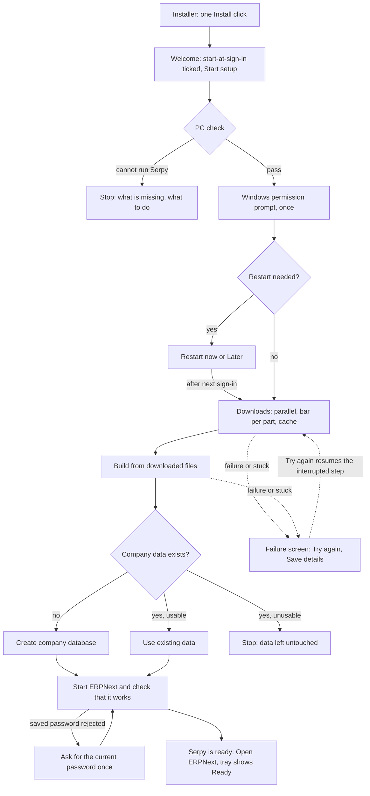
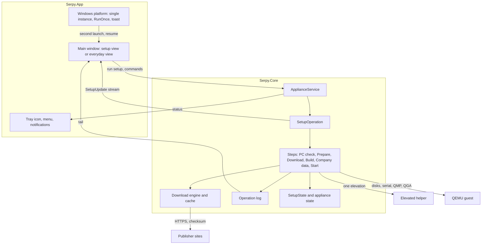
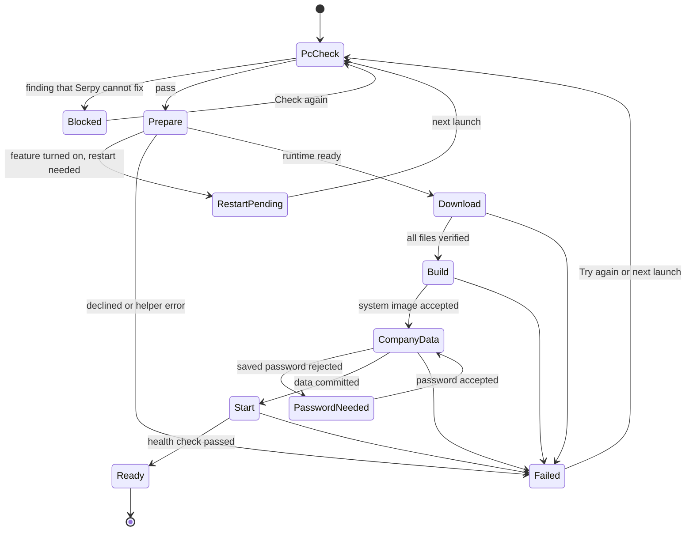
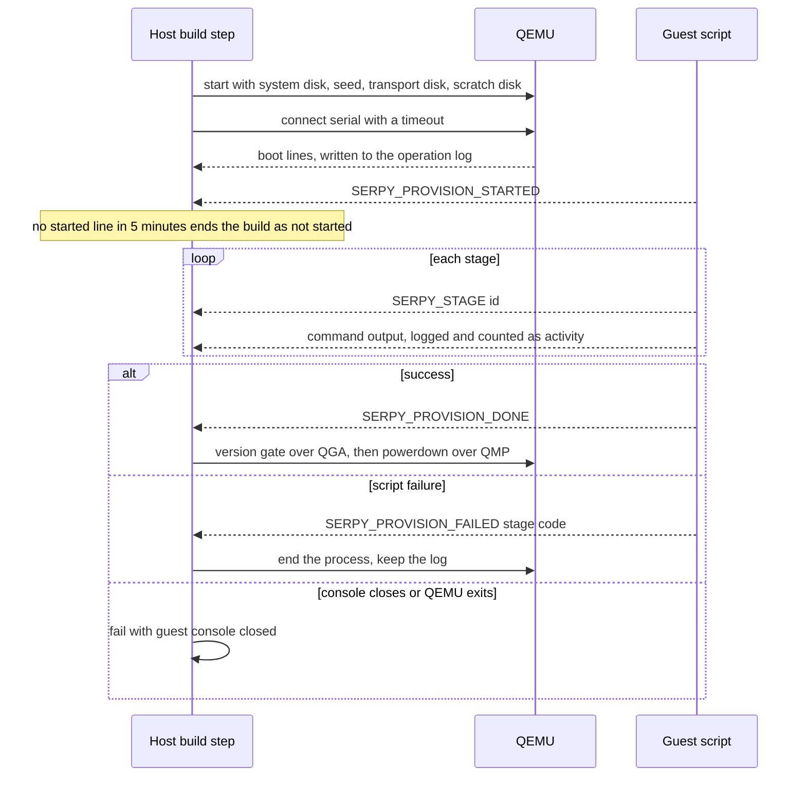
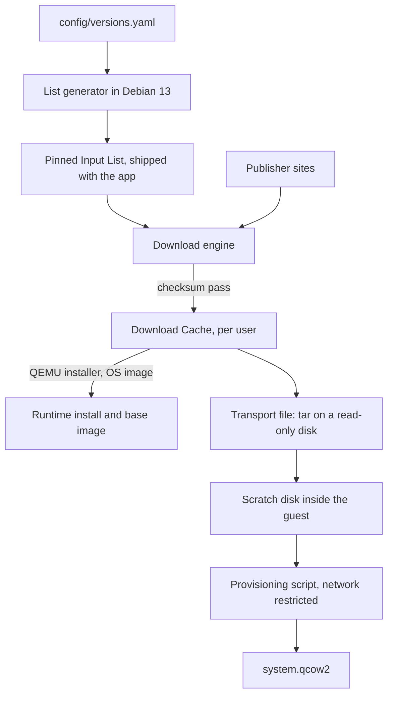

# Easy Install Experience - Plan

## Goal Capsule

- **Objective:** A person whose only install experience is Microsoft Office installs Serpy on a Windows PC, reaches a working ERPNext without making a technical decision, and can tell from the tray at any time whether ERPNext is ready.
- **Means:** Fix the provisioning defect that stops every setup today (KTD1, KTD2). Put setup under one resumable Core operation with a guided window and tray states (KTD6, KTD7, KTD16, KTD17). Then move downloads to a host-side cache and build offline from it (KTD25, KTD27, KTD29, KTD30).
- **Product authority:** ce-brainstorm. The Product Contract decides product behaviour. A KTD decides mechanism inside the requirements it cites. A unit overrides neither.
- **Execution profile:** Three phases in order, and Serpy is usable after each. Phase 1 is smoke-first on the reference PC. Phase 2 is test-first for Core state logic and mockup-checked for screens. Phase 3 starts with a runtime proof (U13). Per `AGENTS.md`, run GitNexus `impact` before editing a symbol and `detect_changes` before each commit.
- **Stop conditions:** Stop and ask the user in four cases. The offline proof (U13) shows a tool cannot install from local files. A defect found in U4 needs a product decision. Impact analysis reports HIGH or CRITICAL risk on a symbol that System-Wide Impact does not list. A change would break an `AGENTS.md` invariant.
- **Tail ownership:** The executor updates `docs/results.md`, `README.md`, `AGENTS.md` and `CONCEPTS.md` (U17) and removes code from abandoned attempts before declaring done.
- **Open blockers:** None.
- **Product Contract preservation:** Changed. The Problem Frame states the diagnosed cause. Outstanding Questions were resolved into KTDs and Open Questions. R41, R42, AE24 and AE25 were added: R41 is user-approved, R42 is a planning inference. No existing R, F or AE changed meaning.

---

## Product Contract

### Summary

Replace the dashboard's Build and Initialize buttons and its create-or-load dialog with one guided setup: Welcome, PC check, downloads, build, Ready.
Setup fetches all build inputs in parallel with a progress bar per part, keeps them in a cache, and builds from that cache on the user's PC.
A tray icon shows whether ERPNext is ready, and every default screen uses plain words.

### Problem Frame

A first-time user today presses "Set Up ERPNext" or "Build", answers a dialog offering "Create new database" or "Load existing data file (.img)", and types a site name and a password. The reported experience is that setup always sticks midway, with no way to tell working from stuck.

The code explains the blind spot. The progress bar is set to 30% when the long step begins and does not move until that step ends. That step is labelled "30–60 min" and waits up to two hours. "Show details" receives no text during the earlier steps, and its box is capped at 160 px inside a 520 × 460 window, so maximizing the window does not enlarge it.

The build needs the internet throughout, from inside the virtual computer, where Windows cannot show per-file progress or keep files between attempts. Only the Debian base image and the QEMU installer are cached. The Python libraries are version ranges, so two installs a month apart can receive different library versions.

On the reference PC, seven build attempts are logged between 2026-08-24 and 2026-11-20 and the appliance state is still `NotBuilt`. The guest log of the 2026-11-20 attempt shows the cause. cloud-init rejects the setup script at `build/cloud-init/user-data:19` as invalid YAML and runs nothing. The host then waits up to two hours for a completion line that cannot arrive.

On any other PC setup cannot start at all. No code path calls the QEMU installer or turns on the Windows feature that QEMU needs.

The tray icon has a fixed image and the fixed tooltip "Serpy", so it cannot say whether ERPNext is ready. Start-at-sign-in is off by default and offered only as a dashboard checkbox.

### Key Decisions

- **Start at sign-in from the tray, not a Windows service.** (session-settled: user-directed — chosen over a real Windows service: a service runs under a system account that cannot read per-user data or unlock the saved password, and ERPNext is reachable only from the same PC.) Governs R32, R33.
- **Build from source on the user's PC with cached, parallel downloads; the project hosts nothing.** (session-settled: user-directed — chosen over a ready-made system image built and hosted per release: the user wants a repeatable build from source, does not want to host anything, and accepts the wait.) Governs R15, R16, R18, R20.
- **Fetch on the Windows side before the build, so the build needs no internet.** (session-settled: user-approved — chosen over downloading inside the virtual computer as today: Windows cannot show per-file progress or reuse files there.) Governs R15, R17, R20.
- **Pin every build input, including Python and JavaScript libraries.** (session-settled: user-approved — chosen over today's version ranges: identical versions on every install, at the cost of regenerating the list at each version bump.) Governs R14, R21.
- **The Administrator password is `admin` for the MVP.** (session-settled: user-directed — chosen over a generated password and over a password typed during setup: the shortest path to a working install.) Governs R12. Planning note: another Windows account or program on the same PC can reach ERPNext while it runs and can sign in with this password; see Risks & Dependencies.
- **Ask for a password only when the saved one is rejected.** Reused data, or a password changed inside ERPNext, would otherwise leave Serpy unable to confirm that ERPNext works. Governs R13.
- **One progress bar per named part, not per file.** Frappe's `yarn.lock` alone lists 489 entries, so a bar per file would be unreadable. Governs R17.
- **Setup ends on a Ready screen, and the browser opens on a click.** A setup that runs unattended for an hour should not take over the screen when it ends. This replaces R15 of `docs/plans/2026-08-24-1538-feat-accountant-friendly-first-run-plan-v2.md`. Governs R30.
- **Unusable existing data stops setup; the MVP has no start-fresh action.** The case is rare and the safe default is to touch nothing. Governs R10.
- **A PC check runs before any download.** Nothing checks disk space, memory or virtualization before a build today. Governs R4, R5.
- **A dismissed password question leaves ERPNext running.** (session-settled: user-approved — chosen over stopping ERPNext: a password changed inside ERPNext must not lock the user out of it.) Governs R41.
- **Exit during setup asks first.** It extends the existing exit question that appears while ERPNext runs. Governs R42.

### Requirements

**Installing and starting setup**

- R1. The installer needs one Install click and asks no question about folders or options.
- R2. When the installer finishes, the setup wizard opens by itself under the signed-in user's own account.
- R3. After the installer, a normal setup asks for one Start click and the start-at-sign-in choice (R31), plus Windows' own permission prompts, and nothing else.

**Checking the PC**

- R4. Before any large download, setup checks that the PC can run Serpy: Windows version, memory, free disk space, virtualization support and internet access.
- R5. A failed check that Serpy cannot fix stops setup at that point and names what is missing and what the user can do.
- R6. Setup shows at most one Windows permission prompt of its own, covering every step in setup that needs one.
- R7. When Windows must restart to turn on a feature Serpy needs, setup says so, offers Restart now or Later, and continues by itself after the next sign-in.

**Company data**

- R8. All Serpy data lives in one default folder inside the user's Windows account, and setup never asks where.
- R9. Setup creates the company data when none exists in that folder and uses the existing data when it does, without asking.
- R10. Setup never deletes or overwrites existing company data; when that data cannot be used, setup stops and leaves it untouched.
- R11. Files left by a setup that never finished do not count as existing company data, and setup clears them without asking.
- R12. A new company database gets the username `Administrator` and the password `admin`, and the Ready screen shows both.
- R13. When ERPNext rejects the saved Administrator password, Serpy asks for the current one, checks it and saves it; setup has no other password prompt.
- R41. When the user dismisses the password question of R13 at start-up, ERPNext keeps running, the tray shows Needs attention, and Serpy asks again at the next start.

**Downloads**

- R14. Each Serpy release carries a complete list of the files its build needs, with a checksum for each, including Python and JavaScript libraries.
- R15. Before the build starts, setup downloads exactly the files on that list from their publishers' sites.
- R16. Setup downloads several files at the same time.
- R17. The download screen shows overall progress and one progress bar per named part with its state and size; a part made of many small files shows one bar and a file count.
- R18. A file that has been downloaded and has passed its checksum is kept and never downloaded again, across retries, reruns of setup and reinstalls of the same release.
- R19. A file that fails its checksum is discarded and fetched once more; a second failure stops setup, and a failed file is never used.

**Build**

- R20. The build runs on the user's PC from the downloaded files only, and completes with the internet disconnected.
- R21. Two installs of the same Serpy release end with the same version of every component.
- R22. The build screen lists its steps in plain words, and its progress indicator advances as work completes instead of waiting at a fixed value.
- R23. While setup is working, the screen changes at least every few seconds through a moving indicator, the latest activity line and the time spent on the current step.
- R24. When a step produces no activity for longer than its expected quiet time, setup says it may be stuck and offers Keep waiting or Try again.
- R25. Setup keeps the PC from going to sleep by itself while it is working.

**Interruptions and failures**

- R26. Closing the window during setup does not stop it: setup continues, the tray icon shows progress, and reopening the window shows the current step.
- R27. A setup that was cancelled, failed or cut off resumes at the step that was interrupted, without repeating finished downloads.
- R28. Every failure screen states what happened and what to do, and offers Try again plus one action that saves the technical details to a file.
- R29. Show details is available on every setup screen, shows live activity from the first step onward, and grows with the window.
- R42. Choosing Exit while setup is working asks for confirmation; confirming stops setup, and the next launch resumes it as R27 states.

**Ready, tray and sign-in**

- R30. Setup ends on a "Serpy is ready" screen with an Open ERPNext button and the sign-in details; the browser opens only when the user clicks.
- R31. The wizard asks once whether Serpy should start when the user signs in to Windows, with yes preselected.
- R32. With start-at-sign-in on, Serpy starts in the tray at sign-in; the setting can be changed later from the tray menu and the Serpy window.
- R33. Whenever Serpy starts on a PC that is already set up, it starts ERPNext by itself.
- R34. While Serpy runs, its tray icon shows one of the five states below, told apart by shape as well as colour, with the state in words in the tooltip.
- R35. Serpy shows a Windows notification when ERPNext becomes ready and when it needs attention.
- R36. The tray menu offers Open ERPNext, Open Serpy, Start or Stop ERPNext, the start-at-sign-in setting and Exit.
- R37. Starting Serpy while it is already running brings its window to the front.
- R38. After setup, the Serpy window shows the state in words, Open ERPNext, Start or Stop, the start-at-sign-in setting and Show details; Restart and Recover sit under Show details.

Tray states for R34:

| State | When | Tooltip |
|---|---|---|
| Setting up | Setup is running | Serpy: setting up, step 3 of 5 |
| Starting | ERPNext is starting | Serpy: starting ERPNext |
| Ready | ERPNext is running and has passed its check | Serpy: ERPNext is ready |
| Stopped | The user stopped ERPNext, or setup has not finished and is not running | Serpy: ERPNext is stopped |
| Needs attention | ERPNext stopped unexpectedly, fails its check, or setup failed | Serpy: needs attention |

**Wording**

- R39. Default screens use plain words; names of internal files, tools and protocols appear only under Show details.
- R40. A technical term appears on a default screen only where the user must act on it, with a one-sentence explanation beside it.

Starting vocabulary for R39; final strings are settled against the mockups:

| Technical term today | Shown to the user |
|---|---|
| Build, provisioning | Installing ERPNext |
| Initialize, site creation | Creating your company database |
| Appliance, VM, QEMU | ERPNext, or Serpy for the app itself |
| Windows Hypervisor Platform, WHPX | A Windows feature that Serpy needs to run ERPNext |
| Health check | Checking that ERPNext works |
| `data.img`, dataset | Your company data |
| Crashed | ERPNext stopped unexpectedly |
| Loopback URL, port | ERPNext opens in your web browser and works only on this PC |
| Cached download | Already on this PC |

### Key Flows

Screens for every step are drawn in `docs/plans/mockups/2026-11-20-easy-install/easy-install-mockups.html`.

- F1. First-time setup on a clean PC
  - **Trigger:** The user runs the Serpy installer on a PC without Serpy.
  - **Steps:** Installer (R1) → wizard opens (R2) → Welcome, Start setup (R3, R31) → PC check (R4) → Windows permission prompt (R6) → downloads (R15–R17) → build (R20, R22–R25) → company database created (R9, R12) → ERPNext starts and is checked → Ready screen and notification (R30, R35).
  - **Outcome:** The tray shows Ready, and Open ERPNext shows the ERPNext sign-in page.
  - **Covers R1–R4, R6, R9, R12, R15–R17, R20, R22–R25, R30, R31, R35.**
- F2. Setup needs a Windows restart
  - **Trigger:** The PC check finds the Windows feature Serpy needs turned off.
  - **Steps:** Wizard explains the feature (R40) → Windows permission prompt (R6) → Restart now or Later (R7) → after the next sign-in the wizard reopens and continues.
  - **Outcome:** Setup continues as F1 from downloads.
  - **Covers R6, R7, R40.**
- F3. Setup is interrupted or fails
  - **Trigger:** Lost internet, a declined permission prompt, power loss, Cancel, a build error or a stuck step.
  - **Steps:** Failure screen (R28) or stuck notice (R24) → Try again, or the next launch of Serpy → setup resumes at the interrupted step (R27), and finished downloads show "Already on this PC" (R18).
  - **Outcome:** Setup completes as F1, or stops again with a new message.
  - **Covers R18, R24, R27, R28.**
- F4. Setup finds existing company data
  - **Trigger:** The default folder (R8) holds company data from a setup that finished.
  - **Steps:** PC check → downloads and build as needed → existing data used without asking (R9) → ERPNext starts → saved password checked, and asked for once if rejected (R13).
  - **Outcome:** Ready with the existing data. When the data cannot be used, setup stops and leaves it untouched (R10).
  - **Covers R8, R9, R10, R13.**
- F5. Everyday use
  - **Trigger:** The user signs in to Windows with start-at-sign-in on, or starts Serpy from the Start menu.
  - **Steps:** Tray icon appears as Starting (R32–R34) → ERPNext starts → tray turns Ready with a notification (R35) → the user opens ERPNext from the tray menu or the Serpy window (R36, R38).
  - **Outcome:** ERPNext is open in the browser, and the tray keeps showing its state until Exit.
  - **Covers R32–R36, R38.**

KTD14 sets the position of the Windows permission prompt in F1, within R6.

### Acceptance Examples

- AE1. **Covers R1, R2, R3.** Given a clean PC that passes every check, when the user clicks Install, clicks Start setup and approves Windows' prompts, then setup reaches the Ready screen with no other input.
- AE2. **Covers R4, R5.** Given a PC with less free disk space than Serpy needs, when the PC check runs, then setup stops before downloading, shows the space needed and the space free, and offers Check again.
- AE3. **Covers R5, R40.** Given virtualization is turned off in the PC's startup settings, when the PC check runs, then setup stops and explains what the setting is, that Serpy cannot change it, and who can.
- AE4. **Covers R6, R7.** Given the Windows feature Serpy needs is off, when the user approves the prompt and picks Restart now, then after the next sign-in the wizard reopens by itself and continues with downloads.
- AE5. **Covers R6, R28.** Given the user answers No to the permission prompt, then setup pauses, explains that it cannot continue without permission, and offers Try again.
- AE6. **Covers R18, R27.** Given internet access is lost after three parts finished downloading, when the user reconnects and clicks Try again, then those three parts show "Already on this PC" and are not downloaded again.
- AE7. **Covers R18, R27.** Given a build failed after every download finished, when setup runs again, then it downloads nothing and goes to the build step.
- AE8. **Covers R19.** Given a cached file no longer matches its checksum, when setup checks the cache, then the file is downloaded again once and the old copy is not used.
- AE9. **Covers R20.** Given every download has finished, when the PC is disconnected from the internet, then the build and the first start still complete.
- AE10. **Covers R14, R21.** Given two PCs install the same Serpy release a month apart, then both download the same list of files and Show details reports the same version of every component on both.
- AE11. **Covers R22, R23, R24.** Given a build step runs for 20 minutes, then the screen shows new activity at least every few seconds throughout; given a step produces nothing for longer than its quiet time, then the stuck notice appears with Keep waiting and Try again.
- AE12. **Covers R25.** Given the PC is set to sleep after 15 idle minutes, when setup runs untouched for an hour, then the PC stays awake until setup finishes or fails.
- AE13. **Covers R26, R34, R35.** Given the user closes the window during the build, then the tray icon shows Setting up with the current step in its tooltip, and a notification appears when ERPNext is ready.
- AE14. **Covers R29.** Given Show details is open and the window is maximized, then the details area fills the added space and already holds lines from the PC check.
- AE15. **Covers R9, R13.** Given existing company data whose Administrator password is saved or is `admin`, then setup reaches Ready without asking about data or passwords.
- AE16. **Covers R13.** Given existing company data whose password is neither saved nor `admin`, then Serpy asks once for the current Administrator password, and a wrong entry is reported and can be retried.
- AE17. **Covers R13.** Given the user changed the Administrator password inside ERPNext, when ERPNext next starts, then Serpy asks for the current password instead of showing Needs attention without a reason.
- AE18. **Covers R10.** Given existing company data that cannot be used, then setup stops with a plain message and the data files are unchanged.
- AE19. **Covers R11.** Given files left by a setup that never finished, then setup clears them and proceeds as a first-time setup.
- AE20. **Covers R30, R32, R33, R35.** Given start-at-sign-in is on, when the user signs in, then the tray icon appears as Starting, turns Ready with a notification, and no browser window opens by itself.
- AE21. **Covers R31, R32.** Given the user unticked start-at-sign-in in the wizard, then Serpy does not start at the next sign-in.
- AE22. **Covers R37.** Given Serpy is running in the tray, when the user starts Serpy from the Start menu, then the existing Serpy window comes to the front and no second copy runs.
- AE23. **Covers R39.** Given any default screen, then none of these appears: appliance, QEMU, WHPX, hypervisor, QMP, QGA, cloud-init, qcow2, `.img`, provision, bench, loopback, port.
- AE24. **Covers R41.** Given the Administrator password was changed inside ERPNext, when the user dismisses Serpy's password question at start-up, then ERPNext stays reachable in the browser, the tray shows Needs attention, and Serpy asks again at the next start.
- AE25. **Covers R42.** Given setup is installing, when the user picks Exit from the tray menu and confirms, then setup stops, Serpy exits, and the next launch continues at the installing step without downloading again.

### Success Criteria

- A clean install completes on a real Windows PC, from the installer to the ERPNext sign-in page, and `docs/results.md` records it.
- A second run of setup on that PC downloads nothing.
- One person who has installed Office and never used Serpy completes setup unaided, observed once before release.
- The time and size figures on the Welcome screen come from that measured install.

### Scope Boundaries

- No Windows service.
- No hosted or ready-made system image, and no mirror of upstream files.
- No password choice, change or reset inside Serpy beyond R13.
- No choice of data file or folder, no import of data from another PC or Windows account, and one company dataset per Windows account.
- No start-fresh action when existing data cannot be used.
- The Recover flow keeps its behaviour; only its place in the window changes (R38).
- Moving an existing install to a newer ERPNext version is not part of this plan.
- ERPNext's own first-sign-in questions, the uninstaller and the `--unattended` command-line mode keep their behaviour.
- macOS and Linux remain compile-only targets.

#### Deferred to Follow-Up Work

- One permission prompt for the installer and setup together. It needs a bootstrapper-style installer.
- A clean-up action for the Download Cache.
- Resuming a partly downloaded file instead of fetching it again.
- Verification on AMD processors. Only an Intel host is verified, and WHPX may need the `svm` CPU flag masked.
- Showing a start-at-sign-in entry that the user disabled in Windows' Startup apps list.
- Aligning the site name of `--unattended` (`erp.serpy.local`) with the name that start and adoption assume (`site1.local`).
- Checking the Frappe and ERPNext sources by git tree hash, so that a regenerated GitHub archive does not fail setup.
- Serialising the state write that a status read makes when it finds a dead QEMU process. The state store has no lock today.

### Dependencies / Assumptions

- Upstream publishers keep the pinned files available. With no mirror, a removed file breaks new installs of that release until a new release updates the list.
- Someone regenerates the list in R14 at every version bump. This is new recurring work.
- The Windows installer shows its own permission prompt, separate from R6, because it installs for every user of the PC. A normal setup therefore shows two prompts.
- The app's current estimates are 30–60 minutes for the build and 20+ minutes for the company database. Neither has been measured on a finished install.
- This plan replaces three parts of `docs/plans/2026-08-24-1538-feat-accountant-friendly-first-run-plan-v2.md`: R4 (typed password), R6–R8 (the load-existing choice and its prompts) and R15 (automatic browser open). That plan's R5, never destroy data, carries over as R10.
- The invariants in `AGENTS.md` stay in force: lifecycle rules in `Serpy.Core`, the two-disk boundary, managed QEMU and per-user credential storage.

### Sources / Research

- Progress fixed at 30% during provisioning, serial lines carry no percentage: `src/Serpy.Core/Operations/BuildOperation.cs:120-139`.
- Details panel capped at 160 px in a 520 × 460 window: `src/Serpy.App/Views/DashboardWindow.axaml:7-8,92-105`. Early build steps pass no detail text: `src/Serpy.Core/Operations/BuildOperation.cs:69-87`.
- Downloads run inside the virtual computer: `build/cloud-init/user-data:14-40`. The build boots with open network access (`src/Serpy.Core/Operations/BuildOperation.cs:102-105`); a restricted mode exists (`src/Serpy.Core/Qemu/QemuArguments.cs:61-66`) and is used by `src/Serpy.Core/Operations/AdoptOperation.cs:147-162`.
- Existing checksum-verified cache to extend: `src/Serpy.Core/Images/BaseImageDownloader.cs:22-70`. Runtime reuse marker: `src/Serpy.Core/Qemu/ManagedRuntimeResolver.cs:93-100`.
- Pin checks today: `src/Serpy.Core/Versions/PackageClosurePreflight.cs`. Frappe's `pyproject.toml` at commit `6a329d068416768ec47ccd3326b9cc95a8d7bf99` lists 77 direct dependencies, most as `~=` ranges, with no `requirements.txt` or `uv.lock`; its `yarn.lock` has 489 entries.
- Tray icon and menu: `src/Serpy.App/App.axaml:10-42`. Closing the window hides it: `src/Serpy.App/App.axaml.cs:151-155`.
- Start-at-sign-in: `src/Serpy.App/Platform/Windows/RunKeyAutostart.cs:20-60`, default off at `src/Serpy.Core/Configuration/ApplianceSettings.cs:28-29`.
- A second launch exits without signalling the running copy: `src/Serpy.App/Program.cs:29-38`.
- The health check signs in as Administrator with the saved password: `src/Serpy.Core/Health/HealthChecker.cs:50-59,85-89`. Storage is per Windows account: `src/Serpy.Core/Health/HealthCredentials.cs:71-75`.
- Default credentials already used by unattended mode: `src/Serpy.App/Program.cs:129-132`.
- Windows feature enabler exists and is not called: `src/Serpy.Core/Qemu/WhpxEnabler.cs:24-37`. Restart flag with no user surface: `src/Serpy.Core/Configuration/SetupState.cs:22-29`.
- Setup's existing permission prompt, for the QEMU installer: `src/Serpy.Core/Qemu/ManagedRuntimeResolver.cs:190,318-319`.
- Installer scope and finish dialog: `eng/installer/Serpy.wxs:25-42`.
- No PC check before a build; the only free-space check is `src/Serpy.Core/Operations/AdoptOperation.cs:87-103`, and the accelerator probe runs at start: `src/Serpy.Core/Operations/StartOperation.cs:81-92`.
- Dialog this plan removes: `src/Serpy.App/Views/InitializeDialog.cs:8-64`. `tests/Serpy.Windows.UiTests` binds to its controls (`SiteNameBox`, `PasswordBox`, `LoadExistingRadio`, `InitializeButton`).
- Data root: `src/Serpy.Core/Configuration/KnownPaths.cs:13-29`.
- Cause of the stall, from the guest's cloud-init log on the leftover staging disk of the 2026-11-20 attempt: `Failed loading yaml blob. Invalid format at line 19 column 29`, then `empty cloud config`, then `write-files` and `runcmd` skipped. The line arrived in commit `c93d9a1` (2026-08-22), before the first logged attempt.
- No test parses the rendered user-data as YAML: `tests/Serpy.Core.Tests/Images/NoCloudSeedWriterTests.cs`.
- The runtime install entry point has no caller: `src/Serpy.Core/Qemu/ManagedRuntimeResolver.cs:69`. The feature enabler has no caller: `src/Serpy.Core/Qemu/WhpxEnabler.cs:28`.
- The serial wait loops without pause after the stream ends: `ReadLineAsync` and `WaitForSentinelAsync` in `src/Serpy.Core/Protocols/SerialClient.cs`. The serial connect and TLS handshake have no timeout.
- The lifecycle lock is a thread-bound named mutex with no handling for an abandoned owner: `src/Serpy.Core/Coordination/LifecycleLock.cs:22-45`.
- `system.qcow2` is an overlay on the cached OS image: `src/Serpy.Core/Images/QemuImageTool.cs:16-20`, `src/Serpy.Core/Operations/BuildOperation.cs:84-88`.
- Company data gets the name `data.img` only after the health check and a clean guest halt: `src/Serpy.Core/Operations/InitializeOperation.cs:130-160`.
- Start and adoption assume the site name `site1.local`: `src/Serpy.Core/Operations/StartOperation.cs:173`, `src/Serpy.Core/Operations/AdoptOperation.cs:184,225,307`.
- View-model orchestration that moves into Core: `DispatchCreateNewAsync` and `DispatchAdoptAsync` in `src/Serpy.App/ViewModels/DashboardViewModel.cs`.
- Design adopted by KTD3 and never built: `docs/plans/2026-08-24-1254-fix-dashboard-live-log-tail-plan.md`.
- Learnings that still apply: `docs/solutions/runtime-errors/mtls-client-cert-auth-failed-schannel-ephemeral-key.md`, `docs/solutions/ui-bugs/avalonia-uia-com-interop-missing-controls.md`.
- External references: QEMU `restrict` option of user networking (https://www.qemu.org/docs/master/system/invocation.html); a report of snapshot.debian.org timing out under parallel requests (https://github.com/GoogleContainerTools/distroless/issues/1038); Yarn offline mirror (https://classic.yarnpkg.com/blog/2016/11/24/offline-mirror/); uv environment variables (https://docs.astral.sh/uv/reference/environment/); `PowerCreateRequest` (https://learn.microsoft.com/en-us/windows/win32/api/winbase/nf-winbase-powercreaterequest); toasts from unpackaged apps (https://learn.microsoft.com/en-us/windows/apps/design/shell/tiles-and-notifications/send-local-toast-other-apps); `PF_VIRT_FIRMWARE_ENABLED` under a running hypervisor (https://devblogs.microsoft.com/oldnewthing/20201216-00/?p=104550).

---

## Planning Contract

### Key Technical Decisions

**Making setup finish**

- KTD1. **Provisioning runs as one script, embedded base64 in the user-data.** `write_files` carries every guest script with base64 encoding, and `runcmd` holds one entry that runs the provisioning script. No shell text passes through the YAML parser again. Quoting line 19 alone was rejected: it leaves 30 other shell lines open to the same class of error.
- KTD2. **The guest reports progress and failure on the serial console, and the host fails fast.** The provisioning script prints `SERPY_PROVISION_STARTED`, `SERPY_STAGE <id>`, `SERPY_PROVISION_DONE` and `SERPY_PROVISION_FAILED <stage> <exit code>`. The host fails the build at once on a failure line, on the end of the serial stream and on QEMU exit. The host fails with "provisioning did not start" when no started line arrives within 5 minutes of boot. One monitor component holds this logic and takes a line stream, a clock and a process-exit signal, so that its tests need no QEMU. Governs R22, R24, R28.
- KTD3. **Every operation writes one durable operation log, and the details panel tails that file.** This plan adopts the design of `docs/plans/2026-08-24-1254-fix-dashboard-live-log-tail-plan.md`. Deltas: the log also receives every guest serial line, each stage change with a timestamp, QEMU start and exit, and full exception chains. The log and the details file of KTD22 never hold the Administrator password, a session cookie, a request body or private-key content. The panel lives in the main window of KTD16. Governs R23, R28, R29.
- KTD4. **Setup-time QEMU processes end with Serpy.** The build, the company-data creation and the adoption trial start QEMU inside a Windows job object that ends the process when Serpy exits. The everyday ERPNext process stays outside the job, because "Leave running" at exit is existing behaviour. No orphan can then hold the staging disk open at the next launch. Governs R27.
- KTD5. **The lifecycle lease becomes a file lease.** An exclusive open of a lock file under the settings folder replaces the named mutex. Windows releases it when the process dies, and it is not bound to a thread. The mutex throws after its owner crashed, and it must be released on the acquiring thread, which async code off the UI thread does not guarantee. The acquire call and the lease handle keep their shape. Governs R27.

**Setup as one Core operation**

- KTD6. **`SetupOperation` in `Serpy.Core` owns the whole setup.** `IApplianceService` exposes it as one call. It holds the lifecycle lease for its whole run and calls the step operations directly. View models only render. The build-then-initialize and build-inspect-adopt sequences leave `DashboardViewModel`. This follows the `AGENTS.md` invariant that lifecycle rules live in `Serpy.Core`.
- KTD7. **Steps and durable state.** The steps are PC check, Prepare, Download, Build, Company data and Start. PC check and Prepare run again on every run, because they are cheap and repeatable. Each later step is skipped when its own artifact exists under its final name and passes validation: verified cache files, an accepted system image, committed company data. Appliance state and its journals stay the authority for readiness and recovery, and every run reconciles the journals before it skips or deletes anything. `SetupState` in schema 2 is the authority only for what files cannot show: the restart-pending flag, the start-at-sign-in choice, the company data route of KTD11 and the last failure. Its status per step is for display. Governs R7, R27.
- KTD8. **A `SetupUpdate` stream carries what the screens show.** Each update holds the step list with states, overall progress, the latest activity line, the time on the current step, the stuck flag, the download parts and any failure. Core detects a stuck step: no activity for the step's quiet time raises the flag while the work continues. Keep waiting re-arms the timer. Try again cancels the step and restarts it. The first quiet times are 2 minutes without received bytes for Download and 10 minutes without a guest line for Build and Company data. U4's measured run sets the final values. Governs R23, R24.
- KTD9. **Failures carry a typed code.** `OperationResult` and `SetupUpdate` gain a failure code: PC check finding, elevation declined, restart required, network unavailable, disk full, checksum mismatch, provisioning not started, provisioning failed, guest console closed, password rejected, data unusable, cancelled, unknown. The App maps each code to a headline and a what-to-do text. The raw message goes to the details panel only. Governs R5, R13, R28.
- KTD10. **What counts as company data.** A file named `data.img` is committed company data. Setup never deletes it and replaces it only through the journaled promotion of KTD11. `.pending-data.img`, `.pending-adopted-data.img`, `.staging-system.qcow2`, `.cloud-init-seed.iso`, the transport and scratch disks of KTD29 and `.part` downloads are leftovers. The step that owns a leftover deletes it when that step starts, under the lifecycle lease and after journal reconciliation. While an adoption or recovery journal is open, its pending and backup files belong to the journal. Verified cache files are never leftovers. The cached OS image stays while a system image exists, because `system.qcow2` is an overlay on it. If the OS image fails its check, the system image counts as not accepted, and Build runs again with data preserved. Governs R10, R11.
- KTD11. **Existing data goes through the existing adoption, without a consent prompt.** When `data.img` exists and readiness is not Initialized, setup builds with data preserved if no accepted system image exists. It then adopts the data in place: disposable copy, isolated trial start, journaled promotion with the original kept as a backup until the journal completes. Setup decides this route once, before Build, and saves it in `SetupState`, because a build with data preserved already marks readiness Initialized. Consent for data without a provenance record is implied: the copy protects the original, and the trial start with its health check is the validation. The adoption's free-space check needs the full size of the data file plus 2 GiB, and the PC check adds that amount on this route. The table under High-Level Technical Design owns the routing. Governs R9, R10.
- KTD12. **Site name, password and the health check.** Guided setup creates the site `site1.local`, the name that start and adoption assume. When no credential is saved, the health check tries `admin` and saves it on success. A rejected sign-in returns the password-rejected code in place of the generic health failure. At start-up that code does not stop ERPNext when the checks that need no sign-in pass: health becomes running-unhealthy with the reason "password needed", and the address stays available. That state is never Ready: the start reports the password-rejected code, the tray shows Needs attention, and no Ready notification fires. A new service call verifies a submitted password, saves it and runs the health check again. Governs R12, R13, R41.

**PC check, permission and restart**

- KTD13. **PC check probes and first thresholds.** No probe needs elevation. The Windows build is 19045 or later. Total memory is 8 GB or more. Free space on the data drive is 30 GB or more, plus the amount that KTD11 names when existing data is reused. For virtualization, a running hypervisor passes. A missing Windows feature with firmware virtualization on is fixable in Prepare. Firmware virtualization off is not fixable. The firmware flag is read only when no hypervisor runs, because it reads false under one. For internet, the check sends one request to each host in the Pinned Input List and is skipped when every file is cached. The thresholds live in one place, and U4's measured run sets the final values and the Welcome screen figures. Governs R4, R5.
- KTD14. **One elevated session does both jobs.** The existing signed elevated helper installs QEMU and turns on the Windows features in one session. The request carries a yes-or-no flag only. The helper starts the DISM tool by its full path under the Windows system folder, with a fixed argument list that names the two features, so that no caller text and no search path can change what runs. The app's check of the helper's signature, the helper's signed-descriptor check of the installer, and the identity and nonce checks stay and cover this request too. The Windows permission prompt remains the user's consent for both jobs. Exit code 3010 means that a restart is needed. Prepare obtains the QEMU installer first and asks for elevation only when one of the two jobs is needed. `WhpxEnabler` is deleted. A bootstrapper-style installer that would also merge the installer's prompt was rejected for this plan, because it changes the installer type. Governs R6.
- KTD15. **Restart, resume and the start-at-sign-in entry.** The restart-pending flag persists in `SetupState` and clears only when the WHPX probe passes after a restart. Restart now writes a per-user RunOnce entry, then restarts Windows. The entry holds exactly the checked path of the installed executable and `--resume-setup`, built with the path checks that the start-at-sign-in entry uses. `--resume-setup` only shows the setup view, so a forged entry gains nothing. Later closes the window, and every later launch shows the restart screen until the probe passes. Serpy writes the start-at-sign-in entry only when setup reaches Ready, from the choice saved in `SetupState`, so that a `--tray` launch cannot run during setup. Governs R7, R31, R32.

**Window, tray and Windows integration**

- KTD16. **One main window with two views.** The setup view shows until the user leaves the Ready screen. The everyday view shows afterwards. `DashboardWindow` becomes this window. `InitializeDialog`, the load-existing path and the consent prompt are deleted. Recover keeps its confirmation dialog. A `SetupViewModel` renders `SetupUpdate`, and `DashboardViewModel` keeps the everyday state. Governs R26, R30, R38.
- KTD17. **Tray state is a pure mapping, first match wins.** The table under High-Level Technical Design owns the mapping. Five pre-rendered icon files with sizes from 16 to 32 pixels carry the badge shapes of the mockups. Code sets the icon and tooltip on each state change, because the tray icon is not part of a window's visual tree. Governs R34.
- KTD18. **Launch behaviour.** When setup is finished and no journal blocks start, every launch starts ERPNext if it is stopped. A `--tray` launch opens no window and no splash. Both automatic browser opens are removed: the one on the healthy status poll and the one after a finished operation. `--unattended` keeps its own browser launch. Governs R30, R33.
- KTD19. **Notifications are Windows toasts through source-generated COM interop.** No reflection-based toolkit is used, because the app publishes Native-AOT. The MSI sets an application user model ID on the Start-menu shortcut, and the process declares the same ID at start. A toast fires on a change into Ready and on a change into Needs attention, once per change. When the toast call fails, Serpy logs it and continues. Governs R35.
- KTD20. **A second launch talks to the first over a per-user named pipe.** The second process sends one command from a fixed list, grants the first process the right to take the foreground, and exits. The list is: show the window, show the setup view, and open from a notification. The first process ignores anything else and never acts on `--unattended`, `--fresh-install`, a path or an address that arrives over the pipe. The pipe accepts the current user only. The first process shows and activates its window. `--resume-setup` and a clicked toast use the same path. The takeover logic of `--unattended` stays. Governs R37.
- KTD21. **A process-owned power request keeps the PC awake.** `SetupOperation` holds it while a step works and releases it on success, failure and cancel. A thread-bound execution state was rejected, because async continuations change threads. Governs R25.
- KTD22. **Save details writes one text file.** Core assembles the PC check report, the setup state, the appliance state, the pinned versions and the operation logs of the current setup run. The file never includes the saved credential or certificate material. Governs R28.
- KTD23. **One text table holds every user-facing string.** Setup, tray, notification and failure texts are keyed by step, state and failure code. A test checks the default-screen strings against the banned terms of AE23. Governs R39, R40.
- KTD24. **The MSI shows one Install button.** A custom dialog set without a folder page or licence page replaces `WixUI_InstallDir`. On a first install the exit dialog starts Serpy without a checkbox, through the existing unelevated launch action. The install scope stays per machine. Governs R1, R2.

**Pinned inputs, cache and offline build**

- KTD25. **The Pinned Input List is a JSON file shipped with the app.** `config/build-inputs.json` lists the eight named parts of the mockups. Each file entry has a cache key, a size, a SHA-256 or SHA-512 checksum and ordered source addresses. `config/versions.yaml` stays the hand-edited source of versions, and a test checks that the two agree. The list replaces `PackageClosurePreflight`. Serpy reads the list only from its install folder, which a standard user cannot change. Programs that run as the same user are inside the trust boundary for the cache and the appliance files, as they are today. The elevated helper is the one place that does not trust them, and it keeps its own check of the QEMU installer. Governs R14, R21.
- KTD26. **A script in a Debian 13 environment generates the list.** A manually started GitHub Actions job in a `debian:trixie` container runs it, and the same script runs in any Debian 13 shell. It resolves the Debian and MariaDB package closure with the build's own sources and pins, a hashed Python lock for CPython 3.14 on Linux x86-64, the entries of both `yarn.lock` files, the Node archive and the source archives. A developer commits the output. The app never resolves versions at install time. Governs R14.
- KTD27. **The download engine limits parallel requests per host.** (session-settled: user-approved — chosen over unlimited parallel downloads: Debian's snapshot archive has a public report of timing out under parallel requests.) This is the mechanism for the user-directed parallel-download decision that governs R16. Four downloads run at once overall, and at most two run against the snapshot archive, with backoff on refusal. A file entry lists Debian's main mirror before the snapshot archive, and the checksum makes either source safe. Each file goes to a `.part` name, passes its checksum and is then renamed into a content-addressed cache under the per-user data folder. A cached file is hashed once per setup run before it is trusted. A mismatch deletes the file and fetches it once more, and a second mismatch fails with the checksum code. An interrupted `.part` file is fetched again from the start. The OS image keeps its present location, because existing system images name it as their backing file. Governs R15, R16, R18, R19.
- KTD28. **The engine also supplies the QEMU installer and the OS image.** `BaseImageDownloader` and the installer download inside `ManagedRuntimeResolver` move onto the engine. Prepare asks the engine for the installer part before it asks for elevation, and Download fetches every other part. Governs R15, R17.
- KTD29. **A tar file on a read-only disk carries the cache into the guest.** The host packs the files that the build needs into one uncompressed tar file and attaches it as a read-only raw disk with a fixed serial. The writer checks each file's checksum again while it copies the file into the tar file, so that a file changed after the download check cannot enter the build. The host also attaches an empty scratch disk. The provisioning script formats the scratch disk, mounts it and unpacks the tar file onto it. The host deletes both files after the build. This uses only tools that the base image has, keeps the cache out of `system.qcow2` and needs no network. Three alternatives were rejected. A host web server reached through user networking fails, because `restrict=on` blocks guest-to-host traffic and without it the guest has internet. An ISO image cuts long wheel names under Joliet, and the seed writer builds its image in memory. A QEMU virtual FAT drive is reported as unreliable on Windows. The cost is temporary space of about twice the cache size during the build, which the threshold of KTD13 includes. Governs R20.
- KTD30. **The build installs everything from local files with the network restricted.** (session-settled: user-approved — chosen over leaving a tool online when it cannot install offline: the user decides whether R20 may bend.) The build boots with the restricted network mode that the adoption trial uses. Debian and MariaDB packages install from a single flat local file repository (`deb [trusted=yes] file:/srv/cache/debs ./`) which the base image indexes itself via `apt-ftparchive` (verified in U13; no shipped index in git required; `-t sid` dropped offline). Python libraries install from a local wheelhouse with pre-built CPython 3.14 wheels for `mysqlclient` and `psutil`, pointed to by `PIP_NO_INDEX=1`, `PIP_FIND_LINKS=/srv/cache/wheels`, `UV_NO_INDEX=1`, and `UV_FIND_LINKS=/srv/cache/wheels` in `/etc/profile.d/serpy-offline.sh`. The two git-pinned Python libraries (`pypika`, `gunicorn`) resolve via git `insteadOf` rewrites to local bare mirrors. JavaScript libraries install from Yarn's offline mirror (`yarn-offline-mirror "/srv/cache/yarn-mirror"` with `--install.offline true` and a frozen lockfile). Frappe and ERPNext install from local bare git clones tagged with the pinned versions. U13 exercised each of these mechanisms and passed all 6 version gates on a collection VM that still had internet; the same build under `restrict=on` is not yet proven (see docs/results.md). Governs R20, R21.

### High-Level Technical Design

Components and the direction of calls:

Setup steps and their exits (KTD7, KTD15). Stuck is a flag on a working step, not a state:

The build conversation between host and guest (KTD2):

From pinned versions to the system image (KTD25 to KTD30):

Tray state mapping (KTD17). The first matching row wins:

| Order | Condition | Tray state |
|---|---|---|
| 1 | Setup is working | Setting up |
| 2 | The last setup run failed; a recovery or adoption journal blocks start; health is crashed or running-unhealthy | Needs attention |
| 3 | Health is starting, or a start is in progress | Starting |
| 4 | Health is running | Ready |
| 5 | Anything else, including a setup that is not finished and not working | Stopped |

Company data routing (KTD10, KTD11):

| `data.img` | Readiness | Journal | Company data step |
|---|---|---|---|
| absent | not Initialized | none | Delete leftovers, then create new data |
| present | Initialized | none | Skip the step |
| present | not Initialized | none | Build with data preserved if needed, then adopt in place |
| absent | Initialized | none | Stop with the data-unusable code; create nothing |
| any | any | recovery journal that has not passed | Stop with the data-unusable code; the Recover flow owns it |
| any | any | adoption journal | Let the existing reconciliation run, then evaluate again |

Validated files decide the route, and setup calls the step operations directly, so that an entry guard of the service cannot refuse a route that the table chooses. When an accepted system image exists and appliance state says not built, the Build step records the image in appliance state in place of a new build.

### Sequencing

- Phase 1, setup finishes: U1, U2, U3, U4. U4 is the gate for every number that later units show or check.
- Phase 2, guided setup and tray: U5 to U12. U5 comes first. U6, U7 and U8 add steps to it. U9 and U10 need U5. U11 and U12 can run beside U9.
- Phase 3, cached downloads and offline build: U13 to U17. U13 comes first and can change KTD30. U14 feeds U15, and U16 needs both.
- The riskiest work is last, and each phase ends with a green `publish-windows` CI job.

### System-Wide Impact

- `IApplianceService` gains calls for setup, password and save details. `FakeApplianceService` and the unattended pipeline compile against it. Expect a HIGH impact rating.
- `LifecycleLock` changes its mechanism (KTD5). Every mutating operation depends on it. Expect a HIGH impact rating.
- `ManagedRuntimeResolver.InstallAsync` gets its first production caller, and it elevates. Expect a HIGH impact rating.
- The elevated helper's request gains one field (KTD14). App and helper ship in one MSI, so mixed versions do not run. The helper's signature and descriptor checks stay.
- `SetupState` moves to schema 2. A schema 1 file loads with defaults and keeps its restart flag.
- `OperationResult` gains a failure code. Every operation and every test that builds a result is touched.
- New persisted and wire types need source-generated JSON contexts, because the app publishes Native-AOT.
- `guest/provision-done.sh` is folded into `guest/provision.sh`. These files name the old script: `eng/package-windows.ps1`, `eng/installer/build-msi.ps1`, `.github/workflows/build-test-publish.yml`, `tests/Serpy.App.Tests/PackagingAssetTests.cs`, `tests/Serpy.Core.Tests/Serpy.Core.Tests.csproj`.
- The UI tests in `tests/Serpy.Windows.UiTests` bind to controls that this plan removes.
- `ResetOperation` and `--unattended` keep their behaviour. Reset must not delete the Download Cache.
- The layout and status sections of `AGENTS.md` describe the old flow.

### Risks & Dependencies

| Risk | Effect | Treatment |
|---|---|---|
| Unknown defects wait behind the script error, because the build never ran past it | Phase 1 needs more runs than expected | U2 lands before the first run, so each failure names its stage. U4 gates Phase 2's numbers |
| A tool cannot install from local files | R20 cannot hold for that tool | U13 proves each tool first. The Goal Capsule has the stop condition |
| A publisher removes a pinned file, or GitHub regenerates a source archive | New installs of that release fail with the checksum code | Stated in Dependencies. The tree-hash check is deferred follow-up work |
| The snapshot archive throttles | Debian downloads are slow or fail | Per-host limit, backoff and the main mirror first (KTD27) |
| Toast interop fails under Native-AOT | No notifications appear | The CI publish job is the proof. A failure leaves the tray state working (KTD19) |
| The elevated helper changes | A flaw runs with administrator rights | Flag-only request, fixed command line, two-phase validation untouched (KTD14). The bootstrapper tests grow |
| The file lease behaves unlike the mutex | Operations block or overlap | The API stays. U3 adds crash and cross-thread tests after impact analysis |
| The build needs temporary space of twice the cache size | Setup fails late on a small disk | The PC check threshold includes it (KTD13). Every write path reports the disk-full code |
| Native-AOT publish cannot run on the developer PC | AOT errors appear late | Each phase ends with a green `publish-windows` job |
| Only an Intel host is verified | AMD PCs can fail at start | Listed as follow-up work. No text claims AMD support |
| The WHPX capability call and the DISM behaviour come from research, not from a test here | The PC check or Prepare misjudges a PC | U6 and U7 verify both on the reference PC before the screens depend on them |
| The default password `admin` is known, and ERPNext listens on the PC's loopback address | Another Windows account or program on the same PC can sign in as Administrator while ERPNext runs | Accepted with the user-directed password decision for the MVP. The forward stays bound to loopback. A password change inside Serpy is out of scope |
| A program that runs as the same user changes a cached file or an appliance file | A changed input enters the build | Same-user programs are inside the trust boundary (KTD25). The transport writer checks each file again (KTD29), and the elevated helper keeps its own check (KTD14) |
| `SetupState` and appliance state disagree after a crash | Setup skips a step that did not finish, or repeats one that did | Appliance state and its journals are the authority (KTD7). U5 tests a crash between each pair of writes |

### Open Questions

All are deferred to implementation. None blocks the start.

- Did the host receive guest lines in past attempts, given that Show details stayed empty? U4's first run answers it from the operation log.
- How did the app process end during the 2026-11-20 attempt? No crash event was logged.
- Which call restarts Windows from a standard user session?
- How does a clicked toast reach the running instance without a registered COM activator? If it cannot, the toast text drops its "click" wording.
- What are the final thresholds, quiet times and Welcome screen figures? U4 measures them.
- Which environment variables and file names does the bench tool need for an offline install? Answered by U13: `PIP_NO_INDEX=1`, `PIP_FIND_LINKS=/srv/cache/wheels`, `UV_NO_INDEX=1`, `UV_FIND_LINKS=/srv/cache/wheels`, and `/etc/gitconfig` `insteadOf` rewrites for `pypika` and `gunicorn`. Yarn uses `yarn-offline-mirror "/srv/cache/yarn-mirror"` and `--install.offline true` in `.yarnrc`. Because `su - frappe` resets process environment, offline variables are exported via `/etc/profile.d/serpy-offline.sh`.
- Which Python libraries build from source under CPython 3.14? Answered by U13: `mysqlclient==2.2.7` and `psutil==7.0.0` (both compile cleanly against Debian's `libmariadb-dev` / CPython 3.14 headers; pre-built wheels in the wheelhouse eliminate build overhead offline). Pure-Python sdists with no pre-built wheels: `docopt`, `googlemaps`, `plaid-python`, `PyQRCode`, `rauth`.
- Can the Debian base image build a package index itself? If it can, the shipped index of KTD30 is dropped. Answered by U13: Yes. `apt-ftparchive` (`/usr/bin/apt-ftparchive`) is present out-of-the-box in `debian-base-20260819-2575.qcow2`. The shipped index of KTD30 is dropped.

---

## Implementation Units

| Unit | Title | Key files | Depends on |
|---|---|---|---|
| U1 | Provisioning script that YAML cannot break | `guest/provision.sh`, `build/cloud-init/user-data`, `src/Serpy.Core/Images/NoCloudSeedWriter.cs` | none |
| U2 | Operation log and fail-fast build wait | `src/Serpy.Core/Operations/OperationLog.cs`, `src/Serpy.Core/Guest/ProvisionMonitor.cs`, `src/Serpy.Core/Protocols/SerialClient.cs` | U1 |
| U3 | Lifecycle lease as a file lease | `src/Serpy.Core/Coordination/LifecycleLock.cs` | none |
| U4 | First complete setup on the reference PC | `docs/results.md`, `guest/provision.sh` | U1, U2, U3 |
| U5 | Setup operation, state and progress contract | `src/Serpy.Core/Operations/SetupOperation.cs`, `src/Serpy.Core/Configuration/SetupState.cs`, `src/Serpy.Core/Contracts/IApplianceService.cs` | U2, U3 |
| U6 | PC check | `src/Serpy.Core/Setup/PcCheck.cs` | U5 |
| U7 | One elevation, Windows feature, restart and resume | `src/Serpy.InstallerBootstrapper/Program.cs`, `src/Serpy.Core/Qemu/ManagedRuntimeResolver.cs`, `src/Serpy.Core/Setup/PrepareStep.cs` | U5, U6 |
| U8 | Company data step and password handling | `src/Serpy.Core/Setup/CompanyDataStep.cs`, `src/Serpy.Core/Health/HealthChecker.cs`, `src/Serpy.Core/Operations/StartOperation.cs` | U5 |
| U9 | Setup view | `src/Serpy.App/Views/SetupView.axaml`, `src/Serpy.App/ViewModels/SetupViewModel.cs`, `src/Serpy.App/Text/UiText.cs` | U5, U6, U7, U8 |
| U10 | Everyday view, tray states and launch behaviour | `src/Serpy.App/App.axaml.cs`, `src/Serpy.App/Tray/TrayStateMapper.cs` | U5, U8 |
| U11 | Notifications, second launch and keep-awake | `src/Serpy.App/Platform/Windows/ToastNotifier.cs`, `src/Serpy.App/Platform/Windows/SingleInstanceChannel.cs`, `src/Serpy.Core/Platform/Windows/PowerRequest.cs` | U5, U10 |
| U12 | One-click installer | `eng/installer/Serpy.wxs` | U11 |
| U13 | Offline build proof | `guest/provision.sh`, `docs/results.md` | U4 |
| U14 | Pinned Input List and its generator | `config/build-inputs.json`, `eng/lock/generate-build-inputs.sh`, `src/Serpy.Core/Versions/BuildInputs.cs` | U13 |
| U15 | Download engine, cache and Download step | `src/Serpy.Core/Downloads/DownloadEngine.cs`, `src/Serpy.Core/Setup/DownloadStep.cs` | U5, U14 |
| U16 | Offline build from the cache | `src/Serpy.Core/Images/CacheTransport.cs`, `src/Serpy.Core/Operations/BuildOperation.cs`, `guest/provision.sh` | U13, U15 |
| U17 | Acceptance run, documents and CI | `docs/results.md`, `README.md`, `AGENTS.md` | U1 to U16 |

**Phase 1: setup finishes**

### U1. Provisioning script that YAML cannot break

**Goal:** The guest runs the provisioning script on every build, and no script text can make the user-data invalid.

**Requirements:** R22, R28; KTD1, KTD2.

**Dependencies:** None.

**Files:**
- Create: `guest/provision.sh`
- Delete: `guest/provision-done.sh`
- Modify: `build/cloud-init/user-data`, `src/Serpy.Core/Images/NoCloudSeedWriter.cs`, `src/Serpy.App/Program.cs`, `src/Serpy.App/Serpy.App.csproj`, `Directory.Packages.props`, `tests/Serpy.Core.Tests/Serpy.Core.Tests.csproj`, `eng/package-windows.ps1`, `eng/installer/build-msi.ps1`, `.github/workflows/build-test-publish.yml`, `tests/Serpy.Windows.IntegrationTests/ApplianceWorkflowTests.cs`
- Test: `tests/Serpy.Core.Tests/Images/NoCloudSeedWriterTests.cs`, `tests/Serpy.App.Tests/PackagingAssetTests.cs`

**Approach:**
1. Move the 31 `runcmd` lines into `guest/provision.sh` with the same effect, grouped under the stage ids `os-packages`, `database`, `language-tools`, `erpnext-source`, `erpnext-assets` and `services`.
2. The script stops at the first failing command and writes the markers of KTD2 to the serial device. Command output also goes to the serial device.
3. `RenderUserData` embeds each guest script as base64 and converts line endings to LF first.
4. The template keeps its settings and its small unit files. It holds no shell command lines.
5. A YAML parser package is added to the test project only. Product code keeps no YAML dependency.

**Patterns to follow:** `ExtractWriteFileContent` and the canonical-script test in `tests/Serpy.Core.Tests/Images/NoCloudSeedWriterTests.cs`; the write to `/dev/ttyS0` in `guest/provision-done.sh`.

**Test scenarios:**
- The user-data rendered from the repo template parses with a YAML parser and has `write_files` and `runcmd` at the top level.
- `runcmd` has exactly one entry, and that entry runs the provisioning script.
- Every `write_files` entry that carries a script declares base64 and decodes to the source script byte for byte.
- A script with CRLF line endings renders with LF only.
- A script that contains `: `, `*`, `&`, `#`, a tab and a here-document renders to a document that still parses. This is the regression test for `build/cloud-init/user-data:19`.
- A template that lacks a placeholder fails with an error that names the placeholder.
- The build output contains `guest/provision.sh` and no `guest/provision-done.sh`.

**Verification:** The user-data rendered from the shipped template parses, and its provisioning script prints the started marker first.

### U2. Operation log and fail-fast build wait

**Goal:** Every operation leaves a readable log, and a build that cannot finish fails within minutes with a named cause.

**Requirements:** R23, R24, R27, R28, R29; KTD2, KTD3, KTD4, KTD9.

**Dependencies:** U1.

**Files:**
- Create: `src/Serpy.Core/Operations/OperationLog.cs`, `src/Serpy.Core/Guest/ProvisionMonitor.cs`, `src/Serpy.Core/Platform/Windows/JobObject.cs`
- Modify: `src/Serpy.Core/Protocols/SerialClient.cs`, `src/Serpy.Core/Qemu/QemuProcess.cs`, `src/Serpy.Core/Contracts/OperationResult.cs`, `src/Serpy.Core/Contracts/ApplianceStatus.cs`, `src/Serpy.Core/Operations/BuildOperation.cs`, `src/Serpy.Core/Operations/InitializeOperation.cs`, `src/Serpy.Core/Operations/StartOperation.cs`, `src/Serpy.Core/Operations/StopOperation.cs`, `src/Serpy.Core/Operations/RecoverOperation.cs`, `src/Serpy.Core/Operations/AdoptOperation.cs`, `src/Serpy.Core/Operations/StatusOperation.cs`, `src/Serpy.App/ViewModels/DashboardViewModel.cs`
- Test: `tests/Serpy.Core.Tests/Guest/ProvisionMonitorTests.cs`, `tests/Serpy.Core.Tests/Operations/OperationLogTests.cs`, `tests/Serpy.Core.Tests/Protocols/SerialClientTests.cs`, `tests/Serpy.Core.Tests/Qemu/JobObjectTests.cs`

**Approach:**
1. `OperationLog` appends timestamped lines and flushes each line. Every operation writes its stage changes, QEMU start with the process id, QEMU exit with the exit code, and full exception text.
2. Each operation saves its log path to appliance state when it starts, as Start does today. `ApplianceStatus` exposes the path.
3. `SerialClient` reports the end of the stream as a distinct result. Its connect and its TLS handshake each get a timeout.
4. `ProvisionMonitor` replaces the sentinel wait in `BuildOperation`. Build progress follows the stage markers in place of the fixed 30%.
5. `QemuProcess` gets an option to start inside the job object. Build, Initialize and the adoption trial use it. Start does not.
6. Each failure path sets the failure code.
7. `DashboardViewModel` catches a failed dispatch and shows its message, so that an exception cannot end the app before U9 and U10 replace this code.

**Patterns to follow:** the log-path write in `src/Serpy.Core/Operations/StartOperation.cs`; the secret checks in `tests/Serpy.Core.Tests/Guest/CredentialSafetyTests.cs`; the injectable seams in `tests/Serpy.Core.Tests/Qemu/ManagedRuntimeResolverTests.cs`.

**Test scenarios:**
- Monitor: started, stage and done lines in order give success and one stage event per stage.
- Monitor: no started line within the start window gives the not-started code.
- Monitor: a failed line gives the provisioning-failed code with its stage and exit code.
- Monitor: a stream that ends before the done line gives the console-closed code after a bounded number of reads.
- Monitor: the process-exit signal gives a failure that carries the exit code.
- Monitor: no line for the quiet time raises the stuck signal, and the wait continues.
- Monitor: cancellation gives the cancelled code.
- Serial client: a connect that exceeds its timeout fails and names the connect phase.
- Serial client: a TLS handshake that exceeds its timeout fails and names the handshake phase.
- Operation log: a second reader sees each line while the writer keeps the file open.
- Operation log: the Administrator password passed to an operation never appears in the file.
- Job object: a child process started in the job ends when the job handle closes.
- A build against a simulated guest that never prints the started line fails with the not-started code, and its log holds the boot lines.
- Status exposes the log path of the last operation after Build, Initialize, Stop and Recover.

**Verification:** A build against a guest that runs nothing ends in about 5 minutes with a named cause, and the log file shows the guest's boot.

### U3. Lifecycle lease as a file lease

**Goal:** The lifecycle lease works after a crash and when an operation finishes on another thread.

**Requirements:** R27; KTD5.

**Dependencies:** None.

**Files:**
- Modify: `src/Serpy.Core/Coordination/LifecycleLock.cs`
- Test: `tests/Serpy.Core.Tests/Coordination/LifecycleLockTests.cs`

**Approach:** The lock file lives under the settings folder, so that it follows the app-data root and keeps the test isolation that the mutex name gave. Releasing a lease is safe from any thread and safe to repeat.

**Execution note:** Run impact analysis on `LifecycleLock` first. Keep the existing lock and service tests green before the mechanism changes.

**Test scenarios:**
- A lease taken on one thread is released on another thread without an error.
- A second acquire while the lease is held returns nothing within its timeout.
- An acquire succeeds after the previous holder's handle closed without a release, which is what a crashed process leaves.
- Two app-data roots do not contend.
- A lease disposed twice causes no error.
- The existing tests in `tests/Serpy.Core.Tests/Operations/ApplianceServiceTests.cs` pass unchanged.

**Verification:** An operation started off the UI thread completes and frees the lease.

### U4. First complete setup on the reference PC

**Goal:** Build, company data and start complete on the reference PC through the existing window, and the measured figures are on record.

**Requirements:** Success Criteria; inputs for KTD8 and KTD13.

**Dependencies:** U1, U2, U3.

**Files:**
- Modify: `docs/results.md`, and the files that each found defect needs. Expect `guest/provision.sh`, `guest/init-data.sh`, `config/versions.yaml` and files under `src/Serpy.Core/Operations/`.
- Create: `docs/solutions/runtime-errors/cloud-init-user-data-yaml-rejected-setup-waits.md`
- Test: one regression test beside each fixed defect.

**Approach:**
1. Run a full setup. For each failure, read the operation log, fix the cause, and add a regression test when the failure can be reproduced without QEMU.
2. Record the time of each step, the download size, the system image size, the company data size and the peak disk use.
3. Fill the guest version report in `docs/results.md`.
4. Set the thresholds of KTD13 and the quiet times of KTD8 from the measurements.

**Execution note:** This is a runtime proof on the reference PC, and one run takes about an hour. Stop and ask when a defect needs a product decision.

**Test scenarios:**
- The opt-in appliance workflow test builds, creates company data, starts, stops and starts again, and the data is intact.
- The version gate reports the locked versions of `config/versions.yaml`.
- Each defect fixed in this unit has a test that fails without its fix.

**Verification:** `docs/results.md` records a passing run with versions, step times and sizes, and ERPNext's sign-in page opens at the local address.

**Phase 2: guided setup and tray**

### U5. Setup operation, state and progress contract

**Goal:** One Core operation runs setup from the first step to Ready, survives an interruption, and streams everything that the screens need.

**Requirements:** R7, R23, R24, R25, R26, R27, R28; KTD6, KTD7, KTD8, KTD9, KTD10, KTD21, KTD22.

**Dependencies:** U2, U3.

**Files:**
- Create: `src/Serpy.Core/Operations/SetupOperation.cs`, `src/Serpy.Core/Contracts/SetupContracts.cs`, `src/Serpy.Core/Setup/ISetupStep.cs`, `src/Serpy.Core/Setup/BuildStep.cs`, `src/Serpy.Core/Setup/StartStep.cs`, `src/Serpy.Core/Setup/DetailsReport.cs`
- Modify: `src/Serpy.Core/Configuration/SetupState.cs`, `src/Serpy.Core/Configuration/SetupStateStore.cs`, `src/Serpy.Core/Contracts/IApplianceService.cs`, `src/Serpy.Core/Contracts/ApplianceStatus.cs`, `src/Serpy.Core/Operations/ApplianceService.cs`, `src/Serpy.Core/Operations/StatusOperation.cs`, `tests/Serpy.App.Tests/FakeApplianceService.cs`
- Test: `tests/Serpy.Core.Tests/Operations/SetupOperationTests.cs`, `tests/Serpy.Core.Tests/Configuration/SetupStateStoreTests.cs`, `tests/Serpy.Core.Tests/Setup/DetailsReportTests.cs`

**Approach:**
1. Each step is one small type with three duties: report whether its artifact exists, run, and delete its leftovers.
2. This unit ships the Build step, the Start step and a Company data step that only creates new data. U6, U7, U8 and U15 add or extend steps.
3. The operation takes the lifecycle lease once and calls the step operations without passing through the service's locked entry points.
4. The clock and the power request are injected, so that tests use fakes.
5. Status exposes a setup summary: finished or not, working or not, and the last failure code.

**Patterns to follow:** `src/Serpy.Core/Operations/ResetOperation.cs` for a multi-stage Core operation; `src/Serpy.Core/Configuration/SetupStateStore.cs` for atomic JSON state; `tests/Serpy.Core.Tests/Operations/ApplianceServiceTests.cs`.

**Test scenarios:**
- A fresh state runs the steps in order and ends finished.
- A failure in Build ends the run with Build marked failed and the failure code saved.
- The run after that failure starts Build again and repeats no finished step after Prepare.
- An accepted system image makes the Build step skip.
- A cancel during Build ends as cancelled, and the next run deletes the staging leftovers before it builds.
- No activity for the quiet time raises the stuck flag. Keep waiting re-arms it. Try again restarts the step.
- Covers AE11. Updates arrive at least every few seconds while a step works, from the activity line or the elapsed-time tick.
- A start request during setup returns the busy result.
- A schema 1 state file loads as schema 2 with defaults and keeps its restart flag.
- A corrupt state file is treated as a fresh state, and the event is logged.
- A crash between the appliance-state write and the `SetupState` write of a step leads the next run to the same end state as a run without the crash.
- A file under a pending or staging name never counts as a finished artifact.
- An accepted system image with appliance state not built is recorded as built, and no new build runs.
- No leftover is deleted while an adoption or recovery journal is open.
- Covers AE12. The power request is taken when the first working step starts and is released on success, on failure and on cancel.
- The details report contains the PC check report, both states and the run's logs, and contains no credential.

**Verification:** With fake steps, a run that is interrupted at any step resumes at that step and ends finished.

### U6. PC check

**Goal:** Setup knows before any large download whether this PC can run Serpy, and says what is missing.

**Requirements:** R4, R5; KTD13.

**Dependencies:** U5.

**Files:**
- Create: `src/Serpy.Core/Setup/PcCheck.cs`, `src/Serpy.Core/Setup/PcCheckStep.cs`, `src/Serpy.Core/Platform/Windows/WindowsPcProbe.cs`
- Modify: `src/Serpy.Core/Operations/SetupOperation.cs`
- Test: `tests/Serpy.Core.Tests/Setup/PcCheckTests.cs`

**Approach:** The probes sit behind one interface, so that tests feed values. The report lists each check with the measured value, the needed value and the result. The Windows probe is run on the reference PC before U9 depends on it.

**Patterns to follow:** the platform attribute and probe shape of `src/Serpy.Core/Qemu/WhpxProbe.cs`.

**Test scenarios:**
- Covers AE2. Free space below the threshold fails before any download and reports the space needed and the space free.
- Covers AE3. No hypervisor and firmware virtualization off give the finding that Serpy cannot fix.
- A running hypervisor passes virtualization whatever the firmware flag reads.
- A missing Windows feature with firmware virtualization on passes and marks that Prepare must turn the feature on.
- Memory below the threshold fails and reports both figures.
- A Windows build below the threshold fails.
- No internet with files still to download gives the network-unavailable code.
- No internet with every file cached passes.
- Check again runs every probe again.

**Verification:** On the reference PC the report matches the PC's real memory, free space and Windows build.

### U7. One elevation, Windows feature, restart and resume

**Goal:** Setup installs QEMU and turns on the Windows features with one permission prompt, and continues by itself after a restart.

**Requirements:** R6, R7; KTD14, KTD15.

**Dependencies:** U5, U6.

**Files:**
- Create: `src/Serpy.Core/Setup/PrepareStep.cs`, `src/Serpy.App/Platform/Windows/RunOnceResume.cs`
- Modify: `src/Serpy.InstallerBootstrapper/Program.cs`, `src/Serpy.Core/Qemu/BootstrapWireMessages.cs`, `src/Serpy.Core/Qemu/ElevatedInstallChannel.cs`, `src/Serpy.Core/Qemu/ManagedRuntimeResolver.cs`, `src/Serpy.App/Program.cs`
- Delete: `src/Serpy.Core/Qemu/WhpxEnabler.cs`
- Test: `tests/Serpy.Core.Tests/Setup/PrepareStepTests.cs`, `tests/Serpy.Core.Tests/Qemu/ManagedRuntimeResolverTests.cs`, `tests/Serpy.Core.Tests/Qemu/ElevatedInstallSessionTests.cs`, `tests/Serpy.InstallerBootstrapper.Tests/FeatureEnableTests.cs`

**Approach:**
1. The helper's request gains the feature flag, and its result reports the DISM exit code beside the install result.
2. `PrepareStep` decides what is needed from the PC check report and from the resolver's installed check, then makes one call to the resolver.
3. The two-phase validation of the QEMU staging tree stays as it is.
4. `RunOnceResume` follows `RunKeyAutostart`: the same path checks, a value written only for a chosen restart, and removal when Serpy starts with `--resume-setup`.
5. `--resume-setup` opens the main window in the setup view, whatever the start-at-sign-in choice is.

**Execution note:** This unit changes code that runs elevated. Run impact analysis on `InstallAsync` and on the helper's entry point first.

**Patterns to follow:** `src/Serpy.App/Platform/Windows/RunKeyAutostart.cs`; the wire records and their JSON context in `src/Serpy.Core/Qemu/BootstrapWireMessages.cs`; `tests/Serpy.InstallerBootstrapper.Tests/StagingHardeningTests.cs`.

**Test scenarios:**
- QEMU missing and the feature off: one elevated session does both jobs.
- QEMU present and the feature on: no elevation is requested.
- Covers AE5. A declined prompt gives the elevation-declined code and leaves the state unchanged, and a second try works.
- Exit code 3010 from the helper sets restart-pending and ends the step with the restart-required code.
- Covers AE4. With restart-pending set and the probe passing, the flag clears and setup goes on to Download.
- With restart-pending set and the probe failing, the step ends with the restart-required code again.
- A request message with an unknown field is rejected, so that no caller can pass a command line.
- A helper failure gives a failure whose log holds the exit code.
- The RunOnce value exists only after Restart now and is absent after the resumed start.
- The existing tests in `tests/Serpy.InstallerBootstrapper.Tests/` pass unchanged.
- The helper starts DISM by its full path under the system folder. A `dism.exe` placed earlier on the search path is not run.
- A feature request that fails the identity, nonce or descriptor check is refused, as an install request is.

**Verification:** On a Windows PC or virtual machine without QEMU and with the feature off, setup shows one prompt, asks for a restart and continues after sign-in.

### U8. Company data step and password handling

**Goal:** Setup creates company data or reuses existing data without a question, and a rejected password leads to one request in place of a failed start.

**Requirements:** R9, R10, R11, R12, R13, R41; KTD10, KTD11, KTD12.

**Dependencies:** U5.

**Files:**
- Create: `src/Serpy.Core/Setup/CompanyDataStep.cs`
- Modify: `src/Serpy.Core/Operations/AdoptOperation.cs`, `src/Serpy.Core/Operations/InitializeOperation.cs`, `src/Serpy.Core/Operations/StartOperation.cs`, `src/Serpy.Core/Operations/StatusOperation.cs`, `src/Serpy.Core/Operations/ApplianceService.cs`, `src/Serpy.Core/Health/HealthChecker.cs`, `src/Serpy.Core/Contracts/ApplianceStatus.cs`, `src/Serpy.Core/Contracts/IApplianceService.cs`
- Test: `tests/Serpy.Core.Tests/Setup/CompanyDataStepTests.cs`, `tests/Serpy.Core.Tests/Health/HealthCheckerTests.cs`, `tests/Serpy.Core.Tests/Operations/StartOperationTests.cs`, `tests/Serpy.Core.Tests/Operations/AdoptionOperationTests.cs`, `tests/Serpy.Core.Tests/Operations/InitializeOperationTests.cs`

**Approach:**
1. The step follows the company data routing table of the High-Level Technical Design.
2. The password of new data reaches the guest through standard input, as today.
3. Adoption checks the free space for its working copy before it copies.
4. The health check returns a distinct result for a rejected sign-in.
5. The service call for a submitted password runs under the lifecycle lease.

**Patterns to follow:** the journal handling of `AdoptOperation.ReconcileJournal`; `tests/Serpy.Core.Tests/Guest/CredentialSafetyTests.cs`.

**Test scenarios:**
- Covers AE15. Existing data with a saved working password reaches Ready with no password request.
- Covers AE15. Existing data with no saved credential and the password `admin` reaches Ready and saves the credential.
- Covers AE16. Existing data with neither gives the password-rejected code. A wrong submitted password is reported. The right one is saved and setup continues.
- Covers AE17. A start whose saved password is rejected ends with ERPNext running, health running-unhealthy and the reason "password needed".
- Covers AE24. In that state with no submitted password, the address stays available and the next start reports the same reason.
- Covers AE18. A rejected inspection or a failed trial gives the data-unusable code and leaves `data.img` byte-identical.
- Covers AE19. A `.pending-data.img` with no `data.img` is deleted, and new data is created.
- An adoption whose promotion fails midway restores the original `data.img` from its backup.
- A recovery journal that has not passed gives the data-unusable code and changes nothing.
- A data file whose full size plus 2 GiB exceeds the free space gives the disk-full code before any copy starts, and `data.img` is unchanged.
- New data is created as `site1.local` with the password `admin`, and the password is absent from the operation log.
- A missing `data.img` with readiness Initialized gives the data-unusable code and creates nothing.
- Each row of the company data routing table has a test, and the operation that the row calls accepts the route.
- The route saved before Build is still used after a build with data preserved has marked readiness Initialized.

**Verification:** On the reference PC, removing the appliance state file while keeping `data.img` leads setup back to Ready with the same company data.

### U9. Setup view

**Goal:** The main window shows each setup step as the mockups draw it, in plain words and with live details.

**Requirements:** R3, R5, R7, R13, R17, R22, R23, R24, R26, R28, R29, R30, R31, R39, R40; KTD16, KTD22, KTD23.

**Dependencies:** U5, U6, U7, U8.

**Files:**
- Create: `src/Serpy.App/Views/SetupView.axaml`, `src/Serpy.App/Views/SetupView.axaml.cs`, `src/Serpy.App/Views/DetailsPanel.axaml`, `src/Serpy.App/Views/DetailsPanel.axaml.cs`, `src/Serpy.App/ViewModels/SetupViewModel.cs`, `src/Serpy.App/Text/UiText.cs`, `src/Serpy.Core/Operations/LogTailReader.cs`, `tests/Serpy.Windows.UiTests/PageObjects/SetupPage.cs`
- Modify: `src/Serpy.App/Views/DashboardWindow.axaml`, `src/Serpy.App/Views/DashboardWindow.axaml.cs`, `src/Serpy.App/App.axaml.cs`, `src/Serpy.App/ViewModels/DashboardViewModel.cs`
- Delete: `src/Serpy.App/Views/InitializeDialog.cs`, `tests/Serpy.Windows.UiTests/PageObjects/InitializeDialogPage.cs`, `tests/Serpy.Windows.UiTests/InitializeDialogValidationTests.cs`
- Test: `tests/Serpy.App.Tests/ViewModels/SetupViewModelTests.cs`, `tests/Serpy.App.Tests/UiTextTests.cs`, `tests/Serpy.App.Tests/AppShellHeadlessTests.cs`, `tests/Serpy.Core.Tests/Operations/LogTailReaderTests.cs`, `tests/Serpy.Windows.UiTests/SetupComponentTests.cs`

**Approach:**
1. The view has one screen per mockup section: Welcome, Checking, Cannot run yet, Restart needed, Downloads, Installing, Step gone quiet, Problem, Password needed and Ready.
2. `SetupViewModel` holds no lifecycle rule. It maps the latest `SetupUpdate` to a screen and sends commands to the service: start, check again, restart now, later, keep waiting, try again, cancel, submit password, save details and open ERPNext.
3. The details panel is a read-only text box that tails the operation log. It stays at the bottom until the user scrolls up, and it sits in a row that takes the window's spare height.
4. Until U15 lands, the Downloads screen lists the two parts that exist: the QEMU installer and the OS image.
5. Every string comes from `UiText`. The figures on the Welcome screen come from the thresholds of KTD13.
6. Controls keep stable automation ids for the UI tests.

**Patterns to follow:** the automation ids in `src/Serpy.App/Views/DashboardWindow.axaml`; `tests/Serpy.App.Tests/AppShellHeadlessTests.cs`; the click guidance in `docs/solutions/ui-bugs/avalonia-uia-com-interop-missing-controls.md`.

**Test scenarios:**
- Each kind of `SetupUpdate` selects the screen that the mockups show for it.
- Covers AE1. On a passing PC the view model needs one Start setup command and raises no other request.
- Covers AE21. An unticked start-at-sign-in box is saved as off with the start command.
- Covers AE11. The stuck flag shows the banner with Keep waiting and Try again, and each button sends its command.
- Covers AE6 and AE7. A part that the engine reports as cached shows "Already on this PC".
- Every failure code has a headline and a what-to-do text, and the failure screen always offers Try again and Save details.
- Covers AE14. The details panel holds lines from the PC check onward, and its height grows when the window height grows.
- Covers AE23. No default-screen string contains a banned term.
- The password screen sends the entered password and shows a wrong-password message on rejection. Cancel sends the cancel command.
- Covers AE13. Closing the window during setup hides it, and setup keeps running.
- The Ready screen shows the username, the password and Open ERPNext. Leaving it switches the window to the everyday view.
- Log tail reader: lines appended after the reader opened arrive in order.
- Log tail reader: a file that does not exist yet yields nothing, then yields its lines once it appears.
- UI test: the Welcome screen shows Start setup and a ticked start-at-sign-in box.
- UI test: Show details opens and holds text during the PC check.

**Verification:** Each screen matches its section of `docs/plans/mockups/2026-11-20-easy-install/easy-install-mockups.html` in content and order.

### U10. Everyday view, tray states and launch behaviour

**Goal:** After setup the window, the tray icon and the tray menu show and control ERPNext as R34, R36 and R38 state, and Serpy starts ERPNext by itself.

**Requirements:** R30, R32, R33, R34, R36, R38, R42; KTD15, KTD17, KTD18.

**Dependencies:** U5, U8.

**Files:**
- Create: `src/Serpy.App/Views/EverydayView.axaml`, `src/Serpy.App/Views/EverydayView.axaml.cs`, `src/Serpy.App/Tray/TrayStateMapper.cs`, `src/Serpy.App/Assets/tray-setting-up.ico`, `src/Serpy.App/Assets/tray-starting.ico`, `src/Serpy.App/Assets/tray-ready.ico`, `src/Serpy.App/Assets/tray-stopped.ico`, `src/Serpy.App/Assets/tray-attention.ico`
- Modify: `src/Serpy.App/App.axaml`, `src/Serpy.App/App.axaml.cs`, `src/Serpy.App/ViewModels/DashboardViewModel.cs`, `src/Serpy.App/Views/ExitWhileRunningDialog.cs`, `src/Serpy.App/Serpy.App.csproj`, `tests/Serpy.Windows.UiTests/PageObjects/DashboardPage.cs`
- Test: `tests/Serpy.App.Tests/TrayStateMapperTests.cs`, `tests/Serpy.App.Tests/ViewModels/DashboardViewModelTests.cs`, `tests/Serpy.App.Tests/AppShellHeadlessTests.cs`, `tests/Serpy.Windows.UiTests/DashboardComponentTests.cs`

**Approach:**
1. `TrayStateMapper` is a pure function from status to tray state and tooltip.
2. `App` applies the icon, the tooltip and the menu on each status change.
3. The automatic start of ERPNext happens once per launch, after the first status read.
4. The start-at-sign-in entry is written when setup reaches Ready, and whenever the user changes the setting in the tray menu or the window.
5. The exit question of R42 reuses `ExitWhileRunningDialog` with wording for setup.
6. Restart and Recover move under Show details.

**Patterns to follow:** the status-driven handlers in `src/Serpy.App/App.axaml.cs`; `src/Serpy.App/Platform/Windows/RunKeyAutostart.cs`; `tests/Serpy.App.Tests/FakeApplianceService.cs`.

**Test scenarios:**
- One test per row of the tray mapping table: a working setup, a failed setup, a blocking journal, running-unhealthy, crashed, starting, running and stopped.
- The tooltip of Setting up names the step number and the step count.
- Covers AE20. A `--tray` launch on a set-up PC requests one start, opens no window, shows no splash and makes no browser call.
- A normal launch on a set-up PC starts ERPNext and shows the everyday view.
- A launch with unfinished setup starts nothing and shows the setup view.
- A Stop during a session is not followed by an automatic start.
- The tray menu holds the items of R36, and its Start or Stop label follows the health state.
- A change of the start-at-sign-in setting in the tray menu shows in the window and writes or removes the entry.
- Covers AE21. Setup that reaches Ready with the choice off writes no entry.
- Covers AE25. Exit during setup asks first. A confirmed exit cancels setup and ends the app. A declined exit changes nothing.
- A status that becomes running makes no browser call, and Open ERPNext makes one.
- The password-needed state maps to Needs attention, and Open ERPNext stays available in it.
- UI test: the everyday view shows the state text, Open ERPNext, Stop and the setting, and shows Restart and Recover only with details open.

**Verification:** On the reference PC the tray icon shows each of the five states during setup, start, stop and a forced failure.

### U11. Notifications, second launch and keep-awake

**Goal:** Windows tells the user when ERPNext is ready or needs attention, a second launch brings the window forward, and the PC stays awake during setup.

**Requirements:** R25, R35, R37; KTD19, KTD20, KTD21.

**Dependencies:** U5, U10.

**Files:**
- Create: `src/Serpy.App/Platform/Windows/ToastNotifier.cs`, `src/Serpy.App/Platform/Windows/SingleInstanceChannel.cs`, `src/Serpy.App/Platform/NotificationPolicy.cs`, `src/Serpy.Core/Platform/Windows/PowerRequest.cs`
- Modify: `src/Serpy.App/Program.cs`, `src/Serpy.App/App.axaml.cs`, `src/Serpy.App/Platform/ProcessController.cs`, `src/Serpy.Core/Operations/ApplianceService.cs`
- Test: `tests/Serpy.App.Tests/NotificationPolicyTests.cs`, `tests/Serpy.App.Tests/SingleInstanceChannelTests.cs`, `tests/Serpy.Core.Tests/Platform/PowerRequestTests.cs`

**Approach:**
1. `NotificationPolicy` decides from two consecutive tray states whether a toast fires. `ToastNotifier` only shows it.
2. The pipe name holds the user's security identifier and the app-data root hash, as the single-instance mutex name does, so that a sandboxed UI test cannot reach a real instance.
3. `Program` tries the channel when the single-instance mutex is taken, then exits with code 0.
4. `PowerRequest` implements the seam that U5 injected.

**Execution note:** Unit tests cannot prove the toast interop. Prove it with the Native-AOT build from CI on the reference PC.

**Patterns to follow:** `ResolveSingleInstanceMutexName` in `src/Serpy.App/Program.cs`; the platform attribute use in `src/Serpy.App/Platform/Windows/RunKeyAutostart.cs`.

**Test scenarios:**
- A change into Ready fires one toast, and staying Ready fires none.
- A change into Needs attention fires one toast per new reason.
- Covers AE13. The change from Setting up to Ready fires the Ready toast.
- A failing toast call does not throw and is logged.
- Covers AE22. A second launch sends its arguments and exits with code 0, and the first instance shows its window.
- `--resume-setup` sent to a running instance shows the setup view.
- A malformed pipe message is ignored.
- A forwarded command outside the fixed list is ignored, including `--unattended` and `--fresh-install`.
- The password-needed state fires the Needs attention toast and never the Ready toast.
- Two app-data roots use different pipe names.
- A power request can be taken and released twice in a row on Windows.

**Verification:** The `publish-windows` CI job passes, and on the reference PC a toast appears when ERPNext becomes ready.

### U12. One-click installer

**Goal:** The MSI installs with one click and opens the setup view under the user's own account.

**Requirements:** R1, R2; KTD19, KTD24.

**Dependencies:** U11.

**Files:**
- Modify: `eng/installer/Serpy.wxs`, `eng/installer/build-msi.ps1`, `.github/workflows/build-test-publish.yml`

**Approach:**
1. Replace the dialog set as KTD24 states.
2. Add the application user model ID to the Start-menu shortcut.
3. Keep the unelevated launch action and its first-install condition.

**Execution note:** This is packaging work. Prefer an install smoke over unit coverage.

**Test scenarios:** Test expectation: none -- installer markup has no unit-testable behaviour. The checks are the CI MSI build and the manual smoke below.

**Verification:** Covers AE1 in part. A manual install shows one Install button and no folder page. The setup view opens at the end at normal integrity under the user's account, and the shortcut carries the ID.

**Phase 3: cached downloads and offline build**

### U13. Offline build proof

**Goal:** A guest build completes with the network restricted, from files collected by hand, and the working mechanism for each tool is on record.

**Requirements:** R20, R21; KTD29, KTD30.

**Dependencies:** U4.

**Files:**
- Modify: `guest/provision.sh`, `docs/results.md`
- Create: `eng/lock/README.md`

**Approach:**
1. Collect the files by hand in a Debian 13 shell with the commands that U14 will automate, and write those commands to `eng/lock/README.md`.
2. Attach the files to a build as KTD29 states, by hand where the host code does not exist yet.
3. Run the build with the restricted network mode. Record for each tool whether it installed from local files and what it needed.
4. Correct KTD30 and the Open Questions with the findings.

**Execution note:** This is a spike with a runtime proof. Apply the stop condition of the Goal Capsule when a tool fails.

**Test scenarios:** Test expectation: none -- the proof is a recorded real run. U14, U15 and U16 carry the tests for what it establishes.

**Verification:** `docs/results.md` records one restricted-network build that passed the version gate, with the list of files used and their total size.

### U14. Pinned Input List and its generator

**Goal:** Each release ships a complete, checked list of build inputs, and a script produces it.

**Requirements:** R14, R21; KTD25, KTD26.

**Dependencies:** U13.

**Files:**
- Create: `config/build-inputs.json`, `eng/lock/generate-build-inputs.sh`, `.github/workflows/generate-build-inputs.yml`, `src/Serpy.Core/Versions/BuildInputs.cs`, `src/Serpy.Core/Versions/BuildInputsLoader.cs`
- Modify: `src/Serpy.App/Serpy.App.csproj`, `src/Serpy.Core/Operations/BuildOperation.cs`, `src/Serpy.Core/Operations/ApplianceService.cs`, `eng/package-windows.ps1`, `.github/workflows/build-test-publish.yml`
- Delete: `src/Serpy.Core/Versions/PackageClosurePreflight.cs`, `tests/Serpy.Core.Tests/Versions/PackageClosurePreflightTests.cs`
- Test: `tests/Serpy.Core.Tests/Versions/BuildInputsTests.cs`, `tests/Serpy.App.Tests/PackagingAssetTests.cs`

**Approach:**
1. The generator reads `config/versions.yaml` and writes the list. It fails when a pinned version cannot be resolved.
2. The loader uses a source-generated JSON context.
3. The CI job starts by hand and uploads the list as an artifact for the developer to commit.

**Patterns to follow:** `src/Serpy.Core/Versions/VersionManifestLoader.cs` and its tests; the JSON context in `src/Serpy.Core/Configuration/SetupState.cs`.

**Test scenarios:**
- The shipped list loads, and every file has at least one address, a size above zero and a checksum whose length fits its algorithm.
- No two files share a cache key, and no part is empty.
- Covers AE10. The versions and commits in the list equal the locks in `config/versions.yaml`.
- Every address uses HTTPS and a host from the allowed publishers.
- A list with a missing field fails to load with an error that names the field.
- An unknown field is ignored.
- The build output contains `config/build-inputs.json`.

**Verification:** The generator job produces a list that passes these tests without a hand edit.

### U15. Download engine, cache and Download step

**Goal:** Setup downloads every listed file once, in parallel within the limits, with progress per part, and never downloads a verified file again.

**Requirements:** R8, R15, R16, R17, R18, R19, R27; KTD27, KTD28.

**Dependencies:** U5, U14.

**Files:**
- Create: `src/Serpy.Core/Downloads/DownloadEngine.cs`, `src/Serpy.Core/Downloads/DownloadCache.cs`, `src/Serpy.Core/Setup/DownloadStep.cs`
- Modify: `src/Serpy.Core/Configuration/KnownPaths.cs`, `src/Serpy.Core/Images/BaseImageDownloader.cs`, `src/Serpy.Core/Qemu/ManagedRuntimeResolver.cs`, `src/Serpy.Core/Setup/PrepareStep.cs`, `src/Serpy.Core/Setup/PcCheck.cs`, `src/Serpy.Core/Operations/SetupOperation.cs`, `src/Serpy.Core/Operations/ResetOperation.cs`, `src/Serpy.App/ViewModels/SetupViewModel.cs`
- Test: `tests/Serpy.Core.Tests/Downloads/DownloadEngineTests.cs`, `tests/Serpy.Core.Tests/Downloads/DownloadCacheTests.cs`, `tests/Serpy.Core.Tests/Images/BaseImageDownloaderTests.cs`, `tests/Serpy.Core.Tests/Operations/ResetOperationTests.cs`

**Approach:**
1. The engine takes the list and an HTTP handler, so that tests use a fake handler.
2. It reports one snapshot per part: state, bytes, total and file count.
3. `BaseImageDownloader` becomes a thin caller of the engine. The OS image path does not change.
4. Reset keeps the cache folder.

**Patterns to follow:** the temp-file, verify and rename sequence of `src/Serpy.Core/Images/BaseImageDownloader.cs`; the injectable HTTP handler in `tests/Serpy.Core.Tests/Images/BaseImageDownloaderTests.cs`.

**Test scenarios:**
- Files across parts download with no more than the overall limit at once and no more than the per-host limit for a limited host.
- Part snapshots move through waiting, checking, downloading and done. A part of many files reports one total and a file count.
- Covers AE6. After three parts finish and the network fails, the run ends with the network-unavailable code. The next run reports those parts as already present and sends no request for them.
- Covers AE7. With every file cached, the step completes and sends no request.
- Covers AE8. A cached file with changed bytes is detected and fetched once more, and the changed bytes are not used.
- A second checksum mismatch for the same file ends with the checksum code and leaves no file.
- A first address that returns 404 leads to the second address.
- All addresses failing ends with a failure that names the part.
- A size that differs from the list is treated as a checksum failure.
- A disk-full error ends with the disk-full code, keeps finished files and removes the `.part` file.
- A cancel removes `.part` files and keeps finished files.
- A refusal from a limited host leads to a later retry that succeeds.
- A file name longer than 100 characters is stored and found again.
- The OS image stays at its present path, so that an existing `system.qcow2` still opens.
- Reset leaves the cache folder in place.
- An OS image that fails its check while a system image exists makes the Build step run again with data preserved.

**Verification:** On the reference PC a second setup run after a Reset downloads nothing.

### U16. Offline build from the cache

**Goal:** The build installs everything from the Download Cache with the network restricted.

**Requirements:** R20, R21, R22; KTD29, KTD30.

**Dependencies:** U13, U15.

**Files:**
- Create: `src/Serpy.Core/Images/CacheTransport.cs`
- Modify: `src/Serpy.Core/Qemu/QemuArguments.cs`, `src/Serpy.Core/Images/QemuImageTool.cs`, `src/Serpy.Core/Operations/BuildOperation.cs`, `src/Serpy.Core/Setup/BuildStep.cs`, `guest/provision.sh`, `build/cloud-init/user-data`
- Test: `tests/Serpy.Core.Tests/Images/CacheTransportTests.cs`, `tests/Serpy.Core.Tests/Qemu/QemuArgumentsTests.cs`, `tests/Serpy.Windows.IntegrationTests/ApplianceWorkflowTests.cs`

**Approach:**
1. `CacheTransport` writes the tar file from the list and the cache, with the list's relative paths.
2. `BuildOperation` attaches the transport and scratch disks, uses the restricted network mode and deletes both files on every exit path.
3. `guest/provision.sh` installs each tool by the mechanism that U13 proved. Its stage ids match the step list of the Installing screen.
4. The version gate stays as it is.

**Patterns to follow:** `UserNetRestricted` and the drive builders in `src/Serpy.Core/Qemu/QemuArguments.cs`; the trial start in `src/Serpy.Core/Operations/AdoptOperation.cs`.

**Test scenarios:**
- The tar file holds every listed file at its relative path with the same bytes, and its size is a multiple of 512.
- A path longer than 100 characters survives a write and a read.
- A cache file changed after the download check fails its checksum during packing, and the build does not start.
- The build arguments contain the restricted network mode, a read-only transport disk with the fixed serial, and a scratch disk.
- The transport and scratch files are gone after success, after failure and after cancel.
- Too little free space for the two files ends with the disk-full code before any packing.
- A failing stage in the guest ends with the provisioning-failed code that names the stage.
- Covers AE9. Integration, opt-in: with the PC offline after the downloads, the build and the first start complete.
- Covers AE10. Integration, opt-in: the version gate reports the locked version of every component.

**Verification:** The opt-in workflow test passes with the PC offline after the Download step.

### U17. Acceptance run, documents and CI

**Goal:** The Success Criteria are met and recorded, and the documents describe the shipped behaviour.

**Requirements:** Success Criteria.

**Dependencies:** U1 to U16.

**Files:**
- Modify: `docs/results.md`, `README.md`, `AGENTS.md`, `CONCEPTS.md`, `.github/workflows/build-test-publish.yml`, `src/Serpy.App/Text/UiText.cs`

**Approach:**
1. Run the Success Criteria on the reference PC: a clean install from the MSI to the sign-in page, a second run that downloads nothing, and one observed install by a person who has installed Office and never used Serpy.
2. Put the measured time and size on the Welcome screen.
3. Rewrite the Quick start and Operations sections of `README.md` for the guided setup.
4. Update the status, layout and invariants of `AGENTS.md` for the setup operation, the Download Cache and the file lease.

**Test scenarios:** Test expectation: none -- acceptance and documents. The suites of U1 to U16 stay green.

**Verification:** `docs/results.md` records the three acceptance results with their dates.

---

## Verification Contract

| Gate | Command or action | Applies to |
|---|---|---|
| Build with warnings as errors | `dotnet build Serpy.slnx -c Release` | All units |
| Unit and headless tests | `dotnet test Serpy.slnx -c Release --filter "FullyQualifiedName!~IntegrationTests&FullyQualifiedName!~UiTests"` | U1 to U11, U14 to U16 |
| Desktop UI tests | `dotnet test tests/Serpy.Windows.UiTests -c Release` on a signed-in Windows desktop | U9, U10 |
| Appliance integration, opt-in | `dotnet test tests/Serpy.Windows.IntegrationTests -c Release` with `SERPY_RUN_APPLIANCE=1` and `SERPY_ADMIN_PASSWORD` set, on a WHPX PC | U4, U13, U16, U17 |
| Native-AOT publish | The `publish-windows` job of `.github/workflows/build-test-publish.yml` | The end of each phase; U2, U5, U11 |
| MSI build and install smoke | The "Build Serpy MSI" CI step, then a manual install | U12, U17 |
| Mockup walk | Compare each screen with `docs/plans/mockups/2026-11-20-easy-install/easy-install-mockups.html` | U9, U10 |
| Impact analysis | GitNexus `impact` before editing each symbol, and `detect_changes` before each commit | All units |
| Elevated-path review | Read the diff of the helper and the resolver against KTD14 | U7 |

---

## Definition of Done

**Whole plan**

- R1 to R42 hold, and AE1 to AE25 pass by the test or the manual check that their units name.
- `docs/results.md` records the Success Criteria: a clean install from the MSI, a second run with no downloads, one observed first-time user, and measured figures on the Welcome screen.
- Every gate of the Verification Contract passes.
- `InitializeDialog`, `WhpxEnabler`, `PackageClosurePreflight`, `guest/provision-done.sh` and their tests are gone, and no caller is left.
- The diff holds no code from an abandoned attempt, no temporary script and no unused flag.
- `README.md`, `AGENTS.md`, `CONCEPTS.md` and `docs/results.md` describe the shipped behaviour.
- The `AGENTS.md` invariants hold: lifecycle rules only in `Serpy.Core`, the two-disk boundary, managed QEMU, and credentials never in logs or command lines.

**Per phase**

- Phase 1: one full setup passes on the reference PC and is recorded (U4).
- Phase 2: a first-time setup runs from the MSI to Ready through the new window, and the tray shows each state.
- Phase 3: setup completes with the PC offline after the Download step, and two installs report equal versions.

# Easy Install Experience - Plan

## Goal Capsule

- **Objective:** A person whose only install experience is Microsoft Office installs Serpy on a Windows PC, reaches a working ERPNext without making a technical decision, and can tell from the tray at any time whether ERPNext is ready.
- **Means:** Fix the provisioning defect that stops every setup today (KTD1, KTD2). Put setup under one resumable Core operation with a guided window and tray states (KTD6, KTD7, KTD16, KTD17). Then move downloads to a host-side cache and build offline from it (KTD25, KTD27, KTD29, KTD30).
- **Product authority:** ce-brainstorm. The Product Contract decides product behaviour. A KTD decides mechanism inside the requirements it cites. A unit overrides neither.
- **Execution profile:** Three phases in order, and Serpy is usable after each. Phase 1 is smoke-first on the reference PC. Phase 2 is test-first for Core state logic and mockup-checked for screens. Phase 3 starts with a runtime proof (U13). Per `AGENTS.md`, run GitNexus `impact` before editing a symbol and `detect_changes` before each commit.
- **Stop conditions:** Stop and ask the user in four cases. The offline proof (U13) shows a tool cannot install from local files. A defect found in U4 needs a product decision. Impact analysis reports HIGH or CRITICAL risk on a symbol that System-Wide Impact does not list. A change would break an `AGENTS.md` invariant.
- **Tail ownership:** The executor updates `docs/results.md`, `README.md`, `AGENTS.md` and `CONCEPTS.md` (U17) and removes code from abandoned attempts before declaring done.
- **Open blockers:** None.
- **Product Contract preservation:** Changed. The Problem Frame states the diagnosed cause. Outstanding Questions were resolved into KTDs and Open Questions. R41, R42, AE24 and AE25 were added: R41 is user-approved, R42 is a planning inference. No existing R, F or AE changed meaning.

---

## Product Contract

### Summary

Replace the dashboard's Build and Initialize buttons and its create-or-load dialog with one guided setup: Welcome, PC check, downloads, build, Ready.
Setup fetches all build inputs in parallel with a progress bar per part, keeps them in a cache, and builds from that cache on the user's PC.
A tray icon shows whether ERPNext is ready, and every default screen uses plain words.

### Problem Frame

A first-time user today presses "Set Up ERPNext" or "Build", answers a dialog offering "Create new database" or "Load existing data file (.img)", and types a site name and a password. The reported experience is that setup always sticks midway, with no way to tell working from stuck.

The code explains the blind spot. The progress bar is set to 30% when the long step begins and does not move until that step ends. That step is labelled "30–60 min" and waits up to two hours. "Show details" receives no text during the earlier steps, and its box is capped at 160 px inside a 520 × 460 window, so maximizing the window does not enlarge it.

The build needs the internet throughout, from inside the virtual computer, where Windows cannot show per-file progress or keep files between attempts. Only the Debian base image and the QEMU installer are cached. The Python libraries are version ranges, so two installs a month apart can receive different library versions.

On the reference PC, seven build attempts are logged between 2026-08-24 and 2026-11-20 and the appliance state is still `NotBuilt`. The guest log of the 2026-11-20 attempt shows the cause. cloud-init rejects the setup script at `build/cloud-init/user-data:19` as invalid YAML and runs nothing. The host then waits up to two hours for a completion line that cannot arrive.

On any other PC setup cannot start at all. No code path calls the QEMU installer or turns on the Windows feature that QEMU needs.

The tray icon has a fixed image and the fixed tooltip "Serpy", so it cannot say whether ERPNext is ready. Start-at-sign-in is off by default and offered only as a dashboard checkbox.

### Key Decisions

- **Start at sign-in from the tray, not a Windows service.** (session-settled: user-directed — chosen over a real Windows service: a service runs under a system account that cannot read per-user data or unlock the saved password, and ERPNext is reachable only from the same PC.) Governs R32, R33.
- **Build from source on the user's PC with cached, parallel downloads; the project hosts nothing.** (session-settled: user-directed — chosen over a ready-made system image built and hosted per release: the user wants a repeatable build from source, does not want to host anything, and accepts the wait.) Governs R15, R16, R18, R20.
- **Fetch on the Windows side before the build, so the build needs no internet.** (session-settled: user-approved — chosen over downloading inside the virtual computer as today: Windows cannot show per-file progress or reuse files there.) Governs R15, R17, R20.
- **Pin every build input, including Python and JavaScript libraries.** (session-settled: user-approved — chosen over today's version ranges: identical versions on every install, at the cost of regenerating the list at each version bump.) Governs R14, R21.
- **The Administrator password is `admin` for the MVP.** (session-settled: user-directed — chosen over a generated password and over a password typed during setup: the shortest path to a working install.) Governs R12. Planning note: another Windows account or program on the same PC can reach ERPNext while it runs and can sign in with this password; see Risks & Dependencies.
- **Ask for a password only when the saved one is rejected.** Reused data, or a password changed inside ERPNext, would otherwise leave Serpy unable to confirm that ERPNext works. Governs R13.
- **One progress bar per named part, not per file.** Frappe's `yarn.lock` alone lists 489 entries, so a bar per file would be unreadable. Governs R17.
- **Setup ends on a Ready screen, and the browser opens on a click.** A setup that runs unattended for an hour should not take over the screen when it ends. This replaces R15 of `docs/plans/2026-08-24-1538-feat-accountant-friendly-first-run-plan-v2.md`. Governs R30.
- **Unusable existing data stops setup; the MVP has no start-fresh action.** The case is rare and the safe default is to touch nothing. Governs R10.
- **A PC check runs before any download.** Nothing checks disk space, memory or virtualization before a build today. Governs R4, R5.
- **A dismissed password question leaves ERPNext running.** (session-settled: user-approved — chosen over stopping ERPNext: a password changed inside ERPNext must not lock the user out of it.) Governs R41.
- **Exit during setup asks first.** It extends the existing exit question that appears while ERPNext runs. Governs R42.

### Requirements

**Installing and starting setup**

- R1. The installer needs one Install click and asks no question about folders or options.
- R2. When the installer finishes, the setup wizard opens by itself under the signed-in user's own account.
- R3. After the installer, a normal setup asks for one Start click and the start-at-sign-in choice (R31), plus Windows' own permission prompts, and nothing else.

**Checking the PC**

- R4. Before any large download, setup checks that the PC can run Serpy: Windows version, memory, free disk space, virtualization support and internet access.
- R5. A failed check that Serpy cannot fix stops setup at that point and names what is missing and what the user can do.
- R6. Setup shows at most one Windows permission prompt of its own, covering every step in setup that needs one.
- R7. When Windows must restart to turn on a feature Serpy needs, setup says so, offers Restart now or Later, and continues by itself after the next sign-in.

**Company data**

- R8. All Serpy data lives in one default folder inside the user's Windows account, and setup never asks where.
- R9. Setup creates the company data when none exists in that folder and uses the existing data when it does, without asking.
- R10. Setup never deletes or overwrites existing company data; when that data cannot be used, setup stops and leaves it untouched.
- R11. Files left by a setup that never finished do not count as existing company data, and setup clears them without asking.
- R12. A new company database gets the username `Administrator` and the password `admin`, and the Ready screen shows both.
- R13. When ERPNext rejects the saved Administrator password, Serpy asks for the current one, checks it and saves it; setup has no other password prompt.
- R41. When the user dismisses the password question of R13 at start-up, ERPNext keeps running, the tray shows Needs attention, and Serpy asks again at the next start.

**Downloads**

- R14. Each Serpy release carries a complete list of the files its build needs, with a checksum for each, including Python and JavaScript libraries.
- R15. Before the build starts, setup downloads exactly the files on that list from their publishers' sites.
- R16. Setup downloads several files at the same time.
- R17. The download screen shows overall progress and one progress bar per named part with its state and size; a part made of many small files shows one bar and a file count.
- R18. A file that has been downloaded and has passed its checksum is kept and never downloaded again, across retries, reruns of setup and reinstalls of the same release.
- R19. A file that fails its checksum is discarded and fetched once more; a second failure stops setup, and a failed file is never used.

**Build**

- R20. The build runs on the user's PC from the downloaded files only, and completes with the internet disconnected.
- R21. Two installs of the same Serpy release end with the same version of every component.
- R22. The build screen lists its steps in plain words, and its progress indicator advances as work completes instead of waiting at a fixed value.
- R23. While setup is working, the screen changes at least every few seconds through a moving indicator, the latest activity line and the time spent on the current step.
- R24. When a step produces no activity for longer than its expected quiet time, setup says it may be stuck and offers Keep waiting or Try again.
- R25. Setup keeps the PC from going to sleep by itself while it is working.

**Interruptions and failures**

- R26. Closing the window during setup does not stop it: setup continues, the tray icon shows progress, and reopening the window shows the current step.
- R27. A setup that was cancelled, failed or cut off resumes at the step that was interrupted, without repeating finished downloads.
- R28. Every failure screen states what happened and what to do, and offers Try again plus one action that saves the technical details to a file.
- R29. Show details is available on every setup screen, shows live activity from the first step onward, and grows with the window.
- R42. Choosing Exit while setup is working asks for confirmation; confirming stops setup, and the next launch resumes it as R27 states.

**Ready, tray and sign-in**

- R30. Setup ends on a "Serpy is ready" screen with an Open ERPNext button and the sign-in details; the browser opens only when the user clicks.
- R31. The wizard asks once whether Serpy should start when the user signs in to Windows, with yes preselected.
- R32. With start-at-sign-in on, Serpy starts in the tray at sign-in; the setting can be changed later from the tray menu and the Serpy window.
- R33. Whenever Serpy starts on a PC that is already set up, it starts ERPNext by itself.
- R34. While Serpy runs, its tray icon shows one of the five states below, told apart by shape as well as colour, with the state in words in the tooltip.
- R35. Serpy shows a Windows notification when ERPNext becomes ready and when it needs attention.
- R36. The tray menu offers Open ERPNext, Open Serpy, Start or Stop ERPNext, the start-at-sign-in setting and Exit.
- R37. Starting Serpy while it is already running brings its window to the front.
- R38. After setup, the Serpy window shows the state in words, Open ERPNext, Start or Stop, the start-at-sign-in setting and Show details; Restart and Recover sit under Show details.

Tray states for R34:

| State | When | Tooltip |
|---|---|---|
| Setting up | Setup is running | Serpy: setting up, step 3 of 5 |
| Starting | ERPNext is starting | Serpy: starting ERPNext |
| Ready | ERPNext is running and has passed its check | Serpy: ERPNext is ready |
| Stopped | The user stopped ERPNext, or setup has not finished and is not running | Serpy: ERPNext is stopped |
| Needs attention | ERPNext stopped unexpectedly, fails its check, or setup failed | Serpy: needs attention |

**Wording**

- R39. Default screens use plain words; names of internal files, tools and protocols appear only under Show details.
- R40. A technical term appears on a default screen only where the user must act on it, with a one-sentence explanation beside it.

Starting vocabulary for R39; final strings are settled against the mockups:

| Technical term today | Shown to the user |
|---|---|
| Build, provisioning | Installing ERPNext |
| Initialize, site creation | Creating your company database |
| Appliance, VM, QEMU | ERPNext, or Serpy for the app itself |
| Windows Hypervisor Platform, WHPX | A Windows feature that Serpy needs to run ERPNext |
| Health check | Checking that ERPNext works |
| `data.img`, dataset | Your company data |
| Crashed | ERPNext stopped unexpectedly |
| Loopback URL, port | ERPNext opens in your web browser and works only on this PC |
| Cached download | Already on this PC |

### Key Flows

Screens for every step are drawn in `docs/plans/mockups/2026-11-20-easy-install/easy-install-mockups.html`.

- F1. First-time setup on a clean PC
  - **Trigger:** The user runs the Serpy installer on a PC without Serpy.
  - **Steps:** Installer (R1) → wizard opens (R2) → Welcome, Start setup (R3, R31) → PC check (R4) → Windows permission prompt (R6) → downloads (R15–R17) → build (R20, R22–R25) → company database created (R9, R12) → ERPNext starts and is checked → Ready screen and notification (R30, R35).
  - **Outcome:** The tray shows Ready, and Open ERPNext shows the ERPNext sign-in page.
  - **Covers R1–R4, R6, R9, R12, R15–R17, R20, R22–R25, R30, R31, R35.**
- F2. Setup needs a Windows restart
  - **Trigger:** The PC check finds the Windows feature Serpy needs turned off.
  - **Steps:** Wizard explains the feature (R40) → Windows permission prompt (R6) → Restart now or Later (R7) → after the next sign-in the wizard reopens and continues.
  - **Outcome:** Setup continues as F1 from downloads.
  - **Covers R6, R7, R40.**
- F3. Setup is interrupted or fails
  - **Trigger:** Lost internet, a declined permission prompt, power loss, Cancel, a build error or a stuck step.
  - **Steps:** Failure screen (R28) or stuck notice (R24) → Try again, or the next launch of Serpy → setup resumes at the interrupted step (R27), and finished downloads show "Already on this PC" (R18).
  - **Outcome:** Setup completes as F1, or stops again with a new message.
  - **Covers R18, R24, R27, R28.**
- F4. Setup finds existing company data
  - **Trigger:** The default folder (R8) holds company data from a setup that finished.
  - **Steps:** PC check → downloads and build as needed → existing data used without asking (R9) → ERPNext starts → saved password checked, and asked for once if rejected (R13).
  - **Outcome:** Ready with the existing data. When the data cannot be used, setup stops and leaves it untouched (R10).
  - **Covers R8, R9, R10, R13.**
- F5. Everyday use
  - **Trigger:** The user signs in to Windows with start-at-sign-in on, or starts Serpy from the Start menu.
  - **Steps:** Tray icon appears as Starting (R32–R34) → ERPNext starts → tray turns Ready with a notification (R35) → the user opens ERPNext from the tray menu or the Serpy window (R36, R38).
  - **Outcome:** ERPNext is open in the browser, and the tray keeps showing its state until Exit.
  - **Covers R32–R36, R38.**

KTD14 sets the position of the Windows permission prompt in F1, within R6.

### Acceptance Examples

- AE1. **Covers R1, R2, R3.** Given a clean PC that passes every check, when the user clicks Install, clicks Start setup and approves Windows' prompts, then setup reaches the Ready screen with no other input.
- AE2. **Covers R4, R5.** Given a PC with less free disk space than Serpy needs, when the PC check runs, then setup stops before downloading, shows the space needed and the space free, and offers Check again.
- AE3. **Covers R5, R40.** Given virtualization is turned off in the PC's startup settings, when the PC check runs, then setup stops and explains what the setting is, that Serpy cannot change it, and who can.
- AE4. **Covers R6, R7.** Given the Windows feature Serpy needs is off, when the user approves the prompt and picks Restart now, then after the next sign-in the wizard reopens by itself and continues with downloads.
- AE5. **Covers R6, R28.** Given the user answers No to the permission prompt, then setup pauses, explains that it cannot continue without permission, and offers Try again.
- AE6. **Covers R18, R27.** Given internet access is lost after three parts finished downloading, when the user reconnects and clicks Try again, then those three parts show "Already on this PC" and are not downloaded again.
- AE7. **Covers R18, R27.** Given a build failed after every download finished, when setup runs again, then it downloads nothing and goes to the build step.
- AE8. **Covers R19.** Given a cached file no longer matches its checksum, when setup checks the cache, then the file is downloaded again once and the old copy is not used.
- AE9. **Covers R20.** Given every download has finished, when the PC is disconnected from the internet, then the build and the first start still complete.
- AE10. **Covers R14, R21.** Given two PCs install the same Serpy release a month apart, then both download the same list of files and Show details reports the same version of every component on both.
- AE11. **Covers R22, R23, R24.** Given a build step runs for 20 minutes, then the screen shows new activity at least every few seconds throughout; given a step produces nothing for longer than its quiet time, then the stuck notice appears with Keep waiting and Try again.
- AE12. **Covers R25.** Given the PC is set to sleep after 15 idle minutes, when setup runs untouched for an hour, then the PC stays awake until setup finishes or fails.
- AE13. **Covers R26, R34, R35.** Given the user closes the window during the build, then the tray icon shows Setting up with the current step in its tooltip, and a notification appears when ERPNext is ready.
- AE14. **Covers R29.** Given Show details is open and the window is maximized, then the details area fills the added space and already holds lines from the PC check.
- AE15. **Covers R9, R13.** Given existing company data whose Administrator password is saved or is `admin`, then setup reaches Ready without asking about data or passwords.
- AE16. **Covers R13.** Given existing company data whose password is neither saved nor `admin`, then Serpy asks once for the current Administrator password, and a wrong entry is reported and can be retried.
- AE17. **Covers R13.** Given the user changed the Administrator password inside ERPNext, when ERPNext next starts, then Serpy asks for the current password instead of showing Needs attention without a reason.
- AE18. **Covers R10.** Given existing company data that cannot be used, then setup stops with a plain message and the data files are unchanged.
- AE19. **Covers R11.** Given files left by a setup that never finished, then setup clears them and proceeds as a first-time setup.
- AE20. **Covers R30, R32, R33, R35.** Given start-at-sign-in is on, when the user signs in, then the tray icon appears as Starting, turns Ready with a notification, and no browser window opens by itself.
- AE21. **Covers R31, R32.** Given the user unticked start-at-sign-in in the wizard, then Serpy does not start at the next sign-in.
- AE22. **Covers R37.** Given Serpy is running in the tray, when the user starts Serpy from the Start menu, then the existing Serpy window comes to the front and no second copy runs.
- AE23. **Covers R39.** Given any default screen, then none of these appears: appliance, QEMU, WHPX, hypervisor, QMP, QGA, cloud-init, qcow2, `.img`, provision, bench, loopback, port.
- AE24. **Covers R41.** Given the Administrator password was changed inside ERPNext, when the user dismisses Serpy's password question at start-up, then ERPNext stays reachable in the browser, the tray shows Needs attention, and Serpy asks again at the next start.
- AE25. **Covers R42.** Given setup is installing, when the user picks Exit from the tray menu and confirms, then setup stops, Serpy exits, and the next launch continues at the installing step without downloading again.

### Success Criteria

- A clean install completes on a real Windows PC, from the installer to the ERPNext sign-in page, and `docs/results.md` records it.
- A second run of setup on that PC downloads nothing.
- One person who has installed Office and never used Serpy completes setup unaided, observed once before release.
- The time and size figures on the Welcome screen come from that measured install.

### Scope Boundaries

- No Windows service.
- No hosted or ready-made system image, and no mirror of upstream files.
- No password choice, change or reset inside Serpy beyond R13.
- No choice of data file or folder, no import of data from another PC or Windows account, and one company dataset per Windows account.
- No start-fresh action when existing data cannot be used.
- The Recover flow keeps its behaviour; only its place in the window changes (R38).
- Moving an existing install to a newer ERPNext version is not part of this plan.
- ERPNext's own first-sign-in questions, the uninstaller and the `--unattended` command-line mode keep their behaviour.
- macOS and Linux remain compile-only targets.

#### Deferred to Follow-Up Work

- One permission prompt for the installer and setup together. It needs a bootstrapper-style installer.
- A clean-up action for the Download Cache.
- Resuming a partly downloaded file instead of fetching it again.
- Verification on AMD processors. Only an Intel host is verified, and WHPX may need the `svm` CPU flag masked.
- Showing a start-at-sign-in entry that the user disabled in Windows' Startup apps list.
- Aligning the site name of `--unattended` (`erp.serpy.local`) with the name that start and adoption assume (`site1.local`).
- Checking the Frappe and ERPNext sources by git tree hash, so that a regenerated GitHub archive does not fail setup.
- Serialising the state write that a status read makes when it finds a dead QEMU process. The state store has no lock today.

### Dependencies / Assumptions

- Upstream publishers keep the pinned files available. With no mirror, a removed file breaks new installs of that release until a new release updates the list.
- Someone regenerates the list in R14 at every version bump. This is new recurring work.
- The Windows installer shows its own permission prompt, separate from R6, because it installs for every user of the PC. A normal setup therefore shows two prompts.
- The app's current estimates are 30–60 minutes for the build and 20+ minutes for the company database. Neither has been measured on a finished install.
- This plan replaces three parts of `docs/plans/2026-08-24-1538-feat-accountant-friendly-first-run-plan-v2.md`: R4 (typed password), R6–R8 (the load-existing choice and its prompts) and R15 (automatic browser open). That plan's R5, never destroy data, carries over as R10.
- The invariants in `AGENTS.md` stay in force: lifecycle rules in `Serpy.Core`, the two-disk boundary, managed QEMU and per-user credential storage.

### Sources / Research

- Progress fixed at 30% during provisioning, serial lines carry no percentage: `src/Serpy.Core/Operations/BuildOperation.cs:120-139`.
- Details panel capped at 160 px in a 520 × 460 window: `src/Serpy.App/Views/DashboardWindow.axaml:7-8,92-105`. Early build steps pass no detail text: `src/Serpy.Core/Operations/BuildOperation.cs:69-87`.
- Downloads run inside the virtual computer: `build/cloud-init/user-data:14-40`. The build boots with open network access (`src/Serpy.Core/Operations/BuildOperation.cs:102-105`); a restricted mode exists (`src/Serpy.Core/Qemu/QemuArguments.cs:61-66`) and is used by `src/Serpy.Core/Operations/AdoptOperation.cs:147-162`.
- Existing checksum-verified cache to extend: `src/Serpy.Core/Images/BaseImageDownloader.cs:22-70`. Runtime reuse marker: `src/Serpy.Core/Qemu/ManagedRuntimeResolver.cs:93-100`.
- Pin checks today: `src/Serpy.Core/Versions/PackageClosurePreflight.cs`. Frappe's `pyproject.toml` at commit `6a329d068416768ec47ccd3326b9cc95a8d7bf99` lists 77 direct dependencies, most as `~=` ranges, with no `requirements.txt` or `uv.lock`; its `yarn.lock` has 489 entries.
- Tray icon and menu: `src/Serpy.App/App.axaml:10-42`. Closing the window hides it: `src/Serpy.App/App.axaml.cs:151-155`.
- Start-at-sign-in: `src/Serpy.App/Platform/Windows/RunKeyAutostart.cs:20-60`, default off at `src/Serpy.Core/Configuration/ApplianceSettings.cs:28-29`.
- A second launch exits without signalling the running copy: `src/Serpy.App/Program.cs:29-38`.
- The health check signs in as Administrator with the saved password: `src/Serpy.Core/Health/HealthChecker.cs:50-59,85-89`. Storage is per Windows account: `src/Serpy.Core/Health/HealthCredentials.cs:71-75`.
- Default credentials already used by unattended mode: `src/Serpy.App/Program.cs:129-132`.
- Windows feature enabler exists and is not called: `src/Serpy.Core/Qemu/WhpxEnabler.cs:24-37`. Restart flag with no user surface: `src/Serpy.Core/Configuration/SetupState.cs:22-29`.
- Setup's existing permission prompt, for the QEMU installer: `src/Serpy.Core/Qemu/ManagedRuntimeResolver.cs:190,318-319`.
- Installer scope and finish dialog: `eng/installer/Serpy.wxs:25-42`.
- No PC check before a build; the only free-space check is `src/Serpy.Core/Operations/AdoptOperation.cs:87-103`, and the accelerator probe runs at start: `src/Serpy.Core/Operations/StartOperation.cs:81-92`.
- Dialog this plan removes: `src/Serpy.App/Views/InitializeDialog.cs:8-64`. `tests/Serpy.Windows.UiTests` binds to its controls (`SiteNameBox`, `PasswordBox`, `LoadExistingRadio`, `InitializeButton`).
- Data root: `src/Serpy.Core/Configuration/KnownPaths.cs:13-29`.
- Cause of the stall, from the guest's cloud-init log on the leftover staging disk of the 2026-11-20 attempt: `Failed loading yaml blob. Invalid format at line 19 column 29`, then `empty cloud config`, then `write-files` and `runcmd` skipped. The line arrived in commit `c93d9a1` (2026-08-22), before the first logged attempt.
- No test parses the rendered user-data as YAML: `tests/Serpy.Core.Tests/Images/NoCloudSeedWriterTests.cs`.
- The runtime install entry point has no caller: `src/Serpy.Core/Qemu/ManagedRuntimeResolver.cs:69`. The feature enabler has no caller: `src/Serpy.Core/Qemu/WhpxEnabler.cs:28`.
- The serial wait loops without pause after the stream ends: `ReadLineAsync` and `WaitForSentinelAsync` in `src/Serpy.Core/Protocols/SerialClient.cs`. The serial connect and TLS handshake have no timeout.
- The lifecycle lock is a thread-bound named mutex with no handling for an abandoned owner: `src/Serpy.Core/Coordination/LifecycleLock.cs:22-45`.
- `system.qcow2` is an overlay on the cached OS image: `src/Serpy.Core/Images/QemuImageTool.cs:16-20`, `src/Serpy.Core/Operations/BuildOperation.cs:84-88`.
- Company data gets the name `data.img` only after the health check and a clean guest halt: `src/Serpy.Core/Operations/InitializeOperation.cs:130-160`.
- Start and adoption assume the site name `site1.local`: `src/Serpy.Core/Operations/StartOperation.cs:173`, `src/Serpy.Core/Operations/AdoptOperation.cs:184,225,307`.
- View-model orchestration that moves into Core: `DispatchCreateNewAsync` and `DispatchAdoptAsync` in `src/Serpy.App/ViewModels/DashboardViewModel.cs`.
- Design adopted by KTD3 and never built: `docs/plans/2026-08-24-1254-fix-dashboard-live-log-tail-plan.md`.
- Learnings that still apply: `docs/solutions/runtime-errors/mtls-client-cert-auth-failed-schannel-ephemeral-key.md`, `docs/solutions/ui-bugs/avalonia-uia-com-interop-missing-controls.md`.
- External references: QEMU `restrict` option of user networking (https://www.qemu.org/docs/master/system/invocation.html); a report of snapshot.debian.org timing out under parallel requests (https://github.com/GoogleContainerTools/distroless/issues/1038); Yarn offline mirror (https://classic.yarnpkg.com/blog/2016/11/24/offline-mirror/); uv environment variables (https://docs.astral.sh/uv/reference/environment/); `PowerCreateRequest` (https://learn.microsoft.com/en-us/windows/win32/api/winbase/nf-winbase-powercreaterequest); toasts from unpackaged apps (https://learn.microsoft.com/en-us/windows/apps/design/shell/tiles-and-notifications/send-local-toast-other-apps); `PF_VIRT_FIRMWARE_ENABLED` under a running hypervisor (https://devblogs.microsoft.com/oldnewthing/20201216-00/?p=104550).

---

## Planning Contract

### Key Technical Decisions

**Making setup finish**

- KTD1. **Provisioning runs as one script, embedded base64 in the user-data.** `write_files` carries every guest script with base64 encoding, and `runcmd` holds one entry that runs the provisioning script. No shell text passes through the YAML parser again. Quoting line 19 alone was rejected: it leaves 30 other shell lines open to the same class of error.
- KTD2. **The guest reports progress and failure on the serial console, and the host fails fast.** The provisioning script prints `SERPY_PROVISION_STARTED`, `SERPY_STAGE <id>`, `SERPY_PROVISION_DONE` and `SERPY_PROVISION_FAILED <stage> <exit code>`. The host fails the build at once on a failure line, on the end of the serial stream and on QEMU exit. The host fails with "provisioning did not start" when no started line arrives within 5 minutes of boot. One monitor component holds this logic and takes a line stream, a clock and a process-exit signal, so that its tests need no QEMU. Governs R22, R24, R28.
- KTD3. **Every operation writes one durable operation log, and the details panel tails that file.** This plan adopts the design of `docs/plans/2026-08-24-1254-fix-dashboard-live-log-tail-plan.md`. Deltas: the log also receives every guest serial line, each stage change with a timestamp, QEMU start and exit, and full exception chains. The log and the details file of KTD22 never hold the Administrator password, a session cookie, a request body or private-key content. The panel lives in the main window of KTD16. Governs R23, R28, R29.
- KTD4. **Setup-time QEMU processes end with Serpy.** The build, the company-data creation and the adoption trial start QEMU inside a Windows job object that ends the process when Serpy exits. The everyday ERPNext process stays outside the job, because "Leave running" at exit is existing behaviour. No orphan can then hold the staging disk open at the next launch. Governs R27.
- KTD5. **The lifecycle lease becomes a file lease.** An exclusive open of a lock file under the settings folder replaces the named mutex. Windows releases it when the process dies, and it is not bound to a thread. The mutex throws after its owner crashed, and it must be released on the acquiring thread, which async code off the UI thread does not guarantee. The acquire call and the lease handle keep their shape. Governs R27.

**Setup as one Core operation**

- KTD6. **`SetupOperation` in `Serpy.Core` owns the whole setup.** `IApplianceService` exposes it as one call. It holds the lifecycle lease for its whole run and calls the step operations directly. View models only render. The build-then-initialize and build-inspect-adopt sequences leave `DashboardViewModel`. This follows the `AGENTS.md` invariant that lifecycle rules live in `Serpy.Core`.
- KTD7. **Steps and durable state.** The steps are PC check, Prepare, Download, Build, Company data and Start. PC check and Prepare run again on every run, because they are cheap and repeatable. Each later step is skipped when its own artifact exists under its final name and passes validation: verified cache files, an accepted system image, committed company data. Appliance state and its journals stay the authority for readiness and recovery, and every run reconciles the journals before it skips or deletes anything. `SetupState` in schema 2 is the authority only for what files cannot show: the restart-pending flag, the start-at-sign-in choice, the company data route of KTD11 and the last failure. Its status per step is for display. Governs R7, R27.
- KTD8. **A `SetupUpdate` stream carries what the screens show.** Each update holds the step list with states, overall progress, the latest activity line, the time on the current step, the stuck flag, the download parts and any failure. Core detects a stuck step: no activity for the step's quiet time raises the flag while the work continues. Keep waiting re-arms the timer. Try again cancels the step and restarts it. The first quiet times are 2 minutes without received bytes for Download and 10 minutes without a guest line for Build and Company data. U4's measured run sets the final values. Governs R23, R24.
- KTD9. **Failures carry a typed code.** `OperationResult` and `SetupUpdate` gain a failure code: PC check finding, elevation declined, restart required, network unavailable, disk full, checksum mismatch, provisioning not started, provisioning failed, guest console closed, password rejected, data unusable, cancelled, unknown. The App maps each code to a headline and a what-to-do text. The raw message goes to the details panel only. Governs R5, R13, R28.
- KTD10. **What counts as company data.** A file named `data.img` is committed company data. Setup never deletes it and replaces it only through the journaled promotion of KTD11. `.pending-data.img`, `.pending-adopted-data.img`, `.staging-system.qcow2`, `.cloud-init-seed.iso`, the transport and scratch disks of KTD29 and `.part` downloads are leftovers. The step that owns a leftover deletes it when that step starts, under the lifecycle lease and after journal reconciliation. While an adoption or recovery journal is open, its pending and backup files belong to the journal. Verified cache files are never leftovers. The cached OS image stays while a system image exists, because `system.qcow2` is an overlay on it. If the OS image fails its check, the system image counts as not accepted, and Build runs again with data preserved. Governs R10, R11.
- KTD11. **Existing data goes through the existing adoption, without a consent prompt.** When `data.img` exists and readiness is not Initialized, setup builds with data preserved if no accepted system image exists. It then adopts the data in place: disposable copy, isolated trial start, journaled promotion with the original kept as a backup until the journal completes. Setup decides this route once, before Build, and saves it in `SetupState`, because a build with data preserved already marks readiness Initialized. Consent for data without a provenance record is implied: the copy protects the original, and the trial start with its health check is the validation. The adoption's free-space check needs the full size of the data file plus 2 GiB, and the PC check adds that amount on this route. The table under High-Level Technical Design owns the routing. Governs R9, R10.
- KTD12. **Site name, password and the health check.** Guided setup creates the site `site1.local`, the name that start and adoption assume. When no credential is saved, the health check tries `admin` and saves it on success. A rejected sign-in returns the password-rejected code in place of the generic health failure. At start-up that code does not stop ERPNext when the checks that need no sign-in pass: health becomes running-unhealthy with the reason "password needed", and the address stays available. That state is never Ready: the start reports the password-rejected code, the tray shows Needs attention, and no Ready notification fires. A new service call verifies a submitted password, saves it and runs the health check again. Governs R12, R13, R41.

**PC check, permission and restart**

- KTD13. **PC check probes and first thresholds.** No probe needs elevation. The Windows build is 19045 or later. Total memory is 8 GB or more. Free space on the data drive is 30 GB or more, plus the amount that KTD11 names when existing data is reused. For virtualization, a running hypervisor passes. A missing Windows feature with firmware virtualization on is fixable in Prepare. Firmware virtualization off is not fixable. The firmware flag is read only when no hypervisor runs, because it reads false under one. For internet, the check sends one request to each host in the Pinned Input List and is skipped when every file is cached. The thresholds live in one place, and U4's measured run sets the final values and the Welcome screen figures. Governs R4, R5.
- KTD14. **One elevated session does both jobs.** The existing signed elevated helper installs QEMU and turns on the Windows features in one session. The request carries a yes-or-no flag only. The helper starts the DISM tool by its full path under the Windows system folder, with a fixed argument list that names the two features, so that no caller text and no search path can change what runs. The app's check of the helper's signature, the helper's signed-descriptor check of the installer, and the identity and nonce checks stay and cover this request too. The Windows permission prompt remains the user's consent for both jobs. Exit code 3010 means that a restart is needed. Prepare obtains the QEMU installer first and asks for elevation only when one of the two jobs is needed. `WhpxEnabler` is deleted. A bootstrapper-style installer that would also merge the installer's prompt was rejected for this plan, because it changes the installer type. Governs R6.
- KTD15. **Restart, resume and the start-at-sign-in entry.** The restart-pending flag persists in `SetupState` and clears only when the WHPX probe passes after a restart. Restart now writes a per-user RunOnce entry, then restarts Windows. The entry holds exactly the checked path of the installed executable and `--resume-setup`, built with the path checks that the start-at-sign-in entry uses. `--resume-setup` only shows the setup view, so a forged entry gains nothing. Later closes the window, and every later launch shows the restart screen until the probe passes. Serpy writes the start-at-sign-in entry only when setup reaches Ready, from the choice saved in `SetupState`, so that a `--tray` launch cannot run during setup. Governs R7, R31, R32.

**Window, tray and Windows integration**

- KTD16. **One main window with two views.** The setup view shows until the user leaves the Ready screen. The everyday view shows afterwards. `DashboardWindow` becomes this window. `InitializeDialog`, the load-existing path and the consent prompt are deleted. Recover keeps its confirmation dialog. A `SetupViewModel` renders `SetupUpdate`, and `DashboardViewModel` keeps the everyday state. Governs R26, R30, R38.
- KTD17. **Tray state is a pure mapping, first match wins.** The table under High-Level Technical Design owns the mapping. Five pre-rendered icon files with sizes from 16 to 32 pixels carry the badge shapes of the mockups. Code sets the icon and tooltip on each state change, because the tray icon is not part of a window's visual tree. Governs R34.
- KTD18. **Launch behaviour.** When setup is finished and no journal blocks start, every launch starts ERPNext if it is stopped. A `--tray` launch opens no window and no splash. Both automatic browser opens are removed: the one on the healthy status poll and the one after a finished operation. `--unattended` keeps its own browser launch. Governs R30, R33.
- KTD19. **Notifications are Windows toasts through source-generated COM interop.** No reflection-based toolkit is used, because the app publishes Native-AOT. The MSI sets an application user model ID on the Start-menu shortcut, and the process declares the same ID at start. A toast fires on a change into Ready and on a change into Needs attention, once per change. When the toast call fails, Serpy logs it and continues. Governs R35.
- KTD20. **A second launch talks to the first over a per-user named pipe.** The second process sends one command from a fixed list, grants the first process the right to take the foreground, and exits. The list is: show the window, show the setup view, and open from a notification. The first process ignores anything else and never acts on `--unattended`, `--fresh-install`, a path or an address that arrives over the pipe. The pipe accepts the current user only. The first process shows and activates its window. `--resume-setup` and a clicked toast use the same path. The takeover logic of `--unattended` stays. Governs R37.
- KTD21. **A process-owned power request keeps the PC awake.** `SetupOperation` holds it while a step works and releases it on success, failure and cancel. A thread-bound execution state was rejected, because async continuations change threads. Governs R25.
- KTD22. **Save details writes one text file.** Core assembles the PC check report, the setup state, the appliance state, the pinned versions and the operation logs of the current setup run. The file never includes the saved credential or certificate material. Governs R28.
- KTD23. **One text table holds every user-facing string.** Setup, tray, notification and failure texts are keyed by step, state and failure code. A test checks the default-screen strings against the banned terms of AE23. Governs R39, R40.
- KTD24. **The MSI shows one Install button.** A custom dialog set without a folder page or licence page replaces `WixUI_InstallDir`. On a first install the exit dialog starts Serpy without a checkbox, through the existing unelevated launch action. The install scope stays per machine. Governs R1, R2.

**Pinned inputs, cache and offline build**

- KTD25. **The Pinned Input List is a JSON file shipped with the app.** `config/build-inputs.json` lists the eight named parts of the mockups. Each file entry has a cache key, a size, a SHA-256 or SHA-512 checksum and ordered source addresses. `config/versions.yaml` stays the hand-edited source of versions, and a test checks that the two agree. The list replaces `PackageClosurePreflight`. Serpy reads the list only from its install folder, which a standard user cannot change. Programs that run as the same user are inside the trust boundary for the cache and the appliance files, as they are today. The elevated helper is the one place that does not trust them, and it keeps its own check of the QEMU installer. Governs R14, R21.
- KTD26. **A script in a Debian 13 environment generates the list.** A manually started GitHub Actions job in a `debian:trixie` container runs it, and the same script runs in any Debian 13 shell. It resolves the Debian and MariaDB package closure with the build's own sources and pins, a hashed Python lock for CPython 3.14 on Linux x86-64, the entries of both `yarn.lock` files, the Node archive and the source archives. A developer commits the output. The app never resolves versions at install time. Governs R14.
- KTD27. **The download engine limits parallel requests per host.** (session-settled: user-approved — chosen over unlimited parallel downloads: Debian's snapshot archive has a public report of timing out under parallel requests.) This is the mechanism for the user-directed parallel-download decision that governs R16. Four downloads run at once overall, and at most two run against the snapshot archive, with backoff on refusal. A file entry lists Debian's main mirror before the snapshot archive, and the checksum makes either source safe. Each file goes to a `.part` name, passes its checksum and is then renamed into a content-addressed cache under the per-user data folder. A cached file is hashed once per setup run before it is trusted. A mismatch deletes the file and fetches it once more, and a second mismatch fails with the checksum code. An interrupted `.part` file is fetched again from the start. The OS image keeps its present location, because existing system images name it as their backing file. Governs R15, R16, R18, R19.
- KTD28. **The engine also supplies the QEMU installer and the OS image.** `BaseImageDownloader` and the installer download inside `ManagedRuntimeResolver` move onto the engine. Prepare asks the engine for the installer part before it asks for elevation, and Download fetches every other part. Governs R15, R17.
- KTD29. **A tar file on a read-only disk carries the cache into the guest.** The host packs the files that the build needs into one uncompressed tar file and attaches it as a read-only raw disk with a fixed serial. The writer checks each file's checksum again while it copies the file into the tar file, so that a file changed after the download check cannot enter the build. The host also attaches an empty scratch disk. The provisioning script formats the scratch disk, mounts it and unpacks the tar file onto it. The host deletes both files after the build. This uses only tools that the base image has, keeps the cache out of `system.qcow2` and needs no network. Three alternatives were rejected. A host web server reached through user networking fails, because `restrict=on` blocks guest-to-host traffic and without it the guest has internet. An ISO image cuts long wheel names under Joliet, and the seed writer builds its image in memory. A QEMU virtual FAT drive is reported as unreliable on Windows. The cost is temporary space of about twice the cache size during the build, which the threshold of KTD13 includes. Governs R20.
- KTD30. **The build installs everything from local files with the network restricted.** (session-settled: user-approved — chosen over leaving a tool online when it cannot install offline: the user decides whether R20 may bend.) The build boots with the restricted network mode that the adoption trial uses. Debian and MariaDB packages install from a single flat local file repository (`deb [trusted=yes] file:/srv/cache/debs ./`) which the base image indexes itself via `apt-ftparchive` (verified in U13; no shipped index in git required; `-t sid` dropped offline). Python libraries install from a local wheelhouse with pre-built CPython 3.14 wheels for `mysqlclient` and `psutil`, pointed to by `PIP_NO_INDEX=1`, `PIP_FIND_LINKS=/srv/cache/wheels`, `UV_NO_INDEX=1`, and `UV_FIND_LINKS=/srv/cache/wheels` in `/etc/profile.d/serpy-offline.sh`. The two git-pinned Python libraries (`pypika`, `gunicorn`) resolve via git `insteadOf` rewrites to local bare mirrors. JavaScript libraries install from Yarn's offline mirror (`yarn-offline-mirror "/srv/cache/yarn-mirror"` with `--install.offline true` and a frozen lockfile). Frappe and ERPNext install from local bare git clones tagged with the pinned versions. U13 exercised each of these mechanisms and passed all 6 version gates on a collection VM that still had internet; the same build under `restrict=on` is not yet proven (see docs/results.md). Governs R20, R21.

### High-Level Technical Design

Components and the direction of calls:

Setup steps and their exits (KTD7, KTD15). Stuck is a flag on a working step, not a state:

The build conversation between host and guest (KTD2):

From pinned versions to the system image (KTD25 to KTD30):

Tray state mapping (KTD17). The first matching row wins:

| Order | Condition | Tray state |
|---|---|---|
| 1 | Setup is working | Setting up |
| 2 | The last setup run failed; a recovery or adoption journal blocks start; health is crashed or running-unhealthy | Needs attention |
| 3 | Health is starting, or a start is in progress | Starting |
| 4 | Health is running | Ready |
| 5 | Anything else, including a setup that is not finished and not working | Stopped |

Company data routing (KTD10, KTD11):

| `data.img` | Readiness | Journal | Company data step |
|---|---|---|---|
| absent | not Initialized | none | Delete leftovers, then create new data |
| present | Initialized | none | Skip the step |
| present | not Initialized | none | Build with data preserved if needed, then adopt in place |
| absent | Initialized | none | Stop with the data-unusable code; create nothing |
| any | any | recovery journal that has not passed | Stop with the data-unusable code; the Recover flow owns it |
| any | any | adoption journal | Let the existing reconciliation run, then evaluate again |

Validated files decide the route, and setup calls the step operations directly, so that an entry guard of the service cannot refuse a route that the table chooses. When an accepted system image exists and appliance state says not built, the Build step records the image in appliance state in place of a new build.

### Sequencing

- Phase 1, setup finishes: U1, U2, U3, U4. U4 is the gate for every number that later units show or check.
- Phase 2, guided setup and tray: U5 to U12. U5 comes first. U6, U7 and U8 add steps to it. U9 and U10 need U5. U11 and U12 can run beside U9.
- Phase 3, cached downloads and offline build: U13 to U17. U13 comes first and can change KTD30. U14 feeds U15, and U16 needs both.
- The riskiest work is last, and each phase ends with a green `publish-windows` CI job.

### System-Wide Impact

- `IApplianceService` gains calls for setup, password and save details. `FakeApplianceService` and the unattended pipeline compile against it. Expect a HIGH impact rating.
- `LifecycleLock` changes its mechanism (KTD5). Every mutating operation depends on it. Expect a HIGH impact rating.
- `ManagedRuntimeResolver.InstallAsync` gets its first production caller, and it elevates. Expect a HIGH impact rating.
- The elevated helper's request gains one field (KTD14). App and helper ship in one MSI, so mixed versions do not run. The helper's signature and descriptor checks stay.
- `SetupState` moves to schema 2. A schema 1 file loads with defaults and keeps its restart flag.
- `OperationResult` gains a failure code. Every operation and every test that builds a result is touched.
- New persisted and wire types need source-generated JSON contexts, because the app publishes Native-AOT.
- `guest/provision-done.sh` is folded into `guest/provision.sh`. These files name the old script: `eng/package-windows.ps1`, `eng/installer/build-msi.ps1`, `.github/workflows/build-test-publish.yml`, `tests/Serpy.App.Tests/PackagingAssetTests.cs`, `tests/Serpy.Core.Tests/Serpy.Core.Tests.csproj`.
- The UI tests in `tests/Serpy.Windows.UiTests` bind to controls that this plan removes.
- `ResetOperation` and `--unattended` keep their behaviour. Reset must not delete the Download Cache.
- The layout and status sections of `AGENTS.md` describe the old flow.

### Risks & Dependencies

| Risk | Effect | Treatment |
|---|---|---|
| Unknown defects wait behind the script error, because the build never ran past it | Phase 1 needs more runs than expected | U2 lands before the first run, so each failure names its stage. U4 gates Phase 2's numbers |
| A tool cannot install from local files | R20 cannot hold for that tool | U13 proves each tool first. The Goal Capsule has the stop condition |
| A publisher removes a pinned file, or GitHub regenerates a source archive | New installs of that release fail with the checksum code | Stated in Dependencies. The tree-hash check is deferred follow-up work |
| The snapshot archive throttles | Debian downloads are slow or fail | Per-host limit, backoff and the main mirror first (KTD27) |
| Toast interop fails under Native-AOT | No notifications appear | The CI publish job is the proof. A failure leaves the tray state working (KTD19) |
| The elevated helper changes | A flaw runs with administrator rights | Flag-only request, fixed command line, two-phase validation untouched (KTD14). The bootstrapper tests grow |
| The file lease behaves unlike the mutex | Operations block or overlap | The API stays. U3 adds crash and cross-thread tests after impact analysis |
| The build needs temporary space of twice the cache size | Setup fails late on a small disk | The PC check threshold includes it (KTD13). Every write path reports the disk-full code |
| Native-AOT publish cannot run on the developer PC | AOT errors appear late | Each phase ends with a green `publish-windows` job |
| Only an Intel host is verified | AMD PCs can fail at start | Listed as follow-up work. No text claims AMD support |
| The WHPX capability call and the DISM behaviour come from research, not from a test here | The PC check or Prepare misjudges a PC | U6 and U7 verify both on the reference PC before the screens depend on them |
| The default password `admin` is known, and ERPNext listens on the PC's loopback address | Another Windows account or program on the same PC can sign in as Administrator while ERPNext runs | Accepted with the user-directed password decision for the MVP. The forward stays bound to loopback. A password change inside Serpy is out of scope |
| A program that runs as the same user changes a cached file or an appliance file | A changed input enters the build | Same-user programs are inside the trust boundary (KTD25). The transport writer checks each file again (KTD29), and the elevated helper keeps its own check (KTD14) |
| `SetupState` and appliance state disagree after a crash | Setup skips a step that did not finish, or repeats one that did | Appliance state and its journals are the authority (KTD7). U5 tests a crash between each pair of writes |

### Open Questions

All are deferred to implementation. None blocks the start.

- Did the host receive guest lines in past attempts, given that Show details stayed empty? U4's first run answers it from the operation log.
- How did the app process end during the 2026-11-20 attempt? No crash event was logged.
- Which call restarts Windows from a standard user session?
- How does a clicked toast reach the running instance without a registered COM activator? If it cannot, the toast text drops its "click" wording.
- What are the final thresholds, quiet times and Welcome screen figures? U4 measures them.
- Which environment variables and file names does the bench tool need for an offline install? Answered by U13: `PIP_NO_INDEX=1`, `PIP_FIND_LINKS=/srv/cache/wheels`, `UV_NO_INDEX=1`, `UV_FIND_LINKS=/srv/cache/wheels`, and `/etc/gitconfig` `insteadOf` rewrites for `pypika` and `gunicorn`. Yarn uses `yarn-offline-mirror "/srv/cache/yarn-mirror"` and `--install.offline true` in `.yarnrc`. Because `su - frappe` resets process environment, offline variables are exported via `/etc/profile.d/serpy-offline.sh`.
- Which Python libraries build from source under CPython 3.14? Answered by U13: `mysqlclient==2.2.7` and `psutil==7.0.0` (both compile cleanly against Debian's `libmariadb-dev` / CPython 3.14 headers; pre-built wheels in the wheelhouse eliminate build overhead offline). Pure-Python sdists with no pre-built wheels: `docopt`, `googlemaps`, `plaid-python`, `PyQRCode`, `rauth`.
- Can the Debian base image build a package index itself? If it can, the shipped index of KTD30 is dropped. Answered by U13: Yes. `apt-ftparchive` (`/usr/bin/apt-ftparchive`) is present out-of-the-box in `debian-base-20260819-2575.qcow2`. The shipped index of KTD30 is dropped.

---

## Implementation Units

| Unit | Title | Key files | Depends on |
|---|---|---|---|
| U1 | Provisioning script that YAML cannot break | `guest/provision.sh`, `build/cloud-init/user-data`, `src/Serpy.Core/Images/NoCloudSeedWriter.cs` | none |
| U2 | Operation log and fail-fast build wait | `src/Serpy.Core/Operations/OperationLog.cs`, `src/Serpy.Core/Guest/ProvisionMonitor.cs`, `src/Serpy.Core/Protocols/SerialClient.cs` | U1 |
| U3 | Lifecycle lease as a file lease | `src/Serpy.Core/Coordination/LifecycleLock.cs` | none |
| U4 | First complete setup on the reference PC | `docs/results.md`, `guest/provision.sh` | U1, U2, U3 |
| U5 | Setup operation, state and progress contract | `src/Serpy.Core/Operations/SetupOperation.cs`, `src/Serpy.Core/Configuration/SetupState.cs`, `src/Serpy.Core/Contracts/IApplianceService.cs` | U2, U3 |
| U6 | PC check | `src/Serpy.Core/Setup/PcCheck.cs` | U5 |
| U7 | One elevation, Windows feature, restart and resume | `src/Serpy.InstallerBootstrapper/Program.cs`, `src/Serpy.Core/Qemu/ManagedRuntimeResolver.cs`, `src/Serpy.Core/Setup/PrepareStep.cs` | U5, U6 |
| U8 | Company data step and password handling | `src/Serpy.Core/Setup/CompanyDataStep.cs`, `src/Serpy.Core/Health/HealthChecker.cs`, `src/Serpy.Core/Operations/StartOperation.cs` | U5 |
| U9 | Setup view | `src/Serpy.App/Views/SetupView.axaml`, `src/Serpy.App/ViewModels/SetupViewModel.cs`, `src/Serpy.App/Text/UiText.cs` | U5, U6, U7, U8 |
| U10 | Everyday view, tray states and launch behaviour | `src/Serpy.App/App.axaml.cs`, `src/Serpy.App/Tray/TrayStateMapper.cs` | U5, U8 |
| U11 | Notifications, second launch and keep-awake | `src/Serpy.App/Platform/Windows/ToastNotifier.cs`, `src/Serpy.App/Platform/Windows/SingleInstanceChannel.cs`, `src/Serpy.Core/Platform/Windows/PowerRequest.cs` | U5, U10 |
| U12 | One-click installer | `eng/installer/Serpy.wxs` | U11 |
| U13 | Offline build proof | `guest/provision.sh`, `docs/results.md` | U4 |
| U14 | Pinned Input List and its generator | `config/build-inputs.json`, `eng/lock/generate-build-inputs.sh`, `src/Serpy.Core/Versions/BuildInputs.cs` | U13 |
| U15 | Download engine, cache and Download step | `src/Serpy.Core/Downloads/DownloadEngine.cs`, `src/Serpy.Core/Setup/DownloadStep.cs` | U5, U14 |
| U16 | Offline build from the cache | `src/Serpy.Core/Images/CacheTransport.cs`, `src/Serpy.Core/Operations/BuildOperation.cs`, `guest/provision.sh` | U13, U15 |
| U17 | Acceptance run, documents and CI | `docs/results.md`, `README.md`, `AGENTS.md` | U1 to U16 |

**Phase 1: setup finishes**

### U1. Provisioning script that YAML cannot break

**Goal:** The guest runs the provisioning script on every build, and no script text can make the user-data invalid.

**Requirements:** R22, R28; KTD1, KTD2.

**Dependencies:** None.

**Files:**
- Create: `guest/provision.sh`
- Delete: `guest/provision-done.sh`
- Modify: `build/cloud-init/user-data`, `src/Serpy.Core/Images/NoCloudSeedWriter.cs`, `src/Serpy.App/Program.cs`, `src/Serpy.App/Serpy.App.csproj`, `Directory.Packages.props`, `tests/Serpy.Core.Tests/Serpy.Core.Tests.csproj`, `eng/package-windows.ps1`, `eng/installer/build-msi.ps1`, `.github/workflows/build-test-publish.yml`, `tests/Serpy.Windows.IntegrationTests/ApplianceWorkflowTests.cs`
- Test: `tests/Serpy.Core.Tests/Images/NoCloudSeedWriterTests.cs`, `tests/Serpy.App.Tests/PackagingAssetTests.cs`

**Approach:**
1. Move the 31 `runcmd` lines into `guest/provision.sh` with the same effect, grouped under the stage ids `os-packages`, `database`, `language-tools`, `erpnext-source`, `erpnext-assets` and `services`.
2. The script stops at the first failing command and writes the markers of KTD2 to the serial device. Command output also goes to the serial device.
3. `RenderUserData` embeds each guest script as base64 and converts line endings to LF first.
4. The template keeps its settings and its small unit files. It holds no shell command lines.
5. A YAML parser package is added to the test project only. Product code keeps no YAML dependency.

**Patterns to follow:** `ExtractWriteFileContent` and the canonical-script test in `tests/Serpy.Core.Tests/Images/NoCloudSeedWriterTests.cs`; the write to `/dev/ttyS0` in `guest/provision-done.sh`.

**Test scenarios:**
- The user-data rendered from the repo template parses with a YAML parser and has `write_files` and `runcmd` at the top level.
- `runcmd` has exactly one entry, and that entry runs the provisioning script.
- Every `write_files` entry that carries a script declares base64 and decodes to the source script byte for byte.
- A script with CRLF line endings renders with LF only.
- A script that contains `: `, `*`, `&`, `#`, a tab and a here-document renders to a document that still parses. This is the regression test for `build/cloud-init/user-data:19`.
- A template that lacks a placeholder fails with an error that names the placeholder.
- The build output contains `guest/provision.sh` and no `guest/provision-done.sh`.

**Verification:** The user-data rendered from the shipped template parses, and its provisioning script prints the started marker first.

### U2. Operation log and fail-fast build wait

**Goal:** Every operation leaves a readable log, and a build that cannot finish fails within minutes with a named cause.

**Requirements:** R23, R24, R27, R28, R29; KTD2, KTD3, KTD4, KTD9.

**Dependencies:** U1.

**Files:**
- Create: `src/Serpy.Core/Operations/OperationLog.cs`, `src/Serpy.Core/Guest/ProvisionMonitor.cs`, `src/Serpy.Core/Platform/Windows/JobObject.cs`
- Modify: `src/Serpy.Core/Protocols/SerialClient.cs`, `src/Serpy.Core/Qemu/QemuProcess.cs`, `src/Serpy.Core/Contracts/OperationResult.cs`, `src/Serpy.Core/Contracts/ApplianceStatus.cs`, `src/Serpy.Core/Operations/BuildOperation.cs`, `src/Serpy.Core/Operations/InitializeOperation.cs`, `src/Serpy.Core/Operations/StartOperation.cs`, `src/Serpy.Core/Operations/StopOperation.cs`, `src/Serpy.Core/Operations/RecoverOperation.cs`, `src/Serpy.Core/Operations/AdoptOperation.cs`, `src/Serpy.Core/Operations/StatusOperation.cs`, `src/Serpy.App/ViewModels/DashboardViewModel.cs`
- Test: `tests/Serpy.Core.Tests/Guest/ProvisionMonitorTests.cs`, `tests/Serpy.Core.Tests/Operations/OperationLogTests.cs`, `tests/Serpy.Core.Tests/Protocols/SerialClientTests.cs`, `tests/Serpy.Core.Tests/Qemu/JobObjectTests.cs`

**Approach:**
1. `OperationLog` appends timestamped lines and flushes each line. Every operation writes its stage changes, QEMU start with the process id, QEMU exit with the exit code, and full exception text.
2. Each operation saves its log path to appliance state when it starts, as Start does today. `ApplianceStatus` exposes the path.
3. `SerialClient` reports the end of the stream as a distinct result. Its connect and its TLS handshake each get a timeout.
4. `ProvisionMonitor` replaces the sentinel wait in `BuildOperation`. Build progress follows the stage markers in place of the fixed 30%.
5. `QemuProcess` gets an option to start inside the job object. Build, Initialize and the adoption trial use it. Start does not.
6. Each failure path sets the failure code.
7. `DashboardViewModel` catches a failed dispatch and shows its message, so that an exception cannot end the app before U9 and U10 replace this code.

**Patterns to follow:** the log-path write in `src/Serpy.Core/Operations/StartOperation.cs`; the secret checks in `tests/Serpy.Core.Tests/Guest/CredentialSafetyTests.cs`; the injectable seams in `tests/Serpy.Core.Tests/Qemu/ManagedRuntimeResolverTests.cs`.

**Test scenarios:**
- Monitor: started, stage and done lines in order give success and one stage event per stage.
- Monitor: no started line within the start window gives the not-started code.
- Monitor: a failed line gives the provisioning-failed code with its stage and exit code.
- Monitor: a stream that ends before the done line gives the console-closed code after a bounded number of reads.
- Monitor: the process-exit signal gives a failure that carries the exit code.
- Monitor: no line for the quiet time raises the stuck signal, and the wait continues.
- Monitor: cancellation gives the cancelled code.
- Serial client: a connect that exceeds its timeout fails and names the connect phase.
- Serial client: a TLS handshake that exceeds its timeout fails and names the handshake phase.
- Operation log: a second reader sees each line while the writer keeps the file open.
- Operation log: the Administrator password passed to an operation never appears in the file.
- Job object: a child process started in the job ends when the job handle closes.
- A build against a simulated guest that never prints the started line fails with the not-started code, and its log holds the boot lines.
- Status exposes the log path of the last operation after Build, Initialize, Stop and Recover.

**Verification:** A build against a guest that runs nothing ends in about 5 minutes with a named cause, and the log file shows the guest's boot.

### U3. Lifecycle lease as a file lease

**Goal:** The lifecycle lease works after a crash and when an operation finishes on another thread.

**Requirements:** R27; KTD5.

**Dependencies:** None.

**Files:**
- Modify: `src/Serpy.Core/Coordination/LifecycleLock.cs`
- Test: `tests/Serpy.Core.Tests/Coordination/LifecycleLockTests.cs`

**Approach:** The lock file lives under the settings folder, so that it follows the app-data root and keeps the test isolation that the mutex name gave. Releasing a lease is safe from any thread and safe to repeat.

**Execution note:** Run impact analysis on `LifecycleLock` first. Keep the existing lock and service tests green before the mechanism changes.

**Test scenarios:**
- A lease taken on one thread is released on another thread without an error.
- A second acquire while the lease is held returns nothing within its timeout.
- An acquire succeeds after the previous holder's handle closed without a release, which is what a crashed process leaves.
- Two app-data roots do not contend.
- A lease disposed twice causes no error.
- The existing tests in `tests/Serpy.Core.Tests/Operations/ApplianceServiceTests.cs` pass unchanged.

**Verification:** An operation started off the UI thread completes and frees the lease.

### U4. First complete setup on the reference PC

**Goal:** Build, company data and start complete on the reference PC through the existing window, and the measured figures are on record.

**Requirements:** Success Criteria; inputs for KTD8 and KTD13.

**Dependencies:** U1, U2, U3.

**Files:**
- Modify: `docs/results.md`, and the files that each found defect needs. Expect `guest/provision.sh`, `guest/init-data.sh`, `config/versions.yaml` and files under `src/Serpy.Core/Operations/`.
- Create: `docs/solutions/runtime-errors/cloud-init-user-data-yaml-rejected-setup-waits.md`
- Test: one regression test beside each fixed defect.

**Approach:**
1. Run a full setup. For each failure, read the operation log, fix the cause, and add a regression test when the failure can be reproduced without QEMU.
2. Record the time of each step, the download size, the system image size, the company data size and the peak disk use.
3. Fill the guest version report in `docs/results.md`.
4. Set the thresholds of KTD13 and the quiet times of KTD8 from the measurements.

**Execution note:** This is a runtime proof on the reference PC, and one run takes about an hour. Stop and ask when a defect needs a product decision.

**Test scenarios:**
- The opt-in appliance workflow test builds, creates company data, starts, stops and starts again, and the data is intact.
- The version gate reports the locked versions of `config/versions.yaml`.
- Each defect fixed in this unit has a test that fails without its fix.

**Verification:** `docs/results.md` records a passing run with versions, step times and sizes, and ERPNext's sign-in page opens at the local address.

**Phase 2: guided setup and tray**

### U5. Setup operation, state and progress contract

**Goal:** One Core operation runs setup from the first step to Ready, survives an interruption, and streams everything that the screens need.

**Requirements:** R7, R23, R24, R25, R26, R27, R28; KTD6, KTD7, KTD8, KTD9, KTD10, KTD21, KTD22.

**Dependencies:** U2, U3.

**Files:**
- Create: `src/Serpy.Core/Operations/SetupOperation.cs`, `src/Serpy.Core/Contracts/SetupContracts.cs`, `src/Serpy.Core/Setup/ISetupStep.cs`, `src/Serpy.Core/Setup/BuildStep.cs`, `src/Serpy.Core/Setup/StartStep.cs`, `src/Serpy.Core/Setup/DetailsReport.cs`
- Modify: `src/Serpy.Core/Configuration/SetupState.cs`, `src/Serpy.Core/Configuration/SetupStateStore.cs`, `src/Serpy.Core/Contracts/IApplianceService.cs`, `src/Serpy.Core/Contracts/ApplianceStatus.cs`, `src/Serpy.Core/Operations/ApplianceService.cs`, `src/Serpy.Core/Operations/StatusOperation.cs`, `tests/Serpy.App.Tests/FakeApplianceService.cs`
- Test: `tests/Serpy.Core.Tests/Operations/SetupOperationTests.cs`, `tests/Serpy.Core.Tests/Configuration/SetupStateStoreTests.cs`, `tests/Serpy.Core.Tests/Setup/DetailsReportTests.cs`

**Approach:**
1. Each step is one small type with three duties: report whether its artifact exists, run, and delete its leftovers.
2. This unit ships the Build step, the Start step and a Company data step that only creates new data. U6, U7, U8 and U15 add or extend steps.
3. The operation takes the lifecycle lease once and calls the step operations without passing through the service's locked entry points.
4. The clock and the power request are injected, so that tests use fakes.
5. Status exposes a setup summary: finished or not, working or not, and the last failure code.

**Patterns to follow:** `src/Serpy.Core/Operations/ResetOperation.cs` for a multi-stage Core operation; `src/Serpy.Core/Configuration/SetupStateStore.cs` for atomic JSON state; `tests/Serpy.Core.Tests/Operations/ApplianceServiceTests.cs`.

**Test scenarios:**
- A fresh state runs the steps in order and ends finished.
- A failure in Build ends the run with Build marked failed and the failure code saved.
- The run after that failure starts Build again and repeats no finished step after Prepare.
- An accepted system image makes the Build step skip.
- A cancel during Build ends as cancelled, and the next run deletes the staging leftovers before it builds.
- No activity for the quiet time raises the stuck flag. Keep waiting re-arms it. Try again restarts the step.
- Covers AE11. Updates arrive at least every few seconds while a step works, from the activity line or the elapsed-time tick.
- A start request during setup returns the busy result.
- A schema 1 state file loads as schema 2 with defaults and keeps its restart flag.
- A corrupt state file is treated as a fresh state, and the event is logged.
- A crash between the appliance-state write and the `SetupState` write of a step leads the next run to the same end state as a run without the crash.
- A file under a pending or staging name never counts as a finished artifact.
- An accepted system image with appliance state not built is recorded as built, and no new build runs.
- No leftover is deleted while an adoption or recovery journal is open.
- Covers AE12. The power request is taken when the first working step starts and is released on success, on failure and on cancel.
- The details report contains the PC check report, both states and the run's logs, and contains no credential.

**Verification:** With fake steps, a run that is interrupted at any step resumes at that step and ends finished.

### U6. PC check

**Goal:** Setup knows before any large download whether this PC can run Serpy, and says what is missing.

**Requirements:** R4, R5; KTD13.

**Dependencies:** U5.

**Files:**
- Create: `src/Serpy.Core/Setup/PcCheck.cs`, `src/Serpy.Core/Setup/PcCheckStep.cs`, `src/Serpy.Core/Platform/Windows/WindowsPcProbe.cs`
- Modify: `src/Serpy.Core/Operations/SetupOperation.cs`
- Test: `tests/Serpy.Core.Tests/Setup/PcCheckTests.cs`

**Approach:** The probes sit behind one interface, so that tests feed values. The report lists each check with the measured value, the needed value and the result. The Windows probe is run on the reference PC before U9 depends on it.

**Patterns to follow:** the platform attribute and probe shape of `src/Serpy.Core/Qemu/WhpxProbe.cs`.

**Test scenarios:**
- Covers AE2. Free space below the threshold fails before any download and reports the space needed and the space free.
- Covers AE3. No hypervisor and firmware virtualization off give the finding that Serpy cannot fix.
- A running hypervisor passes virtualization whatever the firmware flag reads.
- A missing Windows feature with firmware virtualization on passes and marks that Prepare must turn the feature on.
- Memory below the threshold fails and reports both figures.
- A Windows build below the threshold fails.
- No internet with files still to download gives the network-unavailable code.
- No internet with every file cached passes.
- Check again runs every probe again.

**Verification:** On the reference PC the report matches the PC's real memory, free space and Windows build.

### U7. One elevation, Windows feature, restart and resume

**Goal:** Setup installs QEMU and turns on the Windows features with one permission prompt, and continues by itself after a restart.

**Requirements:** R6, R7; KTD14, KTD15.

**Dependencies:** U5, U6.

**Files:**
- Create: `src/Serpy.Core/Setup/PrepareStep.cs`, `src/Serpy.App/Platform/Windows/RunOnceResume.cs`
- Modify: `src/Serpy.InstallerBootstrapper/Program.cs`, `src/Serpy.Core/Qemu/BootstrapWireMessages.cs`, `src/Serpy.Core/Qemu/ElevatedInstallChannel.cs`, `src/Serpy.Core/Qemu/ManagedRuntimeResolver.cs`, `src/Serpy.App/Program.cs`
- Delete: `src/Serpy.Core/Qemu/WhpxEnabler.cs`
- Test: `tests/Serpy.Core.Tests/Setup/PrepareStepTests.cs`, `tests/Serpy.Core.Tests/Qemu/ManagedRuntimeResolverTests.cs`, `tests/Serpy.Core.Tests/Qemu/ElevatedInstallSessionTests.cs`, `tests/Serpy.InstallerBootstrapper.Tests/FeatureEnableTests.cs`

**Approach:**
1. The helper's request gains the feature flag, and its result reports the DISM exit code beside the install result.
2. `PrepareStep` decides what is needed from the PC check report and from the resolver's installed check, then makes one call to the resolver.
3. The two-phase validation of the QEMU staging tree stays as it is.
4. `RunOnceResume` follows `RunKeyAutostart`: the same path checks, a value written only for a chosen restart, and removal when Serpy starts with `--resume-setup`.
5. `--resume-setup` opens the main window in the setup view, whatever the start-at-sign-in choice is.

**Execution note:** This unit changes code that runs elevated. Run impact analysis on `InstallAsync` and on the helper's entry point first.

**Patterns to follow:** `src/Serpy.App/Platform/Windows/RunKeyAutostart.cs`; the wire records and their JSON context in `src/Serpy.Core/Qemu/BootstrapWireMessages.cs`; `tests/Serpy.InstallerBootstrapper.Tests/StagingHardeningTests.cs`.

**Test scenarios:**
- QEMU missing and the feature off: one elevated session does both jobs.
- QEMU present and the feature on: no elevation is requested.
- Covers AE5. A declined prompt gives the elevation-declined code and leaves the state unchanged, and a second try works.
- Exit code 3010 from the helper sets restart-pending and ends the step with the restart-required code.
- Covers AE4. With restart-pending set and the probe passing, the flag clears and setup goes on to Download.
- With restart-pending set and the probe failing, the step ends with the restart-required code again.
- A request message with an unknown field is rejected, so that no caller can pass a command line.
- A helper failure gives a failure whose log holds the exit code.
- The RunOnce value exists only after Restart now and is absent after the resumed start.
- The existing tests in `tests/Serpy.InstallerBootstrapper.Tests/` pass unchanged.
- The helper starts DISM by its full path under the system folder. A `dism.exe` placed earlier on the search path is not run.
- A feature request that fails the identity, nonce or descriptor check is refused, as an install request is.

**Verification:** On a Windows PC or virtual machine without QEMU and with the feature off, setup shows one prompt, asks for a restart and continues after sign-in.

### U8. Company data step and password handling

**Goal:** Setup creates company data or reuses existing data without a question, and a rejected password leads to one request in place of a failed start.

**Requirements:** R9, R10, R11, R12, R13, R41; KTD10, KTD11, KTD12.

**Dependencies:** U5.

**Files:**
- Create: `src/Serpy.Core/Setup/CompanyDataStep.cs`
- Modify: `src/Serpy.Core/Operations/AdoptOperation.cs`, `src/Serpy.Core/Operations/InitializeOperation.cs`, `src/Serpy.Core/Operations/StartOperation.cs`, `src/Serpy.Core/Operations/StatusOperation.cs`, `src/Serpy.Core/Operations/ApplianceService.cs`, `src/Serpy.Core/Health/HealthChecker.cs`, `src/Serpy.Core/Contracts/ApplianceStatus.cs`, `src/Serpy.Core/Contracts/IApplianceService.cs`
- Test: `tests/Serpy.Core.Tests/Setup/CompanyDataStepTests.cs`, `tests/Serpy.Core.Tests/Health/HealthCheckerTests.cs`, `tests/Serpy.Core.Tests/Operations/StartOperationTests.cs`, `tests/Serpy.Core.Tests/Operations/AdoptionOperationTests.cs`, `tests/Serpy.Core.Tests/Operations/InitializeOperationTests.cs`

**Approach:**
1. The step follows the company data routing table of the High-Level Technical Design.
2. The password of new data reaches the guest through standard input, as today.
3. Adoption checks the free space for its working copy before it copies.
4. The health check returns a distinct result for a rejected sign-in.
5. The service call for a submitted password runs under the lifecycle lease.

**Patterns to follow:** the journal handling of `AdoptOperation.ReconcileJournal`; `tests/Serpy.Core.Tests/Guest/CredentialSafetyTests.cs`.

**Test scenarios:**
- Covers AE15. Existing data with a saved working password reaches Ready with no password request.
- Covers AE15. Existing data with no saved credential and the password `admin` reaches Ready and saves the credential.
- Covers AE16. Existing data with neither gives the password-rejected code. A wrong submitted password is reported. The right one is saved and setup continues.
- Covers AE17. A start whose saved password is rejected ends with ERPNext running, health running-unhealthy and the reason "password needed".
- Covers AE24. In that state with no submitted password, the address stays available and the next start reports the same reason.
- Covers AE18. A rejected inspection or a failed trial gives the data-unusable code and leaves `data.img` byte-identical.
- Covers AE19. A `.pending-data.img` with no `data.img` is deleted, and new data is created.
- An adoption whose promotion fails midway restores the original `data.img` from its backup.
- A recovery journal that has not passed gives the data-unusable code and changes nothing.
- A data file whose full size plus 2 GiB exceeds the free space gives the disk-full code before any copy starts, and `data.img` is unchanged.
- New data is created as `site1.local` with the password `admin`, and the password is absent from the operation log.
- A missing `data.img` with readiness Initialized gives the data-unusable code and creates nothing.
- Each row of the company data routing table has a test, and the operation that the row calls accepts the route.
- The route saved before Build is still used after a build with data preserved has marked readiness Initialized.

**Verification:** On the reference PC, removing the appliance state file while keeping `data.img` leads setup back to Ready with the same company data.

### U9. Setup view

**Goal:** The main window shows each setup step as the mockups draw it, in plain words and with live details.

**Requirements:** R3, R5, R7, R13, R17, R22, R23, R24, R26, R28, R29, R30, R31, R39, R40; KTD16, KTD22, KTD23.

**Dependencies:** U5, U6, U7, U8.

**Files:**
- Create: `src/Serpy.App/Views/SetupView.axaml`, `src/Serpy.App/Views/SetupView.axaml.cs`, `src/Serpy.App/Views/DetailsPanel.axaml`, `src/Serpy.App/Views/DetailsPanel.axaml.cs`, `src/Serpy.App/ViewModels/SetupViewModel.cs`, `src/Serpy.App/Text/UiText.cs`, `src/Serpy.Core/Operations/LogTailReader.cs`, `tests/Serpy.Windows.UiTests/PageObjects/SetupPage.cs`
- Modify: `src/Serpy.App/Views/DashboardWindow.axaml`, `src/Serpy.App/Views/DashboardWindow.axaml.cs`, `src/Serpy.App/App.axaml.cs`, `src/Serpy.App/ViewModels/DashboardViewModel.cs`
- Delete: `src/Serpy.App/Views/InitializeDialog.cs`, `tests/Serpy.Windows.UiTests/PageObjects/InitializeDialogPage.cs`, `tests/Serpy.Windows.UiTests/InitializeDialogValidationTests.cs`
- Test: `tests/Serpy.App.Tests/ViewModels/SetupViewModelTests.cs`, `tests/Serpy.App.Tests/UiTextTests.cs`, `tests/Serpy.App.Tests/AppShellHeadlessTests.cs`, `tests/Serpy.Core.Tests/Operations/LogTailReaderTests.cs`, `tests/Serpy.Windows.UiTests/SetupComponentTests.cs`

**Approach:**
1. The view has one screen per mockup section: Welcome, Checking, Cannot run yet, Restart needed, Downloads, Installing, Step gone quiet, Problem, Password needed and Ready.
2. `SetupViewModel` holds no lifecycle rule. It maps the latest `SetupUpdate` to a screen and sends commands to the service: start, check again, restart now, later, keep waiting, try again, cancel, submit password, save details and open ERPNext.
3. The details panel is a read-only text box that tails the operation log. It stays at the bottom until the user scrolls up, and it sits in a row that takes the window's spare height.
4. Until U15 lands, the Downloads screen lists the two parts that exist: the QEMU installer and the OS image.
5. Every string comes from `UiText`. The figures on the Welcome screen come from the thresholds of KTD13.
6. Controls keep stable automation ids for the UI tests.

**Patterns to follow:** the automation ids in `src/Serpy.App/Views/DashboardWindow.axaml`; `tests/Serpy.App.Tests/AppShellHeadlessTests.cs`; the click guidance in `docs/solutions/ui-bugs/avalonia-uia-com-interop-missing-controls.md`.

**Test scenarios:**
- Each kind of `SetupUpdate` selects the screen that the mockups show for it.
- Covers AE1. On a passing PC the view model needs one Start setup command and raises no other request.
- Covers AE21. An unticked start-at-sign-in box is saved as off with the start command.
- Covers AE11. The stuck flag shows the banner with Keep waiting and Try again, and each button sends its command.
- Covers AE6 and AE7. A part that the engine reports as cached shows "Already on this PC".
- Every failure code has a headline and a what-to-do text, and the failure screen always offers Try again and Save details.
- Covers AE14. The details panel holds lines from the PC check onward, and its height grows when the window height grows.
- Covers AE23. No default-screen string contains a banned term.
- The password screen sends the entered password and shows a wrong-password message on rejection. Cancel sends the cancel command.
- Covers AE13. Closing the window during setup hides it, and setup keeps running.
- The Ready screen shows the username, the password and Open ERPNext. Leaving it switches the window to the everyday view.
- Log tail reader: lines appended after the reader opened arrive in order.
- Log tail reader: a file that does not exist yet yields nothing, then yields its lines once it appears.
- UI test: the Welcome screen shows Start setup and a ticked start-at-sign-in box.
- UI test: Show details opens and holds text during the PC check.

**Verification:** Each screen matches its section of `docs/plans/mockups/2026-11-20-easy-install/easy-install-mockups.html` in content and order.

### U10. Everyday view, tray states and launch behaviour

**Goal:** After setup the window, the tray icon and the tray menu show and control ERPNext as R34, R36 and R38 state, and Serpy starts ERPNext by itself.

**Requirements:** R30, R32, R33, R34, R36, R38, R42; KTD15, KTD17, KTD18.

**Dependencies:** U5, U8.

**Files:**
- Create: `src/Serpy.App/Views/EverydayView.axaml`, `src/Serpy.App/Views/EverydayView.axaml.cs`, `src/Serpy.App/Tray/TrayStateMapper.cs`, `src/Serpy.App/Assets/tray-setting-up.ico`, `src/Serpy.App/Assets/tray-starting.ico`, `src/Serpy.App/Assets/tray-ready.ico`, `src/Serpy.App/Assets/tray-stopped.ico`, `src/Serpy.App/Assets/tray-attention.ico`
- Modify: `src/Serpy.App/App.axaml`, `src/Serpy.App/App.axaml.cs`, `src/Serpy.App/ViewModels/DashboardViewModel.cs`, `src/Serpy.App/Views/ExitWhileRunningDialog.cs`, `src/Serpy.App/Serpy.App.csproj`, `tests/Serpy.Windows.UiTests/PageObjects/DashboardPage.cs`
- Test: `tests/Serpy.App.Tests/TrayStateMapperTests.cs`, `tests/Serpy.App.Tests/ViewModels/DashboardViewModelTests.cs`, `tests/Serpy.App.Tests/AppShellHeadlessTests.cs`, `tests/Serpy.Windows.UiTests/DashboardComponentTests.cs`

**Approach:**
1. `TrayStateMapper` is a pure function from status to tray state and tooltip.
2. `App` applies the icon, the tooltip and the menu on each status change.
3. The automatic start of ERPNext happens once per launch, after the first status read.
4. The start-at-sign-in entry is written when setup reaches Ready, and whenever the user changes the setting in the tray menu or the window.
5. The exit question of R42 reuses `ExitWhileRunningDialog` with wording for setup.
6. Restart and Recover move under Show details.

**Patterns to follow:** the status-driven handlers in `src/Serpy.App/App.axaml.cs`; `src/Serpy.App/Platform/Windows/RunKeyAutostart.cs`; `tests/Serpy.App.Tests/FakeApplianceService.cs`.

**Test scenarios:**
- One test per row of the tray mapping table: a working setup, a failed setup, a blocking journal, running-unhealthy, crashed, starting, running and stopped.
- The tooltip of Setting up names the step number and the step count.
- Covers AE20. A `--tray` launch on a set-up PC requests one start, opens no window, shows no splash and makes no browser call.
- A normal launch on a set-up PC starts ERPNext and shows the everyday view.
- A launch with unfinished setup starts nothing and shows the setup view.
- A Stop during a session is not followed by an automatic start.
- The tray menu holds the items of R36, and its Start or Stop label follows the health state.
- A change of the start-at-sign-in setting in the tray menu shows in the window and writes or removes the entry.
- Covers AE21. Setup that reaches Ready with the choice off writes no entry.
- Covers AE25. Exit during setup asks first. A confirmed exit cancels setup and ends the app. A declined exit changes nothing.
- A status that becomes running makes no browser call, and Open ERPNext makes one.
- The password-needed state maps to Needs attention, and Open ERPNext stays available in it.
- UI test: the everyday view shows the state text, Open ERPNext, Stop and the setting, and shows Restart and Recover only with details open.

**Verification:** On the reference PC the tray icon shows each of the five states during setup, start, stop and a forced failure.

### U11. Notifications, second launch and keep-awake

**Goal:** Windows tells the user when ERPNext is ready or needs attention, a second launch brings the window forward, and the PC stays awake during setup.

**Requirements:** R25, R35, R37; KTD19, KTD20, KTD21.

**Dependencies:** U5, U10.

**Files:**
- Create: `src/Serpy.App/Platform/Windows/ToastNotifier.cs`, `src/Serpy.App/Platform/Windows/SingleInstanceChannel.cs`, `src/Serpy.App/Platform/NotificationPolicy.cs`, `src/Serpy.Core/Platform/Windows/PowerRequest.cs`
- Modify: `src/Serpy.App/Program.cs`, `src/Serpy.App/App.axaml.cs`, `src/Serpy.App/Platform/ProcessController.cs`, `src/Serpy.Core/Operations/ApplianceService.cs`
- Test: `tests/Serpy.App.Tests/NotificationPolicyTests.cs`, `tests/Serpy.App.Tests/SingleInstanceChannelTests.cs`, `tests/Serpy.Core.Tests/Platform/PowerRequestTests.cs`

**Approach:**
1. `NotificationPolicy` decides from two consecutive tray states whether a toast fires. `ToastNotifier` only shows it.
2. The pipe name holds the user's security identifier and the app-data root hash, as the single-instance mutex name does, so that a sandboxed UI test cannot reach a real instance.
3. `Program` tries the channel when the single-instance mutex is taken, then exits with code 0.
4. `PowerRequest` implements the seam that U5 injected.

**Execution note:** Unit tests cannot prove the toast interop. Prove it with the Native-AOT build from CI on the reference PC.

**Patterns to follow:** `ResolveSingleInstanceMutexName` in `src/Serpy.App/Program.cs`; the platform attribute use in `src/Serpy.App/Platform/Windows/RunKeyAutostart.cs`.

**Test scenarios:**
- A change into Ready fires one toast, and staying Ready fires none.
- A change into Needs attention fires one toast per new reason.
- Covers AE13. The change from Setting up to Ready fires the Ready toast.
- A failing toast call does not throw and is logged.
- Covers AE22. A second launch sends its arguments and exits with code 0, and the first instance shows its window.
- `--resume-setup` sent to a running instance shows the setup view.
- A malformed pipe message is ignored.
- A forwarded command outside the fixed list is ignored, including `--unattended` and `--fresh-install`.
- The password-needed state fires the Needs attention toast and never the Ready toast.
- Two app-data roots use different pipe names.
- A power request can be taken and released twice in a row on Windows.

**Verification:** The `publish-windows` CI job passes, and on the reference PC a toast appears when ERPNext becomes ready.

### U12. One-click installer

**Goal:** The MSI installs with one click and opens the setup view under the user's own account.

**Requirements:** R1, R2; KTD19, KTD24.

**Dependencies:** U11.

**Files:**
- Modify: `eng/installer/Serpy.wxs`, `eng/installer/build-msi.ps1`, `.github/workflows/build-test-publish.yml`

**Approach:**
1. Replace the dialog set as KTD24 states.
2. Add the application user model ID to the Start-menu shortcut.
3. Keep the unelevated launch action and its first-install condition.

**Execution note:** This is packaging work. Prefer an install smoke over unit coverage.

**Test scenarios:** Test expectation: none -- installer markup has no unit-testable behaviour. The checks are the CI MSI build and the manual smoke below.

**Verification:** Covers AE1 in part. A manual install shows one Install button and no folder page. The setup view opens at the end at normal integrity under the user's account, and the shortcut carries the ID.

**Phase 3: cached downloads and offline build**

### U13. Offline build proof

**Goal:** A guest build completes with the network restricted, from files collected by hand, and the working mechanism for each tool is on record.

**Requirements:** R20, R21; KTD29, KTD30.

**Dependencies:** U4.

**Files:**
- Modify: `guest/provision.sh`, `docs/results.md`
- Create: `eng/lock/README.md`

**Approach:**
1. Collect the files by hand in a Debian 13 shell with the commands that U14 will automate, and write those commands to `eng/lock/README.md`.
2. Attach the files to a build as KTD29 states, by hand where the host code does not exist yet.
3. Run the build with the restricted network mode. Record for each tool whether it installed from local files and what it needed.
4. Correct KTD30 and the Open Questions with the findings.

**Execution note:** This is a spike with a runtime proof. Apply the stop condition of the Goal Capsule when a tool fails.

**Test scenarios:** Test expectation: none -- the proof is a recorded real run. U14, U15 and U16 carry the tests for what it establishes.

**Verification:** `docs/results.md` records one restricted-network build that passed the version gate, with the list of files used and their total size.

### U14. Pinned Input List and its generator

**Goal:** Each release ships a complete, checked list of build inputs, and a script produces it.

**Requirements:** R14, R21; KTD25, KTD26.

**Dependencies:** U13.

**Files:**
- Create: `config/build-inputs.json`, `eng/lock/generate-build-inputs.sh`, `.github/workflows/generate-build-inputs.yml`, `src/Serpy.Core/Versions/BuildInputs.cs`, `src/Serpy.Core/Versions/BuildInputsLoader.cs`
- Modify: `src/Serpy.App/Serpy.App.csproj`, `src/Serpy.Core/Operations/BuildOperation.cs`, `src/Serpy.Core/Operations/ApplianceService.cs`, `eng/package-windows.ps1`, `.github/workflows/build-test-publish.yml`
- Delete: `src/Serpy.Core/Versions/PackageClosurePreflight.cs`, `tests/Serpy.Core.Tests/Versions/PackageClosurePreflightTests.cs`
- Test: `tests/Serpy.Core.Tests/Versions/BuildInputsTests.cs`, `tests/Serpy.App.Tests/PackagingAssetTests.cs`

**Approach:**
1. The generator reads `config/versions.yaml` and writes the list. It fails when a pinned version cannot be resolved.
2. The loader uses a source-generated JSON context.
3. The CI job starts by hand and uploads the list as an artifact for the developer to commit.

**Patterns to follow:** `src/Serpy.Core/Versions/VersionManifestLoader.cs` and its tests; the JSON context in `src/Serpy.Core/Configuration/SetupState.cs`.

**Test scenarios:**
- The shipped list loads, and every file has at least one address, a size above zero and a checksum whose length fits its algorithm.
- No two files share a cache key, and no part is empty.
- Covers AE10. The versions and commits in the list equal the locks in `config/versions.yaml`.
- Every address uses HTTPS and a host from the allowed publishers.
- A list with a missing field fails to load with an error that names the field.
- An unknown field is ignored.
- The build output contains `config/build-inputs.json`.

**Verification:** The generator job produces a list that passes these tests without a hand edit.

### U15. Download engine, cache and Download step

**Goal:** Setup downloads every listed file once, in parallel within the limits, with progress per part, and never downloads a verified file again.

**Requirements:** R8, R15, R16, R17, R18, R19, R27; KTD27, KTD28.

**Dependencies:** U5, U14.

**Files:**
- Create: `src/Serpy.Core/Downloads/DownloadEngine.cs`, `src/Serpy.Core/Downloads/DownloadCache.cs`, `src/Serpy.Core/Setup/DownloadStep.cs`
- Modify: `src/Serpy.Core/Configuration/KnownPaths.cs`, `src/Serpy.Core/Images/BaseImageDownloader.cs`, `src/Serpy.Core/Qemu/ManagedRuntimeResolver.cs`, `src/Serpy.Core/Setup/PrepareStep.cs`, `src/Serpy.Core/Setup/PcCheck.cs`, `src/Serpy.Core/Operations/SetupOperation.cs`, `src/Serpy.Core/Operations/ResetOperation.cs`, `src/Serpy.App/ViewModels/SetupViewModel.cs`
- Test: `tests/Serpy.Core.Tests/Downloads/DownloadEngineTests.cs`, `tests/Serpy.Core.Tests/Downloads/DownloadCacheTests.cs`, `tests/Serpy.Core.Tests/Images/BaseImageDownloaderTests.cs`, `tests/Serpy.Core.Tests/Operations/ResetOperationTests.cs`

**Approach:**
1. The engine takes the list and an HTTP handler, so that tests use a fake handler.
2. It reports one snapshot per part: state, bytes, total and file count.
3. `BaseImageDownloader` becomes a thin caller of the engine. The OS image path does not change.
4. Reset keeps the cache folder.

**Patterns to follow:** the temp-file, verify and rename sequence of `src/Serpy.Core/Images/BaseImageDownloader.cs`; the injectable HTTP handler in `tests/Serpy.Core.Tests/Images/BaseImageDownloaderTests.cs`.

**Test scenarios:**
- Files across parts download with no more than the overall limit at once and no more than the per-host limit for a limited host.
- Part snapshots move through waiting, checking, downloading and done. A part of many files reports one total and a file count.
- Covers AE6. After three parts finish and the network fails, the run ends with the network-unavailable code. The next run reports those parts as already present and sends no request for them.
- Covers AE7. With every file cached, the step completes and sends no request.
- Covers AE8. A cached file with changed bytes is detected and fetched once more, and the changed bytes are not used.
- A second checksum mismatch for the same file ends with the checksum code and leaves no file.
- A first address that returns 404 leads to the second address.
- All addresses failing ends with a failure that names the part.
- A size that differs from the list is treated as a checksum failure.
- A disk-full error ends with the disk-full code, keeps finished files and removes the `.part` file.
- A cancel removes `.part` files and keeps finished files.
- A refusal from a limited host leads to a later retry that succeeds.
- A file name longer than 100 characters is stored and found again.
- The OS image stays at its present path, so that an existing `system.qcow2` still opens.
- Reset leaves the cache folder in place.
- An OS image that fails its check while a system image exists makes the Build step run again with data preserved.

**Verification:** On the reference PC a second setup run after a Reset downloads nothing.

### U16. Offline build from the cache

**Goal:** The build installs everything from the Download Cache with the network restricted.

**Requirements:** R20, R21, R22; KTD29, KTD30.

**Dependencies:** U13, U15.

**Files:**
- Create: `src/Serpy.Core/Images/CacheTransport.cs`
- Modify: `src/Serpy.Core/Qemu/QemuArguments.cs`, `src/Serpy.Core/Images/QemuImageTool.cs`, `src/Serpy.Core/Operations/BuildOperation.cs`, `src/Serpy.Core/Setup/BuildStep.cs`, `guest/provision.sh`, `build/cloud-init/user-data`
- Test: `tests/Serpy.Core.Tests/Images/CacheTransportTests.cs`, `tests/Serpy.Core.Tests/Qemu/QemuArgumentsTests.cs`, `tests/Serpy.Windows.IntegrationTests/ApplianceWorkflowTests.cs`

**Approach:**
1. `CacheTransport` writes the tar file from the list and the cache, with the list's relative paths.
2. `BuildOperation` attaches the transport and scratch disks, uses the restricted network mode and deletes both files on every exit path.
3. `guest/provision.sh` installs each tool by the mechanism that U13 exercised. Its stage ids match the step list of the Installing screen.
4. The version gate stays as it is.

**Patterns to follow:** `UserNetRestricted` and the drive builders in `src/Serpy.Core/Qemu/QemuArguments.cs`; the trial start in `src/Serpy.Core/Operations/AdoptOperation.cs`.

**Test scenarios:**
- The tar file holds every listed file at its relative path with the same bytes, and its size is a multiple of 512.
- A path longer than 100 characters survives a write and a read.
- A cache file changed after the download check fails its checksum during packing, and the build does not start.
- The build arguments contain the restricted network mode, a read-only transport disk with the fixed serial, and a scratch disk.
- The transport and scratch files are gone after success, after failure and after cancel.
- Too little free space for the two files ends with the disk-full code before any packing.
- A failing stage in the guest ends with the provisioning-failed code that names the stage.
- Covers AE9. Integration, opt-in: with the PC offline after the downloads, the build and the first start complete.
- Covers AE10. Integration, opt-in: the version gate reports the locked version of every component.

**Verification:** The opt-in workflow test passes with the PC offline after the Download step.

### U17. Acceptance run, documents and CI

**Goal:** The Success Criteria are met and recorded, and the documents describe the shipped behaviour.

**Requirements:** Success Criteria.

**Dependencies:** U1 to U16.

**Files:**
- Modify: `docs/results.md`, `README.md`, `AGENTS.md`, `CONCEPTS.md`, `.github/workflows/build-test-publish.yml`, `src/Serpy.App/Text/UiText.cs`

**Approach:**
1. Run the Success Criteria on the reference PC: a clean install from the MSI to the sign-in page, a second run that downloads nothing, and one observed install by a person who has installed Office and never used Serpy.
2. Put the measured time and size on the Welcome screen.
3. Rewrite the Quick start and Operations sections of `README.md` for the guided setup.
4. Update the status, layout and invariants of `AGENTS.md` for the setup operation, the Download Cache and the file lease.

**Test scenarios:** Test expectation: none -- acceptance and documents. The suites of U1 to U16 stay green.

**Verification:** `docs/results.md` records the three acceptance results with their dates.

---

## Verification Contract

| Gate | Command or action | Applies to |
|---|---|---|
| Build with warnings as errors | `dotnet build Serpy.slnx -c Release` | All units |
| Unit and headless tests | `dotnet test Serpy.slnx -c Release --filter "FullyQualifiedName!~IntegrationTests&FullyQualifiedName!~UiTests"` | U1 to U11, U14 to U16 |
| Desktop UI tests | `dotnet test tests/Serpy.Windows.UiTests -c Release` on a signed-in Windows desktop | U9, U10 |
| Appliance integration, opt-in | `dotnet test tests/Serpy.Windows.IntegrationTests -c Release` with `SERPY_RUN_APPLIANCE=1` and `SERPY_ADMIN_PASSWORD` set, on a WHPX PC | U4, U13, U16, U17 |
| Native-AOT publish | The `publish-windows` job of `.github/workflows/build-test-publish.yml` | The end of each phase; U2, U5, U11 |
| MSI build and install smoke | The "Build Serpy MSI" CI step, then a manual install | U12, U17 |
| Mockup walk | Compare each screen with `docs/plans/mockups/2026-11-20-easy-install/easy-install-mockups.html` | U9, U10 |
| Impact analysis | GitNexus `impact` before editing each symbol, and `detect_changes` before each commit | All units |
| Elevated-path review | Read the diff of the helper and the resolver against KTD14 | U7 |

---

## Definition of Done

**Whole plan**

- R1 to R42 hold, and AE1 to AE25 pass by the test or the manual check that their units name.
- `docs/results.md` records the Success Criteria: a clean install from the MSI, a second run with no downloads, one observed first-time user, and measured figures on the Welcome screen.
- Every gate of the Verification Contract passes.
- `InitializeDialog`, `WhpxEnabler`, `PackageClosurePreflight`, `guest/provision-done.sh` and their tests are gone, and no caller is left.
- The diff holds no code from an abandoned attempt, no temporary script and no unused flag.
- `README.md`, `AGENTS.md`, `CONCEPTS.md` and `docs/results.md` describe the shipped behaviour.
- The `AGENTS.md` invariants hold: lifecycle rules only in `Serpy.Core`, the two-disk boundary, managed QEMU, and credentials never in logs or command lines.

**Per phase**

- Phase 1: one full setup passes on the reference PC and is recorded (U4).
- Phase 2: a first-time setup runs from the MSI to Ready through the new window, and the tray shows each state.
- Phase 3: setup completes with the PC offline after the Download step, and two installs report equal versions.
