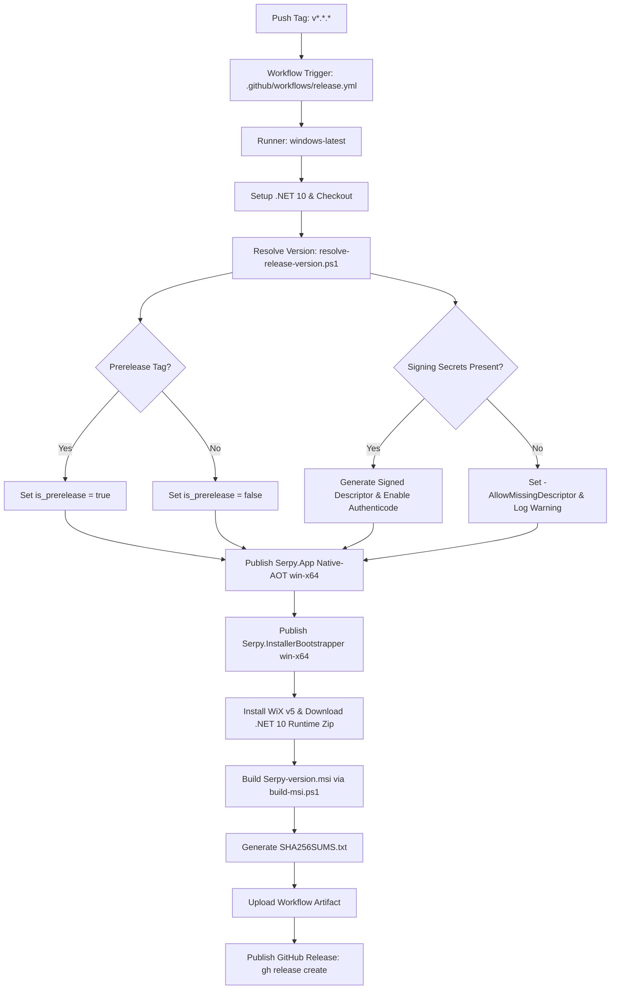

## Goal Capsule

- **Objective:** Enable automated Windows MSI installer packaging and public GitHub Releases whenever a version tag is pushed to the repository, providing users with verified, direct-download installation assets.
- **Means:** GitHub Actions release workflow on `windows-latest` utilizing .NET 10 Native-AOT compilation, WiX v5 installer tooling, conditional descriptor/Authenticode signing, and GitHub CLI release publishing (KTD1, KTD2, KTD3).
- **Authority Hierarchy:** Product Contract Requirements (R1–R8) > Key Technical Decisions (KTD1–KTD5) > Implementation Units (U1–U4).
- **Stop Conditions:** A version tag push (e.g., `v1.0.0`) triggers the release workflow, compiles the Native-AOT application and bootstrapper, builds `Serpy-<version>.msi`, generates `SHA256SUMS.txt`, creates a GitHub Release for that tag, and attaches the assets for download without manual intervention.

---

## Product Contract

### Summary

Serpy currently builds and verifies its Windows Native-AOT distribution and WiX v5 MSI package in CI during branch pushes and pull requests (`.github/workflows/build-test-publish.yml`), but does not publish release artifacts to GitHub Releases. When maintainers cut a release tag (such as `v1.0.0`), a dedicated, automated release workflow must build the official Windows MSI package and publish a downloadable GitHub Release containing the MSI installer and cryptographic checksums.

### Problem Frame

Distributing Serpy to end users requires downloadable, installable packages. Currently, developers or CI produce portable ZIPs or unsigned dev MSIs as workflow build artifacts with temporary retention policies (30 days) that require repository access and sign-in to download. End users and accountants require permanent, public release downloads hosted on GitHub Releases where each version tag corresponds to a release page offering the standalone `.msi` file and its SHA-256 checksums.

### Requirements

**Trigger and Versioning**
- R1. The release workflow MUST trigger automatically upon pushing a git tag matching the semantic version pattern `v*.*.*` (e.g., `v1.0.0`, `v1.2.3`, `v2.0.0-rc.1`).
- R2. The workflow MUST extract and validate a 3-part numeric Windows Installer `ProductVersion` (`major.minor.build`, each integer within bounds: major <= 255, minor <= 255, build <= 65535) from the git tag.
- R3. The workflow MUST detect prerelease tags (e.g., tags containing `-rc`, `-beta`, `-alpha`) and flag the resulting GitHub Release as a prerelease.

**Compilation and Packaging**
- R4. The workflow MUST run on a Windows runner (`windows-latest`) and compile `src/Serpy.App/Serpy.App.csproj` as a self-contained Windows x64 Native-AOT executable with all required provisioning assets (`config/versions.yaml`, `config/build-inputs.json`, `cloud-init/*`, `guest/*`).
- R5. The workflow MUST compile `src/Serpy.InstallerBootstrapper/Serpy.InstallerBootstrapper.csproj` as a framework-dependent x64 binary and harvest the pinned Microsoft .NET 10 runtime payload into the MSI per KD_MSI1.
- R6. The workflow MUST build the Windows MSI installer using WiX v5 via `eng/installer/build-msi.ps1`, naming the output `Serpy-<version>.msi`.

**Signing Posture and Security**
- R7. The workflow MUST support optional production descriptor signing and Authenticode code signing using repository secrets (`DESCRIPTOR_SIGNING_KEY`, `DESCRIPTOR_TRUST_KEY`, `SIGNING_CERT_PFX_BASE64`, `SIGNING_CERT_PASSWORD`); when secrets are absent, it MUST cleanly build with `-AllowMissingDescriptor` and log an explicit diagnostic notice rather than failing opaque.

**Release Publishing**
- R8. The workflow MUST create a GitHub Release corresponding to the git tag, attaching `Serpy-<version>.msi` and a generated `SHA256SUMS.txt` checksum file, with release notes automatically generated from repository commit history.

### Scope Boundaries

- **In Scope:**
  - Automated GitHub Actions workflow (`.github/workflows/release.yml`) triggered by version tags.
  - Tag parsing and Windows Installer version normalization helper script.
  - Integration with existing `build-msi.ps1`, `new-signed-descriptor.ps1`, and WiX v5 packaging.
  - Generation and publication of `SHA256SUMS.txt`.
  - GitHub Release creation and asset attachment via GitHub CLI (`gh release create`).
- **Deferred to Follow-Up Work:**
  - Hardware security module (HSM) or cloud KMS signing service integration (Azure Trusted Signing / DigiCert ONE).
  - Self-hosted WHPX runner acceptance tests during release tag builds (release workflow focuses on packaging and publication; functional WHPX validation remains in `qemu-windows.yml`).
- **Outside This Product's Identity:**
  - Linux and macOS desktop installer distribution (Serpy is a Windows-first appliance; Linux/macOS targets remain compile-only extension targets per AGENTS.md).
  - Publishing portable ZIP distributions to GitHub Releases (MSI is the designated user distribution format).

---

## Planning Contract

### Key Technical Decisions

- KTD1. **Release payload scope: MSI installer and checksum manifest only** (session-settled: user-directed — chosen over publishing both MSI and portable ZIP: user confirmed MSI-only focus to keep download choices simple). The GitHub Release will attach `Serpy-<version>.msi` and `SHA256SUMS.txt`.
- KTD2. **Version extraction and normalization via PowerShell helper.** Git tags follow `v<major>.<minor>.<build>[-<prerelease>]`. Windows Installer strictly requires `ProductVersion` in `X.Y.Z` numeric format (max `255.255.65535`). An isolated PowerShell helper (`eng/installer/resolve-release-version.ps1`) parses `$env:GITHUB_REF_NAME`, validates ranges, extracts `ProductVersion`, and flags prerelease status so both CI and local scripts share identical validation rules.
- KTD3. **Graceful signing secret degradation.** In open repositories and staging forks, production RSA private keys and Authenticode code signing certificates may not be present in repository secrets. The workflow inspects environment secrets: if present, it invokes `new-signed-descriptor.ps1` and passes signing parameters to `build-msi.ps1`; if absent, it passes `-AllowMissingDescriptor`, ensuring clean pull-tag execution across development environments while allowing production keys when configured.
- KTD4. **GitHub CLI (`gh release create`) for release management.** Using the native `gh` CLI bundled on GitHub Actions Windows runners avoids third-party JavaScript actions and their Node.js runtime deprecation lifecycles. `gh release create` natively supports `--title`, `--generate-notes`, `--prerelease`, and multi-file asset attachment.
- KTD5. **Dual-artifact persistence (Release + Workflow Artifact).** In addition to publishing the release via GitHub Releases, the compiled MSI and checksums are uploaded as workflow run artifacts via `actions/upload-artifact@v4` (retention 30 days) to prevent loss if the release creation step experiences rate-limiting or network issues.

### High-Level Technical Design

### Assumptions

- The GitHub Actions runner environment has `contents: write` repository permissions enabled under workflow permissions or repository settings.
- The repository tag naming convention begins with a lowercase `v` followed by standard semantic versioning digits (`v1.0.0`, `v2.1.0-rc.1`).
- The official .NET 10 runtime zip URL (`dotnet-runtime-10.0.15-win-x64.zip`) remains accessible from Microsoft's CDN during build execution, matching `eng/installer/build-msi.ps1`'s pinned SHA-512.

---

## Implementation Units

### U1. Tag Version Resolution and Validation Helper

- **Goal:** Create a reusable PowerShell script to extract, validate, and normalize semantic version tags into Windows Installer `ProductVersion` strings and detect prerelease flags.
- **Requirements:** R1, R2, R3, KTD2
- **Dependencies:** None
- **Files:**
  - `eng/installer/resolve-release-version.ps1`
- **Approach:**
  1. Accept a `-Tag` parameter (defaulting to `$env:GITHUB_REF_NAME` or `$env:GITHUB_REF`).
  2. Parse the tag using regex `^refs/tags/v?([0-9]+)\.([0-9]+)\.([0-9]+)(?:-([0-9A-Za-z.-]+))?$` or `^v?([0-9]+)\.([0-9]+)\.([0-9]+)(?:-([0-9A-Za-z.-]+))?$`.
  3. Validate range constraints: `major <= 255`, `minor <= 255`, `build <= 65535`. If out of range or malformed, throw a terminating error.
  4. Derive `ProductVersion = "$major.$minor.$build"`.
  5. Derive `IsPrerelease = [bool]($prereleaseTag)`.
  6. Output variables to `$env:GITHUB_OUTPUT` if running in GitHub Actions (`product_version`, `release_tag`, `is_prerelease`, `msi_filename`).
- **Patterns to follow:** `eng/package-windows.ps1` strict mode and error handling.
- **Test Scenarios:**
  - Happy path: Tag `v1.0.0` outputs `ProductVersion=1.0.0`, `IsPrerelease=false`, `MsiFilename=Serpy-1.0.0.msi`.
  - Bare tag without 'v': Tag `2.3.4` outputs `ProductVersion=2.3.4`, `IsPrerelease=false`.
  - Prerelease tag: Tag `v1.2.3-rc.1` outputs `ProductVersion=1.2.3`, `IsPrerelease=true`.
  - Malformed tag: Tag `v1.0` (missing build number) throws terminating error.
  - Non-numeric tag: Tag `release-candidate` throws terminating error.
  - Out of range: Tag `v300.1.0` (major > 255) throws terminating error.
- **Verification:** Script runs locally in `pwsh` across test tag inputs and returns expected outputs or throws on invalid inputs.

### U2. Release Signing Preparation Helper

- **Goal:** Provide an automated helper script to detect repository secrets, generate the signed runtime descriptor when keys exist, configure MSBuild trust properties, and prepare Authenticode signing parameters.
- **Requirements:** R7, KTD3
- **Dependencies:** U1
- **Files:**
  - `eng/installer/prepare-release-signing.ps1`
- **Approach:**
  1. Inspect environment variables: `DESCRIPTOR_SIGNING_KEY`, `DESCRIPTOR_TRUST_KEY`, `SIGNING_CERT_PFX_BASE64`, `SIGNING_CERT_PASSWORD`.
  2. Place all decoded sensitive material strictly outside repository and publish directories in a process-isolated temp folder (e.g., `$env:RUNNER_TEMP\signing` or `[System.IO.Path]::GetTempPath()`), ensuring temporary `.pem` and `.pfx` files are never harvested by WiX or included in `SHA256SUMS.txt`.
  3. If `DESCRIPTOR_SIGNING_KEY` is set:
     - Write key content to a temporary `.pem` file under the secure temporary folder.
     - Call `eng/installer/new-signed-descriptor.ps1` with `-VersionsYamlPath config/versions.yaml -PrivateKeyPath <tempPem> -OutputPath dist/runtime-descriptor.signed.json -Verify`.
     - Set output `descriptor_path = dist/runtime-descriptor.signed.json`.
     - Set output `allow_missing_descriptor = false`.
  4. If `DESCRIPTOR_SIGNING_KEY` is not set:
     - Log diagnostic message: "DESCRIPTOR_SIGNING_KEY not detected; falling back to -AllowMissingDescriptor".
     - Set output `descriptor_path = ""`.
     - Set output `allow_missing_descriptor = true`.
  5. If `DESCRIPTOR_TRUST_KEY` is set, export `extra_msbuild_args = /p:SerpyDescriptorTrustKey=<key> /p:SerpyReleasePublish=true`.
  6. If `SIGNING_CERT_PFX_BASE64` is set, decode to a temporary `.pfx` file in the secure temp folder and output path and password argument.
- **Test Scenarios:**
  - Secret absent path: With empty environment variables, script outputs `allow_missing_descriptor=true` and logs warning without error.
  - Descriptor key present: With valid PEM key in environment, script generates `dist/runtime-descriptor.signed.json` and outputs `allow_missing_descriptor=false`.
  - Malformed key: With corrupted PEM key string, script fails fast and reports specific crypto error before packaging begins.
- **Verification:** Script runs with and without mock environment variables and emits expected GitHub Actions outputs and files.

### U3. GitHub Actions Tag Release Workflow

- **Goal:** Implement the complete GitHub Actions workflow file that orchestrates tag triggers, Native-AOT compilation, bootstrapper compilation, WiX v5 packaging, and GitHub Release publication.
- **Requirements:** R1, R2, R3, R4, R5, R6, R7, R8, KTD1, KTD2, KTD3, KTD4, KTD5
- **Dependencies:** U1, U2
- **Files:**
  - `.github/workflows/release.yml`
- **Approach:**
  1. Trigger on `push: tags: ['v*']`.
  2. Configure concurrency group: `concurrency: { group: release-${{ github.ref }}, cancel-in-progress: false }` to prevent overlapping runs on the same tag.
  3. Configure permissions: `contents: write`.
  4. Job `publish-release` running on `windows-latest`.
  5. Steps:
     - Checkout repository (`actions/checkout@v4`).
     - Set up .NET 10 (`actions/setup-dotnet@v4`).
     - Run `eng/installer/resolve-release-version.ps1` to populate version outputs.
     - Run `eng/installer/prepare-release-signing.ps1` with secrets passed via env.
     - Restore and publish `Serpy.App` Native-AOT for `win-x64` using `product_version` and extra MSBuild args.
     - Assert Native-AOT output files (`Serpy.App.exe`, `versions.yaml`, `build-inputs.json`, `user-data`, `meta-data`, guest scripts).
     - Publish `Serpy.InstallerBootstrapper` for `win-x64`.
     - Assert bootstrapper executable exists.
     - Install WiX v5.0.2 global tool and extensions (`WixToolset.Util.wixext`, `WixToolset.UI.wixext`).
     - Download pinned .NET 10 runtime zip into `dist/dotnet-runtime/`.
     - Invoke `eng/installer/build-msi.ps1` passing `AppPublishDir`, `BootstrapperPublishDir`, `OutputPath dist/Serpy-<version>.msi`, `Version <product_version>`, and signing flags.
     - Generate `dist/SHA256SUMS.txt` containing SHA-256 hash and filename of `Serpy-<version>.msi`.
     - Upload workflow artifact (`actions/upload-artifact@v4`) with retention 30 days.
     - Create release via `gh release create` attaching `dist/Serpy-<version>.msi` and `dist/SHA256SUMS.txt`. If `is_prerelease` is true, pass `--prerelease`. Pass `--generate-notes` and `--title "Serpy <tag>"`.
- **Test Scenarios:**
  - Workflow YAML schema validation succeeds (no syntax errors, valid GitHub Actions syntax).
  - Sequence integrity: Version resolution and signing preparation precede build steps; build precedes packaging; packaging precedes release.
  - Secret safety: Signing keys and passwords passed only as environment variables to signing steps, never echoed or logged.
  - Prerelease handling: Step executes `gh release create` with `--prerelease` when `is_prerelease` is true.
- **Verification:** Workflow file validated via local YAML linter / syntax check and tested in GitHub Actions on tag push.

### U4. Release Process Documentation and Operational Guide

- **Goal:** Document the release process for maintainers, including tag creation commands, required/optional repository secrets, release verification, and update repository results status.
- **Requirements:** R7, R8
- **Dependencies:** U3
- **Files:**
  - `docs/results.md`
  - `docs/release-process.md`
- **Approach:**
  1. Document step-by-step instructions for tagging releases: `git tag v1.0.0 && git push origin v1.0.0`.
  2. Document GitHub repository secrets: `DESCRIPTOR_SIGNING_KEY`, `DESCRIPTOR_TRUST_KEY`, `SIGNING_CERT_PFX_BASE64`, `SIGNING_CERT_PASSWORD`.
  3. Explain the difference between production signed releases and dev-fallback releases (`-AllowMissingDescriptor`).
  4. Update `docs/results.md` recording the automated release workflow implementation.
- **Patterns to follow:** `docs/results.md` and repository markdown style.
- **Test Scenarios:**
  - Documentation accurately describes all script parameters, secret names, and tag formats.
  - Markdown references resolve correctly relative to repository root.
- **Verification:** Manual review of documentation clarity and accuracy against workflow implementation.

---

## Verification Contract

| Verification Target | Command / Check | Expected Outcome |
|---|---|---|
| Workflow YAML Syntax | `actionlint .github/workflows/release.yml` (or schema validate) | Zero syntax or structure errors. |
| Tag Resolution Script | `pwsh -File ./eng/installer/resolve-release-version.ps1 -Tag "v1.2.3"` | Emits `ProductVersion=1.2.3`, `IsPrerelease=false`. |
| Tag Prerelease Resolution | `pwsh -File ./eng/installer/resolve-release-version.ps1 -Tag "v2.0.0-rc.1"` | Emits `ProductVersion=2.0.0`, `IsPrerelease=true`. |
| Tag Bounds Validation | `pwsh -File ./eng/installer/resolve-release-version.ps1 -Tag "v300.0.1"` | Throws terminating error regarding Windows Installer bounds. |
| Signing Prep Fallback | `pwsh -File ./eng/installer/prepare-release-signing.ps1` (no env vars) | Emits `allow_missing_descriptor=true` without error. |
| End-to-End Release | Push tag `v*.*.*` to GitHub repository | Workflow completes successfully, creating GitHub Release with attached `Serpy-<version>.msi` and `SHA256SUMS.txt`. |

---

## Definition of Done

- [ ] `eng/installer/resolve-release-version.ps1` is implemented and verifies valid 3-part Windows Installer versions.
- [ ] `eng/installer/prepare-release-signing.ps1` is implemented and cleanly supports both signed secrets and unsigned dev fallback.
- [ ] `.github/workflows/release.yml` is created, triggers on `v*.*.*` tags, builds Native-AOT + WiX MSI, and publishes to GitHub Releases via `gh release create`.
- [ ] Release assets include `Serpy-<version>.msi` and `SHA256SUMS.txt`.
- [ ] Release documentation in `docs/release-process.md` and status in `docs/results.md` are updated.
- [ ] No extraneous build scripts, temporary files, or secrets are leaked into repository diffs or workflow logs.
